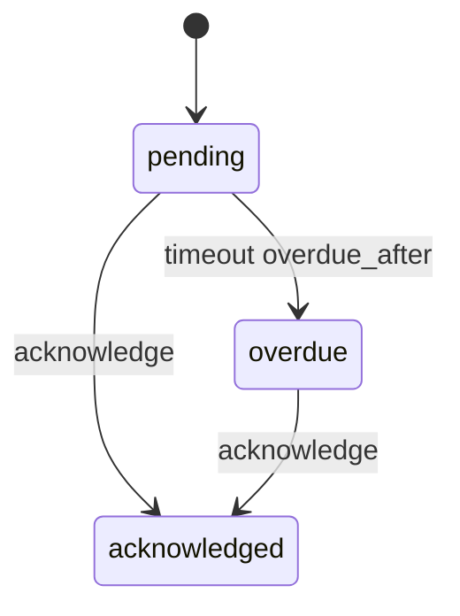

# Design: acknowledgement recipe generator

Status: implemented.

## The problem

Policy attestations and terms updates share one pattern. A document is published, a list of people must each confirm they have read it, and the people who have not confirmed are chased once a deadline passes. Each application writes the same table of who has been asked, the same "has this person acknowledged it" query and the same rule that nobody may acknowledge on someone else's behalf.

`mix ash_workflow.gen.acknowledgement` layers that workflow onto a subject resource. It is a request recipe in [`recipes.md`](recipes.md), after [`gen.approval`](approval-recipe.md) and [`gen.expiry`](expiry-recipe.md).

## The split between generated code and the application

The generator owns the acknowledgement lifecycle: the states, the overdue deadline, the identity that allows one row per person per subject, and the rule that only the row's own person may acknowledge it.

The application owns two things:

- When a request is opened, and for whom. The application calls `PolicyAcknowledgement.request/3` for one person, or `request_many/3` for a list of people, from wherever that makes sense: a publish action, an onboarding step, an Oban job that adds new starters.
- What happens on entering `:overdue`, such as a reminder email. The generator adds no notifier and no action timeout for it.

The generated code never holds a list of who must acknowledge. The rows the application creates are that list.

## The command

```bash
mix ash_workflow.gen.acknowledgement MyApp.Policies.Policy \
  --person MyApp.Accounts.User \
  --overdue-after 14d
```

| Option | Default | Effect |
|---|---|---|
| `--person` | required | The actor resource. Each acknowledgement `belongs_to :person` of this resource. |
| `--module` | `<Subject>Acknowledgement` | Name of the generated acknowledgement resource. |
| `--domain` | the subject's domain | Domain for a subject the generator creates. Required only when the subject does not exist. |
| `--overdue-after` | none | Move an unacknowledged request to `:overdue` this long after `requested_at`. Omitted means no `:overdue` step. |
| `--transition-log` | `true` | Composes `ash_workflow.gen.transition_log` with `--actor` set to the person. `--no-transition-log` skips it. |

`--overdue-after` accepts `30m`, `12h`, `2d` and `2w`, parsed by `Mix.AshWorkflow.Recipe.parse_duration/2` as approval's flag of the same name is. A duration under a minute needs `AshWorkflow.Scheduler.Precise`.

When the subject does not exist, the generator creates it with `ash.gen.resource`. The created subject takes its data layer from `--person`, as approval takes it from `--approver`, and falls back to the resources in `--domain` the same way. When neither has an ETS or Postgres data layer, the generator stops with an Igniter issue.

## The acknowledgement is a sibling resource

The generator adds `MyApp.Policies.PolicyAcknowledgement` next to the subject, for the reason approval does: a resource has one `workflow`, and the subject may already run one.

Acknowledgement is a request recipe. A subject has many acknowledgements, one for each person asked. The identity `:unique_person` on `(subject_id, person_id)` stops a person being asked twice about the same subject. On a data layer without unique constraints, such as ETS, it sets `pre_check_with` to the domain. On Postgres, a table name long enough to push the default index name past 63 bytes gets a shortened `identity_index_names` entry.

The subject gains, by `Ash.Resource.Igniter` edits, and nothing else:

- `has_many :acknowledgements, MyApp.Policies.PolicyAcknowledgement`
- `calculate :acknowledged_by_actor?, :boolean, expr(exists(acknowledgements, person_id == ^actor(:id) and state == :acknowledged))`

The generator adds no change, argument or policy to the subject's actions. Gating a subject action on `acknowledged_by_actor?` is an application decision.

### No `latest_acknowledgement`

[`recipes.md`](recipes.md) gives every request recipe a `has_one :latest_<recipe>`. Acknowledgement does not get one. Approval opens one request at a time, so its latest row is the subject's current approval. Acknowledgement opens one row per person at once, so the latest row belongs to whichever person was asked last. The answer an application wants is per person, and `acknowledged_by_actor?` gives it.

### The calculation reads the actor

Three shapes were considered for the subject's calculation:

| Shape | Answers | Survives a second run | Chosen |
|---|---|---|---|
| `acknowledged_by_actor?`, reading `^actor(:id)` | Has the person loading the subject acknowledged it | Yes, it is a three-argument `calculate` | Yes |
| `acknowledged?` with a `person_id` argument | Has a given person acknowledged it | No. The `argument` needs a `do` block, and `Ash.Resource.Igniter.defines_calculation/3` only matches a three-argument `calculate` | No |
| `acknowledged?` meaning every row is acknowledged | Has everyone asked acknowledged it | Yes | No. It is true for a subject nobody has been asked about |

The actor shape answers the question a UI asks: show a banner on this policy until the current user has acknowledged it. Loading the calculation without an actor returns `false`. A report on who has not acknowledged reads the acknowledgement rows with a filter on `state`, not the subject's calculation.

## The workflow



Generated for the command above:

```elixir
workflow do
  step :pending do
    transition :acknowledge, to: :acknowledged

    timeout :overdue, fire_after: {14, :days}, field: :requested_at, transition_to: :overdue
  end

  step :overdue do
    transition :acknowledge, to: :acknowledged
  end

  step :acknowledged, terminal: true
end
```

`:overdue` is a step, not a flag, for the reason approval's is. A query can filter on `state == :overdue`, and an application can add its own `timeout` or `every` to the step for reminders. A person in `:overdue` can still acknowledge. The `:overdue` step is only generated when `--overdue-after` is given.

There is no cancel or withdraw transition. A person who leaves before acknowledging keeps a `:pending` or `:overdue` row. See the open questions.

### The deadline reads `requested_at`

The overdue timeout is anchored on `requested_at`, not `state_entered_at`. Nothing in the generated workflow re-enters `:pending`, so today the two hold the same instant. They diverge as soon as an application adds a transition that loops back into `:pending`, such as a `remind` that records a reminder was sent. Anchored on `state_entered_at`, that reminder would restart the overdue clock. `requested_at` is written once, by the `:request` create action, so the deadline stays where it was.

`requested_at` is an attribute, so `AshWorkflow.Transformers.AddIndexes` gives the timeout a `(state, requested_at)` index on Postgres.

## The resource

`PolicyAcknowledgement` attributes: `subject_id`, `person_id`, `requested_at` and `acknowledged_at`.

```elixir
actions do
  defaults [:read]

  create :request do
    accept [:subject_id, :person_id]
    upsert? true
    upsert_identity :unique_person
    upsert_fields []
    change set_attribute(:requested_at, &DateTime.utc_now/0)
  end

  update :acknowledge do
    require_atomic? false
    change set_attribute(:acknowledged_at, &DateTime.utc_now/0)
  end
end

code_interface do
  define :request, args: [:subject_id, :person_id]
  define :request_many, action: :request, args: [:subject_id]
  define :acknowledge
end
```

### Opening rows for a list of people

`request_many/3` is a second code interface on the same `:request` action. A create code interface given a list of maps runs `Ash.bulk_create/4`, and `args: [:subject_id]` merges the subject into each map:

```elixir
PolicyAcknowledgement.request_many(policy.id, Enum.map(people, &%{person_id: &1.id}))
```

A generic action taking `person_ids` was the alternative. Its `subject_id` argument would need the subject's primary key type, which the generator would have to read from an existing subject. The code interface takes its types from the `belongs_to` attributes instead.

### `:request` is an upsert

`:request` upserts on `:unique_person` with no `upsert_fields`. Asking a person who already has a row returns that row unchanged: its state, `requested_at` and `acknowledged_at` stay as they were. An application can therefore call `request_many/3` with everyone who must acknowledge, each time that list grows, without first removing the people it already asked.

The alternative was a plain create that fails on the identity. Every caller adding a new starter would then have to read the existing rows and subtract them first, which is the race the identity exists to close.

The upsert relies on `AshWorkflow.Changes.RecordEvent` as fixed in #147, and on Ash 3.29 or later. Before #147, `RecordEvent` appended an `:initial` log row on every create, including an upsert that returned an existing row. A repeated `request` then logged the person as entering their current step a second time. After #147, `RecordEvent` writes no log row and leaves the scheduler alone when a create's record carries `upsert_action: :update` metadata. AshPostgres sets that metadata on an upsert that found an existing row, and `Ash.DataLayer.Ets` sets it from Ash 3.29. #147 tests the Postgres upsert in the library's own suite. The recipe's tests run on ETS, because the Postgres fixture resources set `migrate? false`.

A person acknowledges a subject once. A terms update that must be acknowledged again is a new subject row, such as a new version of the terms, not a second acknowledgement of the old one.

## Who may request and acknowledge

Who may open a request differs per application, so `:request` follows the other recipes. The generator writes `PolicyAcknowledgement.Checks.CanRequest`, a check that denies everyone, and gates `:request` on it. `request_many/3` runs the same action through `Ash.bulk_create/4`, so the same policy authorizes each row of a bulk call.

The only human transition is `acknowledge`, and its rule is the same in every application: the person asked is the person who confirms. The generator writes that rule as a built-in check rather than a deny-by-default check module.

```elixir
policies do
  policy action(:request) do
    authorize_if MyApp.Policies.PolicyAcknowledgement.Checks.CanRequest
  end

  policy action(:acknowledge) do
    authorize_if relates_to_actor_via(:person)
  end
end
```

A check module for `:acknowledge` that denied everyone would make every application write the same `relates_to_actor_via(:person)` line before the recipe did anything. The generator therefore writes no check module for it, and its notice names the policy instead.

`AshWorkflow.Transformers.AddPolicies` allows `:request`, reads and the scheduler's overdue timeout. Ash requires every policy that applies to an action to pass, so `CanRequest` still decides `:request`.

## Composing the transition log

The generator composes `ash_workflow.gen.transition_log` with `--actor` set to `--person`, so each transition records who made it. It composes the log only when it creates the acknowledgement resource. A second run finds the resource and skips it.

## Code shared with the other recipes

The generator uses `Mix.AshWorkflow.Recipe` as it stands: `parse_duration/2`, `ensure_subject/5`, `add_subject_edits/4`, `compose_transition_log/3`, `key_type/3`, `belongs_to/3`, `deny_check_contents/2`, `create_policy/2` and the rendering helpers. It adds nothing to the module.

## Open questions

1. Withdrawing a request. A person who leaves, or a request opened by mistake, has no way out of `:pending` or `:overdue` in the generated workflow. A `withdraw` transition to a terminal `:withdrawn` step is the likely addition. It would need its own deny-by-default check, since who may withdraw differs per application.
2. A subject-wide outcome. `acknowledged_by_actor?` answers for one person. An "everyone asked has acknowledged" calculation is true for a subject nobody was asked about, so it is left to the application, which knows whether an empty list means done.
3. Who opened a request. The generated row has no `requested_by`, because rows are often opened by a system job with no actor. An application that wants it adds `relate_actor(:requested_by, allow_nil?: true)` to `:request`.
