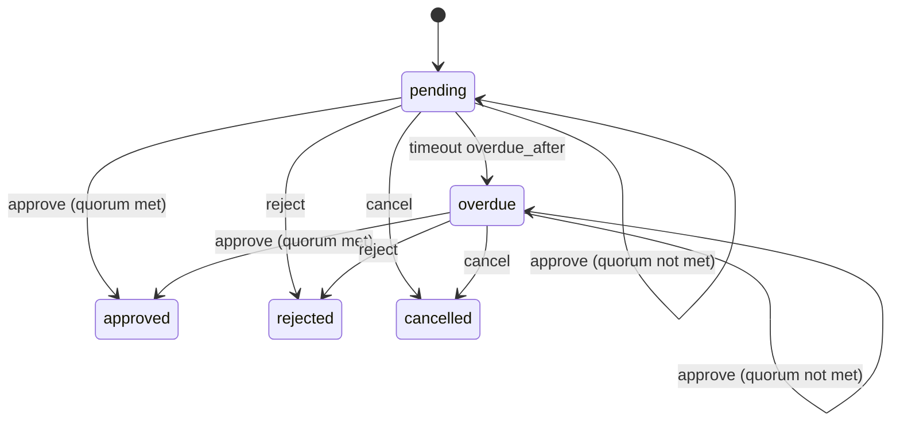

# Design: approval recipe generator

Status: implemented.

## The problem

Approval is the workflow most applications write first. A record is created, one or more people must approve it, and the request is flagged when nobody has. Today every team writes the same `workflow` block, the same decision records, the same overdue timeout and the same "requester cannot approve their own request" policy by hand.

`mix ash_workflow.gen.approval` layers that workflow onto a subject resource. When the subject already exists, the generator leaves its attributes, actions and policies alone and adds approval beside them. When it does not exist, the generator creates a minimal one first. It is the first of a family of `ash_workflow.gen.<recipe>` tasks, each of which writes ordinary resource code the application then owns.

## The split between generated code and the application

The generator owns the approval lifecycle: the states, the transitions, the quorum count, the overdue deadline and the decision history.

The application owns three things, and each lives in exactly one place:

- Who may open a request on a subject. This is one `Ash.Policy.Check` module, generated to deny everyone.
- Who may approve. This is one `Ash.Policy.Check` module, generated to deny everyone.
- When a request is opened. The application calls `ExpenseApproval.request/2` from wherever that makes sense: a create action, a submit action, a LiveView event.

Nothing else in the generated code needs to know who the approvers are.

## The command

```bash
mix ash_workflow.gen.approval MyApp.Expenses.Expense \
  --approver MyApp.Accounts.User \
  --required-approvals 1 \
  --overdue-after 2d
```

| Option | Default | Effect |
|---|---|---|
| `--approver` | required | The actor resource. Decisions and the requester `belongs_to` it. |
| `--module` | `<Subject>Approval` | Name of the generated approval resource. |
| `--domain` | the subject's domain | Domain for a subject the generator creates. Required only when the subject does not exist. |
| `--required-approvals` | `1` | Number of approvals a request needs. Stored per request, but not accepted by `:request`. |
| `--overdue-after` | none | Move a waiting request to `:overdue`. Omitted means no `:overdue` step. |
| `--transition-log` | `true` | Composes `ash_workflow.gen.transition_log` with `--actor` set to the approver. `--no-transition-log` skips it. |

Durations accept `30m`, `12h`, `2d` and `2w`, and parse into the `{n, unit}` tuples `AshWorkflow.Duration` already validates.

## The approval is a sibling resource

The generator adds two resources next to the subject rather than adding a `workflow` block to the subject itself.

- `MyApp.Expenses.ExpenseApproval` holds the workflow. It `belongs_to :subject`.
- `MyApp.Expenses.ExpenseApprovalDecision` holds one row per decision made.

A resource has one `workflow` and one `state_attribute`. Adding approval inline would fail on any subject that already runs a workflow, and would overwrite the subject's `state` on one that runs `ash_state_machine` directly. The sibling resource also covers resubmission: a rejected expense that is edited and submitted again gets a new approval row, and the old row keeps the rejection and who made it. That follows the same reasoning as [undo appending rather than erasing](workflow-undo.md).

When the subject module does not exist, the generator composes `ash.gen.resource` with `--uuid-v7-primary-key id`, `--timestamps`, `--default-actions read,create,update,destroy` and `--domain`. It also passes `--extend ets` or `--extend postgres` when the approver uses that data layer, so the created subject stores its records the way the approver does. Without it, `ash.gen.resource` writes a resource with no data layer, and the approval resources could not persist against it. Composing Ash's own task keeps data layer selection and domain registration in one place rather than reimplementing them. The approval edits below then apply to it the same way they apply to an existing subject. Re-running the generator on that subject finds the relationships already present and leaves them, so the task stays idempotent.

The subject gains, by `Ash.Resource.Igniter` edits, and nothing else:

- `has_many :approvals, MyApp.Expenses.ExpenseApproval`
- `has_one :latest_approval`, sorted by `inserted_at` descending
- `calculate :approved?, :boolean, expr(latest_approval.state == :approved)`

The calculation has no `public?: true`. `Ash.Resource.Igniter.defines_calculation/3` only matches a three-argument `calculate`, so a fourth argument would make a second run add the calculation again.

The generator adds no change, argument or policy to the subject's actions. Gating a subject action on `approved?` is an application decision.

An `--inline` mode for a subject without a workflow is a possible follow-up. It is not in this design.

## The workflow



`:overdue` is a step, not a flag. A request in it can still be approved, rejected or cancelled. The step exists so that a query can filter on `state == :overdue`, and so that an application can add its own `timeout` or `every` to the step for reminders or escalation. The generator adds no reminders. The `:overdue` step is only generated when `--overdue-after` is given.

Generated for the command above:

```elixir
workflow do
  step :pending do
    transition :approve do
      route :approved, when: expr(approvals_remaining <= 1)
      route :pending, when: expr(approvals_remaining > 1)
    end

    transition :reject, to: :rejected
    transition :cancel, to: :cancelled

    timeout :overdue, fire_after: {2, :days}, field: :requested_at, transition_to: :overdue
  end

  step :overdue do
    transition :approve do
      route :approved, when: expr(approvals_remaining <= 1)
      route :overdue, when: expr(approvals_remaining > 1)
    end

    transition :reject, to: :rejected
    transition :cancel, to: :cancelled
  end

  step :approved, terminal: true
  step :rejected, terminal: true
  step :cancelled, terminal: true
end
```

The overdue timeout is anchored on `requested_at`, not `state_entered_at`. A partial approval loops the request back into the step it is in, which moves `state_entered_at`. Anchored on `state_entered_at`, each approval would restart the overdue clock. `requested_at` is written once by the `:request` create action, so the deadline stays where it was.

Routes read the record as it was when the call arrived, as `AshWorkflow.Changes.ConditionalTransition` documents. `approvals_remaining` therefore counts approvals before the current one, and `<= 1` means this call is the last approval needed.

`ConditionalTransition` used to evaluate routes against the record exactly as the caller passed it, so an unloaded calculation read as `nil` and no route matched. It now loads the calculations, aggregates and related fields its routes reference before evaluating them, as the `:transition_targets` calculation already did. The decision row is written in an `after_action`, so the loaded count still excludes the current call.

The count is read when each call arrives. Two approvals that arrive together could both read it before either decision row is written, and both loop back. The decide-once policy would then stop both approvers deciding again, stranding the request. On AshPostgres the generator adds `change get_and_lock_for_update()` to `:approve` and `:reject`. `AshWorkflow.Transformers.AddActions` appends the transition changes after the action's own, so the lock's `before_action` runs first and replaces `changeset.data` with the locked row. `ConditionalTransition` then loads `approvals_remaining` inside the same transaction, after the lock. Other data layers get no lock, and the recipe page states the limit there.

## Decisions and the quorum

`ExpenseApprovalDecision` attributes: `approval_id`, `approver_id`, `decision` (`:approved | :rejected`), `comment`, `decided_at`. The identity `:unique_approver` on `(approval_id, approver_id)` stops an approver deciding twice. On a data layer without unique constraints, such as ETS, it sets `pre_check_with` to the domain. On Postgres, a table name long enough to push the default index name past 63 bytes gets a shortened `identity_index_names` entry.

`ExpenseApprovalDecision` has `Ash.Policy.Authorizer` and one policy, which allows reads. Its `:create` action has no policy, so it is forbidden except through `RecordDecision`, which creates the row with `authorize?: false`. Without this, any caller could create a decision row directly and inflate the quorum.

`:approve` and `:reject` accept a `comment` argument. A generated change creates the actor's decision row in the same transaction. Decision rows are created when someone decides, not when the request opens, so the generated code never needs a list of approvers.

The `:request` create action on `ExpenseApproval` accepts only `subject_id`. It sets `requested_by` from the actor and `requested_at` to now.

`approvals_remaining` is an aggregate-backed calculation: `required_approvals - count(decisions, filter: decision == :approved)`.

`:reject` moves the request to `:rejected` on the first rejection. A quorum where rejection also needs a count is a variation the generated code can be edited into, not an option.

## Who may decide

The generator writes two check modules, `MyApp.Expenses.ExpenseApproval.Checks.CanRequest` and `MyApp.Expenses.ExpenseApproval.Checks.CanApprove`, that deny everyone. The generator's notice says so. A generated approval that anyone could approve would be a worse default than one nobody can approve until the application decides. The same holds for opening a request: without `CanRequest`, any actor could open a request on any subject.

The generated policies reference those checks and add the rules every approval shares:

```elixir
policies do
  policy action(:request) do
    authorize_if MyApp.Expenses.ExpenseApproval.Checks.CanRequest
  end

  policy action([:approve, :reject]) do
    forbid_if expr(requested_by_id == ^actor(:id))
    forbid_if expr(exists(decisions, approver_id == ^actor(:id)))
    authorize_if MyApp.Expenses.ExpenseApproval.Checks.CanApprove
  end

  policy action(:cancel) do
    authorize_if relates_to_actor_via(:requested_by)
  end
end
```

The application replaces the body of `CanApprove`, or replaces the `authorize_if` line with a built-in check:

```elixir
# The expense owner's manager approves
authorize_if relates_to_actor_via([:subject, :owner, :manager])

# Any finance manager approves
authorize_if actor_attribute_equals(:role, :finance_manager)
```

These are resource-level policies rather than a step `policy`, because a step `policy` takes one check and approval needs three. `AshWorkflow.Transformers.AddPolicies` skips actions that already have user-defined policies, so these take precedence. The generated `:available_actions` calculation then answers "can this user approve this request" for a UI with no extra code.

## Generated code, not a runtime module

The alternative is a `Spark.Dsl.Fragment` or a `use AshWorkflow.Recipes.Approval, ...` macro that injects the same workflow at compile time.

| | Igniter-generated code | Runtime fragment |
|---|---|---|
| Customise a route, policy or step | Edit the file | Needs an option for every variation |
| Library fixes reach existing apps | No. Re-run or hand-edit | Yes |
| Readable in the app | Yes | Hidden behind a macro |
| Library API to keep stable | The generator's flags | Every option and every generated name |

The recommendation is generated code. Approval varies per application in the policies, the quorum rule and what happens once a request is overdue, and each of those variations would otherwise become an option on a public API. The strongest objection is that a bug in the generated template stays in every app that ran it. The generator keeps that small by emitting only DSL, one change module and two check modules, with no runtime helpers of its own.

## Composing the transition log

`ash_workflow.gen.transition_log` loaded the workflow resource with `Code.ensure_compiled/1`. The approval resource exists only as source while the generator runs, so the task now falls back to reading the resource's source when the module is not compiled. It reads the domain, data layer, extensions, the Postgres `table` and `repo`, and whether the `workflow` block already has a `transition_log`.

The generator composes the transition log only when it creates the approval resource. A second run finds the approval resource and skips it, which keeps the task idempotent.

## Resolved questions

1. A shared transition name with routes in two steps (`:approve` in `:pending` and `:overdue`) composes. `AshWorkflow.Routing.guarded_routes/2` scopes each route to the step it leaves. `AshWorkflow.SharedRoutedTransitionTest` covers a route that loops back from each step.
