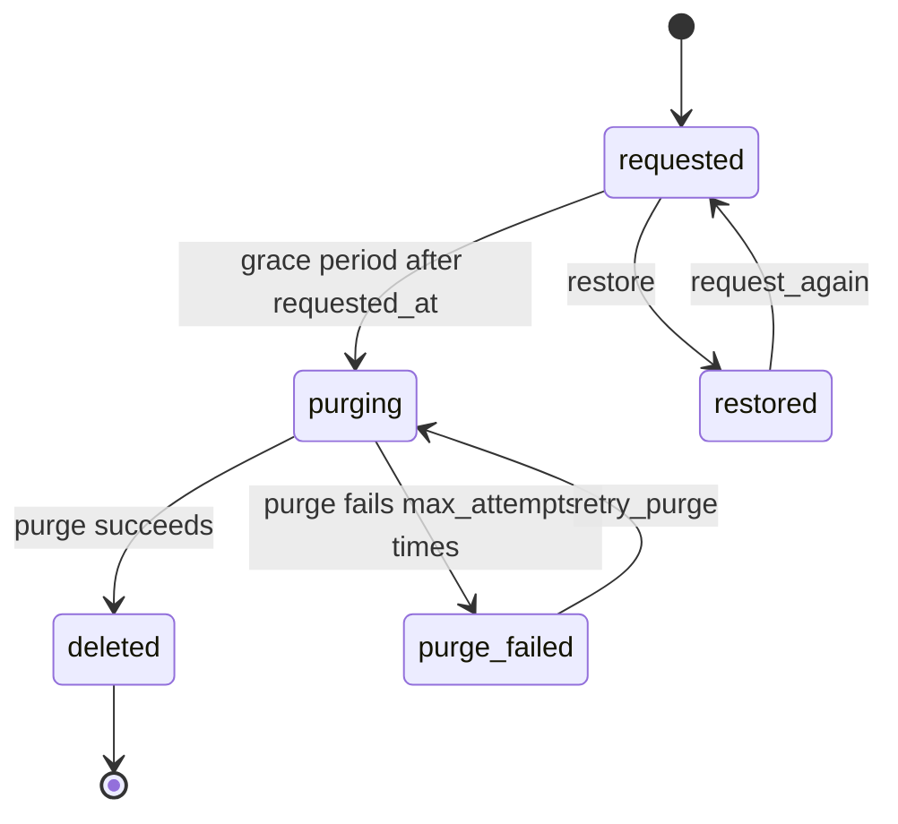

# Design: deletion recipe generator

Status: implemented.

## The problem

Account closure and GDPR erasure follow the same pattern. Someone asks for a record to be deleted, nothing happens for a grace period, and the record is then erased unless someone restored it in the meantime. The erasure itself can fail halfway, such as when a file store is down, and somebody has to see that and try again. Each application writes the same `deletion_requested_at` column, the same nightly job, and the same half-handled failure.

`mix ash_workflow.gen.deletion` layers that lifecycle onto a subject resource. It is the third recipe in [`recipes.md`](recipes.md), and the second lifecycle recipe after [`gen.expiry`](expiry-recipe.md).

## The split between generated code and the application

The generator owns the deletion lifecycle: the states, the grace period, the purge step with its retry and failure step, and the `restore` transition.

The application owns four things:

- When a deletion is requested, and who may request it. The application calls `AccountDeletion.request/2` with the subject from wherever that makes sense: a settings page, a support tool, a data-subject request import.
- Who may request a deletion, request it again, retry a purge, or restore a deletion. These are two `Ash.Policy.Check` modules, each generated to deny everyone.
- What a purge erases. The generator writes a `:purge` update action whose change, `Changes.Purge`, fails until the application fills it in, whether that destroys the subject, anonymises its fields, or removes files from a store.
- What happens on entering `:purge_failed`, such as paging an operator. The generator adds no notifier for it.

The generator itself deletes nothing. A recipe that destroyed the subject by default would erase data in an application that meant to anonymise it.

## The command

```bash
mix ash_workflow.gen.deletion MyApp.Accounts.Account --grace-period 30d
```

| Option | Default | Effect |
|---|---|---|
| `--grace-period` | required | How long a request waits in `:requested` before the purge runs. |
| `--max-attempts` | `3` | How many times the purge runs before the deletion moves to `:purge_failed`. |
| `--module` | `<Subject>Deletion` | Name of the generated deletion resource. |
| `--domain` | the subject's domain | Domain for a subject the generator creates. Required only when the subject does not exist. |
| `--transition-log` | `true` | Composes `ash_workflow.gen.transition_log`. `--no-transition-log` skips it. |

`--grace-period` accepts `30m`, `12h`, `2d` and `2w`, parsed by `Mix.AshWorkflow.Recipe.parse_duration/2` as the other recipes' durations are.

`--grace-period` has no default. A default grace period would be a policy decision, such as the thirty days some regulators allow, made by the generator on the application's behalf.

`--max-attempts` must be a positive integer, checked by `Mix.AshWorkflow.Recipe.validate_max_attempts/1`. Above `1`, it becomes the purge step's `retry` block with the default exponential backoff. At `1`, the generator writes no `retry` block, since a single attempt is the step's default. A purge usually fails on a transient error from a store it calls, so the default retries it rather than sending it straight to `:purge_failed`.

There is no actor option, for the reason `gen.expiry` gives. Nothing in the generated code records who requested or restored a deletion, so the transition log is generated without `--actor`.

## The deletion is a sibling resource

The generator adds `MyApp.Accounts.AccountDeletion` next to the subject, for the reason approval and expiry do: a resource has one `workflow`, and the subject may already run one.

Deletion is a lifecycle recipe. A subject has one current deletion, not a history of them. The subject gains, by `Ash.Resource.Igniter` edits, and nothing else:

- `has_one :deletion, MyApp.Accounts.AccountDeletion`
- `calculate :pending_deletion?, :boolean, expr(deletion.state in [:requested, :purging, :purge_failed] || false)`

`pending_deletion?` is true from the request until the purge succeeds, including while a failed purge waits for a retry. It is `false` for a subject with no deletion, never `nil`, so a filter or policy on it does not need to handle a missing row. That is the window in which the application should treat the subject as on its way out, such as hiding it from search or refusing a login. `:deleted` is excluded because the subject may no longer exist to ask, and `:restored` is excluded because a restored subject is in normal use again.

`AccountDeletion` has the identity `:unique_subject` on `subject_id`. On a data layer without unique constraints, such as ETS, it sets `pre_check_with` to the domain. A second `request` for the same subject fails on the identity, so `has_one :deletion` never has two rows to choose between.

The generator adds no change, argument or policy to the subject's actions. Refusing a login while `pending_deletion?` is true is an application decision.

When the subject module does not exist, the generator creates it with `ash.gen.resource`. Like expiry, deletion has no actor resource, so the created subject takes its data layer from the first resource in `--domain` that uses `Ash.DataLayer.Ets` or `AshPostgres.DataLayer`. When no resource in the domain uses either, `Mix.AshWorkflow.Recipe.ensure_subject/5` stops the task with an Igniter issue and writes nothing.

## The workflow



Generated for the command above:

```elixir
workflow do
  step :requested do
    transition :restore, to: :restored

    timeout :purging, fire_after: {30, :days}, field: :requested_at, transition_to: :purging
  end

  step :purging do
    action :purge
    on_success :deleted
    on_error :purge_failed

    retry do
      max_attempts 3
    end
  end

  step :purge_failed do
    transition :retry_purge, to: :purging
  end

  step :restored do
    transition :request_again, to: :requested
  end

  step :deleted, terminal: true
end
```

No step is optional. Every option either names something or sets a value inside a step that is always generated.

### The grace period is anchored on `requested_at`

The `:request` create action sets `requested_at` to now, and `:request_again` sets it to now again. The `:purging` timeout fires `--grace-period` after it.

Today `:requested` is entered only by `request` and `request_again`, and both write `requested_at`, so `state_entered_at` would give the same deadline. `requested_at` is still the anchor, for two reasons:

- An application that adds a transition looping back into `:requested`, such as a note added by support staff, would restart a `state_entered_at` deadline without meaning to. [`recipes.md`](recipes.md) names that mistake as one recipes exist to prevent.
- `requested_at` is a public attribute the application can show: "your account will be deleted 30 days after 18 October". `state_entered_at` is the workflow's own column.

### `restore` is a transition, not `undo`

[`undo.md`](../topics/undo.md) rewinds the most recent state change, and only when that change came from a transition marked `undoable?: true`. `restore` does not fit it for three reasons:

- `:requested` is the initial state. Its only log row is the `:initial` row, which undo refuses with `:not_undoable`. There is no earlier state for undo to rewind to.
- Undo returns a record to the state it came from. `restore` moves to `:restored`, a state the record has never been in, so that a query can tell a restored subject from one never requested.
- Undo is for a rewind that is "the whole of what needs to happen". A restore usually has work of its own, such as re-enabling a login. The topic page recommends "a forward transition with its own action" for that case.

`undo` also needs the transition log, which `--no-transition-log` removes. The catalogue in [`recipes.md`](recipes.md) listed `undo` as the DSL feature this recipe exercises. That row now lists the automatic step with `on_error` and `retry` instead.

### A restored subject can be requested again

`restored` is not terminal. The identity on `subject_id` allows one deletion row per subject, so a terminal `restored` would mean a subject that was once restored could never be deleted through the workflow again. `request_again` moves the row back to `:requested` and writes a new `requested_at`, which starts a new grace period. The transition log keeps the earlier request and its restore.

### The purge step

`:purging` is an automatic step whose action is the generated `:purge`:

```elixir
update :purge do
  require_atomic? false
  change MyApp.Accounts.AccountDeletion.Changes.Purge
end
```

`Changes.Purge` is generated to add an error naming itself, so as generated every purge fails and the deletion ends in `:purge_failed`. The application replaces its `change/3` with what erases the subject. An empty purge would succeed at once and move the deletion to the terminal `:deleted` with nothing erased. The `:unique_subject` identity would then refuse any later deletion of that subject, and nothing would show that the erasure never ran. A failing purge leaves the deletion where an operator sees it and can call `retry_purge` once the purge is written. `require_atomic? false` is declared for the reason expiry's `renew` declares it: the identity's `pre_check_with` on ETS adds a `before_action` hook to every update. An application's purge also tends to call other resources or stores, which an atomic update cannot do.

A purge that fails is retried until `--max-attempts` attempts have failed, and then `on_error` moves the deletion to `:purge_failed`. `:purge_failed` is a manual step, not a terminal one, following [`error-handling.md`](../topics/error-handling.md): an operator reads the `:error_path` row in the transition log, fixes the cause and calls `retry_purge`, which runs the purge again from the start. A purge that may have partly run before failing must therefore be safe to run twice.

A failed purge cannot be restored. Part of the subject may already be gone, so returning it to normal use is a decision for the application to model, not a generated transition.

## The resource

`AccountDeletion` attributes: `subject_id` and `requested_at`, both required.

```elixir
actions do
  defaults [:read]

  create :request do
    accept [:subject_id]
    change set_attribute(:requested_at, &DateTime.utc_now/0)
  end

  update :request_again do
    require_atomic? false
    change set_attribute(:requested_at, &DateTime.utc_now/0)
  end

  update :purge do
    require_atomic? false
    change MyApp.Accounts.AccountDeletion.Changes.Purge
  end
end

code_interface do
  define :request, args: [:subject_id]
  define :restore
  define :request_again
  define :retry_purge
end
```

## Who may act

The generator writes two check modules, each denying everyone, mirroring approval's `CanRequest` and expiry's `CanCreate`. The generator's notice says so.

- `MyApp.Accounts.AccountDeletion.Checks.CanRequest` decides who may call `request`, `request_again` and `retry_purge`.
- `MyApp.Accounts.AccountDeletion.Checks.CanRestore` decides who may call `restore`.

```elixir
policies do
  policy action(:request) do
    authorize_if MyApp.Accounts.AccountDeletion.Checks.CanRequest
  end

  policy action([:request_again, :retry_purge]) do
    authorize_if MyApp.Accounts.AccountDeletion.Checks.CanRequest
  end

  policy action(:restore) do
    authorize_if MyApp.Accounts.AccountDeletion.Checks.CanRestore
  end
end
```

`request_again` and `retry_purge` share `CanRequest` with `request`. Requesting again starts a deletion as `request` does, and retrying a purge carries out a deletion someone already had the right to ask for. A third check module for one operator action would be one more module to fill in before the workflow can be used. An application that wants a separate rule splits the policy.

The `:request` create action is gated as approval's `request` and expiry's `create` are. `AshWorkflow.Transformers.AddPolicies` allows `create` actions, but every policy that applies must pass, so the `:request` policy still refuses an actor `CanRequest` does not match, including `nil`. An open `:request` would let any caller, including one with no actor, start the clock on erasing a subject. Code that requests a deletion on the application's behalf passes `authorize?: false`.

`AshWorkflow.Transformers.AddPolicies` also allows `read`, the grace-period timeout and the purge step's actions, so a requested deletion runs to `:deleted` without an actor. Reads stay open by default.

## Code shared with the other recipes

Deletion uses `Mix.AshWorkflow.Recipe` as expiry does, passing no source resources to `ensure_subject/5`. It adds nothing to the shared module and changes none of its functions.

## Open questions

1. Who requested a deletion is not recorded. An erasure request under GDPR often has to record who made it. An `--actor` option that adds `requested_by` and passes `--actor` to the transition log would answer it, as approval's `--approver` does.
2. `restore` is not `undoable?`. A mistaken restore is fixed with `request_again`, which starts a new grace period rather than resuming the old one. Resuming it would need the transition log and an `undo` block in every generated deletion.
3. The deadline is not stored. A UI showing "deleted on" adds the grace period to `requested_at` itself. A `purges_at` calculation would answer it, at the cost of a second place the grace period is written.
