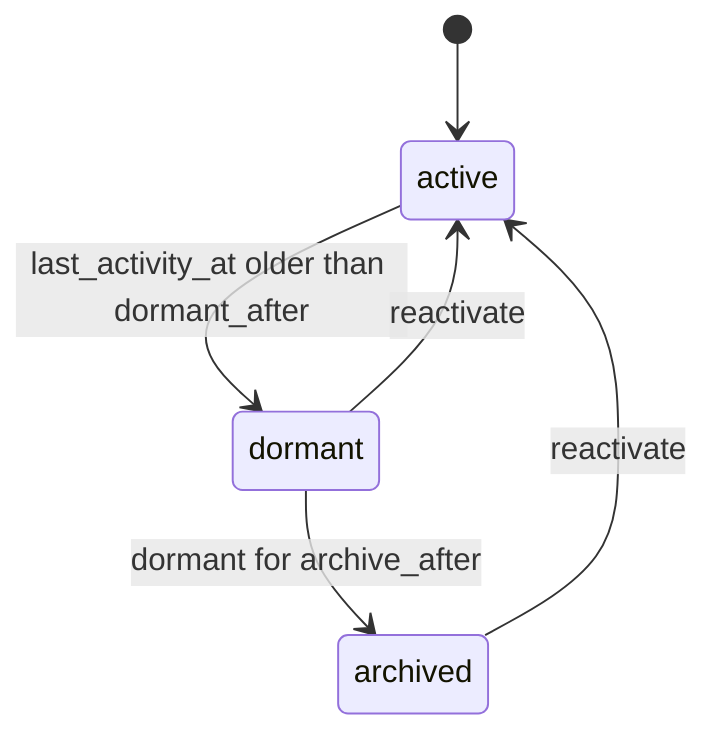

# Design: dormancy recipe generator

Status: implemented.

## The problem

Accounts, projects and leads go quiet. Each application writes the same thing: a `last_activity_at` column that the application bumps when the record is used, a job that marks the record dormant once the column is old enough, a second job that archives a record nobody came back to, and a way to bring a dormant or archived record back. The dormancy deadline is a moving one: every use pushes it out.

`mix ash_workflow.gen.dormancy` layers that lifecycle onto a subject resource. It is a lifecycle recipe in [`recipes.md`](recipes.md), built on the code [`gen.expiry`](expiry-recipe.md) extracted into `Mix.AshWorkflow.Recipe`.

## The split between generated code and the application

The generator owns the dormancy lifecycle: the states, the two deadlines, the `record_activity` action that moves the first deadline, and the `reactivate` transition. It also starts each new subject's dormancy, through a `StartDormancy` change on the subject's create actions.

The application owns five things:

- Dormancies for subjects that existed before the generator ran. These have none, and the application backfills them.
- What counts as activity. The application attaches the generated `RecordActivity` change to the subject actions that count, or calls `AccountDormancy.record_activity/2` wherever the subject is used, such as a sign-in or an API request.
- What happens on entering `:dormant` or `:archived`, such as a "we miss you" email or revoking access. The generator adds no notifier and no action timeout for it.
- Who may reactivate. This is one `Ash.Policy.Check` module, generated to deny everyone.
- Who may create a dormancy directly, outside `StartDormancy`. This is a second check module, also generated to deny everyone.

## The command

```bash
mix ash_workflow.gen.dormancy MyApp.Accounts.Account --dormant-after 90d --archive-after 180d
```

| Option | Default | Effect |
|---|---|---|
| `--dormant-after` | required | Move a dormancy to `:dormant` once `last_activity_at` is this old. |
| `--archive-after` | none | Move a dormancy to `:archived` once it has been `:dormant` this long. Omitted means no `:archived` step. |
| `--module` | `<Subject>Dormancy` | Name of the generated dormancy resource. |
| `--domain` | the subject's domain | Domain for a subject the generator creates. Required only when the subject does not exist. |
| `--transition-log` | `true` | Composes `ash_workflow.gen.transition_log`. `--no-transition-log` skips it. |

Both durations accept `30m`, `12h`, `2d` and `2w`, parsed by `Mix.AshWorkflow.Recipe.parse_duration/2`.

There is no actor option, for the reason expiry has none. The transition log is generated without `--actor`.

## The dormancy is a sibling resource

The generator adds `MyApp.Accounts.AccountDormancy` next to the subject, for the reason approval and expiry do: a resource has one `workflow`, and the subject may already run one.

Dormancy is a lifecycle recipe. A subject has one current dormancy, and a reactivation moves the existing row back to `:active` rather than creating a new row. The subject gains, by `Ash.Resource.Igniter` edits, and nothing else:

- `has_one :dormancy, MyApp.Accounts.AccountDormancy`
- `calculate :dormant?, :boolean, expr(dormancy.state in [:dormant, :archived])`
- `change MyApp.Accounts.AccountDormancy.Changes.StartDormancy, on: [:create]` in its `changes` block

`dormant?` is true for an archived subject too. An archived account has been dormant for longer, and a policy that forbids a dormant account should not let an archived one through. Without `--archive-after`, there is no `:archived` state, and the calculation is `expr(dormancy.state == :dormant)`. An application that needs to tell the two apart reads `dormancy.state`.

`AccountDormancy` has the identity `:unique_subject` on `subject_id`, with `pre_check_with` on a data layer without unique constraints, as expiry's does.

The generator adds no argument or policy to the subject's actions, and no change beyond `StartDormancy`. Attaching `RecordActivity` to a subject action, and gating a subject action on `dormant?`, are application decisions.

## Starting the dormancy

Dormancy needs no input to start: its clock starts at the subject's creation. A subject with no dormancy is never dormant, so leaving the create to the application left every subject untracked until the application remembered to call `AccountDormancy.create`. The generator writes `MyApp.Accounts.AccountDormancy.Changes.StartDormancy` and adds it to the subject's `changes` block with `on: [:create]`, which covers every create action on the subject, including one from `defaults [:create]`.

In an `after_action` hook, `StartDormancy` calls `AccountDormancy.create/2` with the subject's id, so `last_activity_at` takes its default of now. An error from that create fails the subject create.

- It passes `authorize?: false`, with the actor and tenant of the subject create. The dormancy row follows from a create the subject already authorized, and `CanCreate` denies everyone as generated, so checking it would fail every subject create.
- It skips a create that upserted onto an existing subject, read from the record's `upsert_action: :update` or `upsert_skipped: true` metadata.
- It skips a subject that already has a dormancy, found by a read with `authorize?: false`.

`Ash.bulk_create/4` runs `after_action` hooks once per record, so each subject in a bulk create gets its own dormancy, whether or not the bulk create returns its records.

Subjects that existed before the generator ran get no dormancy from `StartDormancy`. The recipe page shows a backfill through `Ash.bulk_create/4` with `authorize?: false`.

`RecordActivity` is generated beside it but not attached. In an `after_action` hook, it calls `AccountDormancy.record_activity/2` for the subject's dormancy with `authorize?: false`, and does nothing for a subject with none. It defines `atomic/3`, so an atomic update can run it. Which subject actions count as activity is the application's decision, so the generator leaves attaching it to the application.

When the subject module does not exist, the generator creates it with `ash.gen.resource` and takes the data layer from the first resource in `--domain` that uses `Ash.DataLayer.Ets` or `AshPostgres.DataLayer`, as expiry does. When no resource there uses either, `Mix.AshWorkflow.Recipe.ensure_subject/5` stops the task with an Igniter issue and nothing is written.

## The workflow



Generated for the command above:

```elixir
workflow do
  step :active do
    timeout :dormant, fire_after: {90, :days}, field: :last_activity_at, transition_to: :dormant
  end

  step :dormant do
    transition :reactivate, to: :active

    timeout :archived, fire_after: {180, :days}, transition_to: :archived
  end

  step :archived do
    transition :reactivate, to: :active
  end
end
```

Without `--archive-after`, there is no `:archived` step, and `:dormant` carries only `reactivate`.

`:archived` is not terminal, because `reactivate` leaves it. It has no timeout, so an archived record stays archived until it is reactivated. Deleting archived records is a job for [`gen.deletion`](recipes.md), not this recipe.

`:active` has no `reactivate`. Activity in `:active` goes through `record_activity`, which moves the deadline without a transition.

### The dormant deadline reads `last_activity_at`

`last_activity_at` is an attribute on the dormancy resource. `record_activity` writes the current time to it, and the `:dormant` timeout measures `--dormant-after` from it with `field: :last_activity_at`.

`record_activity` is an update action, not a transition. A transition back into `:active` would move `state_entered_at` and append a transition log row on every sign-in, and the log would fill with entries that record nothing. `record_activity` moves one column, and the timeout reads it.

A transition timeout has no fired column, as [Data-driven deadlines](../topics/timeouts-and-deadlines.md#data-driven-deadlines-with-field) describes. The trigger matches `state == :active and last_activity_at <= ago(90, :day)`, so a newer `last_activity_at` stops it matching, and leaving `:active` stops it too. Nothing records that the timeout fired, so nothing has to be reset when activity moves the deadline.

`record_activity` works in every step and changes no state. Activity on a dormant record moves `last_activity_at`, which the `:archived` deadline does not read. Bringing a dormant record back is the application's decision, through `reactivate`.

### The archive deadline reads `state_entered_at`

The `:archived` timeout has no `field`, so it measures `--archive-after` from `state_entered_at`, the instant the record became dormant.

[`recipes.md`](recipes.md) warns against `state_entered_at` when a step can be re-entered, because each re-entry restarts the clock. `:dormant` has no transition to itself, so `state_entered_at` only moves when the record goes dormant again after a reactivation, and that is a new dormant period that should get a new clock.

Two other anchors were considered:

| Anchor | `--archive-after` measured from | Chosen |
|---|---|---|
| `state_entered_at` | Entering `:dormant` | Yes |
| `last_activity_at` with `fire_after` set to `dormant_after + archive_after` | The last activity | No |
| A `dormant_at` attribute written on entering `:dormant` | Entering `:dormant` | No |

Anchored on `last_activity_at`, the archive deadline would move whenever a dormant record recorded activity, so a dormant account that was used but never reactivated would never archive. It would also shorten the dormant period when the scheduler fires the `:dormant` timeout late, since both deadlines count from the same instant. A `dormant_at` attribute holds the same instant as `state_entered_at` and needs a change on the timeout to write it.

### `reactivate` resets `last_activity_at`

`reactivate` writes the current time to `last_activity_at` as well as moving the record to `:active`. A record that went dormant has a `last_activity_at` older than `--dormant-after`, so without the reset a reactivated record would match the `:dormant` trigger again on the next sweep.

## The resource

`AccountDormancy` attributes: `subject_id` and `last_activity_at`, both required. `last_activity_at` defaults to the time of creation.

```elixir
actions do
  defaults [:read]

  create :create do
    accept [:subject_id, :last_activity_at]
  end

  update :record_activity do
    require_atomic? false
    change set_attribute(:last_activity_at, &DateTime.utc_now/0)
  end

  update :reactivate do
    require_atomic? false
    change set_attribute(:last_activity_at, &DateTime.utc_now/0)
  end
end

code_interface do
  define :create, args: [:subject_id]
  define :record_activity
  define :reactivate
end
```

`create` accepts `last_activity_at` so a backfill can carry over when a subject was last used. `record_activity` and `reactivate` set `require_atomic? false` for the reason expiry's `renew` does: the `pre_check_with` identity on ETS adds a hook an atomic update cannot run.

## Who may act

The generator writes `MyApp.Accounts.AccountDormancy.Checks.CanCreate` and `MyApp.Accounts.AccountDormancy.Checks.CanReactivate`, which deny everyone, mirroring expiry's `CanCreate` and `CanRenew`. The generator's notice says so.

```elixir
policies do
  policy action(:create) do
    authorize_if MyApp.Accounts.AccountDormancy.Checks.CanCreate
  end

  policy action(:reactivate) do
    authorize_if MyApp.Accounts.AccountDormancy.Checks.CanReactivate
  end

  policy action(:record_activity) do
    authorize_if always()
  end
end
```

`record_activity` is allowed for every caller. The application calls it from its own code as a side effect of a sign-in or an edit, often with the subject's own user as the actor, and a check that denied by default would leave every subject to go dormant until the application wrote one. Recording activity moves a deadline and changes no state, so allowing it gives a caller no transition it could not already reach. An application that exposes `record_activity` through an API should replace `always()` with its own check.

`CanCreate` gates only a direct call to `AccountDormancy.create`. `StartDormancy` creates the dormancy with `authorize?: false`, so a subject create succeeds while `CanCreate` still denies everyone. `AshWorkflow.Transformers.AddPolicies` allows `read` and the scheduler's timeout transitions, so a dormancy goes dormant before the application has written `CanReactivate`.

## Code shared with other recipes

The task builds on `Mix.AshWorkflow.Recipe`. It added the `:changes` option to `Recipe.add_subject_edits/5`, which adds a `change` call to the subject's `changes` block, skipping an identical one and warning about one that differs. It passes no `sources` to `ensure_subject/5`, because it has no actor resource to take a data layer from.

## Open questions

1. Should activity on a dormant record reactivate it automatically? This design says no: `record_activity` never transitions, and `reactivate` is checked by `CanReactivate`. An application that wants a sign-in to wake a dormant account calls `reactivate` with an actor `CanReactivate` permits, or adds a `record_activity` transition to `:dormant` by hand.
2. Should the subject also gain `archived?`? This design adds one calculation per recipe, as [`recipes.md`](recipes.md) describes, and folds `:archived` into `dormant?`.
3. `record_activity` writes on every call. An application calling it on every request writes the dormancy row on every request. Skipping the write when `last_activity_at` is recent would need a threshold option, which this design does not add.
