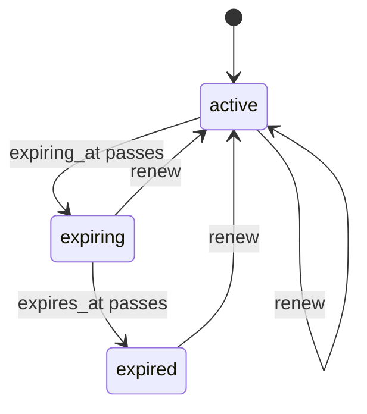

# Design: expiry recipe generator

Status: implemented.

## The problem

Contracts, certifications and licences all lapse on a date. Each application writes the same thing: an `expires_at` column, a job that flips a status once the date passes, a warning some days before it, and a way to push the date out again. The warning and the lapse are two deadlines on one record, and both move when the record is renewed.

`mix ash_workflow.gen.expiry` layers that lifecycle onto a subject resource. It is the first lifecycle recipe in [`recipes.md`](recipes.md), and the second recipe after [`gen.approval`](approval-recipe.md).

## The split between generated code and the application

The generator owns the expiry lifecycle: the states, the two deadlines and the `renew` transition.

The application owns three things:

- When an expiry is created. The application calls the subject's `set_expiry/3`, or adds the generated `SetExpiry` change to a subject action of its own: the subject's create action, an activation step, an import.
- What happens on entering `:expiring` or `:expired`, such as a reminder email or revoking access. The generator adds no notifier and no action timeout for it.
- Who may renew. This is one `Ash.Policy.Check` module, generated to deny everyone.

## The command

```bash
mix ash_workflow.gen.expiry MyApp.Contracts.Contract --notice-period 30d
```

| Option | Default | Effect |
|---|---|---|
| `--module` | `<Subject>Expiry` | Name of the generated expiry resource. |
| `--domain` | the subject's domain | Domain for a subject the generator creates. Required only when the subject does not exist. |
| `--notice-period` | none | Move an expiry to `:expiring` this long before `expires_at`. Omitted means no `:expiring` step. |
| `--transition-log` | `true` | Composes `ash_workflow.gen.transition_log`. `--no-transition-log` skips it. |

`--notice-period` accepts `30m`, `12h`, `2d` and `2w`, parsed by the same code as approval's `--overdue-after`.

There is no actor option. Nothing in the generated code records who renewed, so the transition log is generated without `--actor`. An application that wants the renewer recorded passes `--no-transition-log` and runs `ash_workflow.gen.transition_log` itself with `--actor`.

## The expiry is a sibling resource

The generator adds `MyApp.Contracts.ContractExpiry` next to the subject, for the reason approval does: a resource has one `workflow`, and the subject may already run one.

Expiry is a lifecycle recipe. A subject has one current expiry, not a history of them, so a renewal moves the existing row's deadline rather than creating a new row. The subject gains, by `Ash.Resource.Igniter` edits, and nothing else:

- `has_one :expiry, MyApp.Contracts.ContractExpiry`
- `calculate :expired?, :boolean, expr(expiry.state == :expired)`
- `update :set_expiry`, with an `expires_at` argument and the change `MyApp.Contracts.ContractExpiry.Changes.SetExpiry`
- `define :set_expiry, args: [:expires_at]` in its `code_interface`

`ContractExpiry` has the identity `:unique_subject` on `subject_id`. On a data layer without unique constraints, such as ETS, it sets `pre_check_with` to the domain. A second `create` for the same subject fails on the identity, so `has_one :expiry` never has two rows to choose between.

When the subject module does not exist, the generator creates it with `ash.gen.resource` as approval does. Approval takes the created subject's data layer from the approver. Expiry has no actor resource, so it takes the data layer from the first resource in `--domain` that uses `Ash.DataLayer.Ets` or `AshPostgres.DataLayer`. When no resource in the domain uses either, the generator stops with an Igniter issue and writes nothing, rather than create a subject that cannot store records. `Mix.AshWorkflow.Recipe.ensure_subject/5` makes this check for every recipe.

### Starting the clock from the subject

A subject with no expiry row never expires, and its `expired?` is `false`. The first version of this recipe left creating the row to the application, through `ContractExpiry.create/3`. Nothing in the generated code called it, so a subject the application forgot about stayed unexpired with no sign that anything was missing.

The subject now gains one additive action, `:set_expiry`. Its change, `SetExpiry`, runs in an `after_action` hook on the subject. It looks the expiry up by `subject_id`, calls `create` when there is none and `renew` when there is one. The lookup reads with `authorize?: false`, because whether a row exists only picks the call, and `create` and `renew` are each authorized with the subject action's actor and tenant. An error from either fails the subject action.

`SetExpiry` is opt-in on every other subject action. The generator does not add it to the subject's create action, because only the application knows the term, and a subject created by an import may already have a date of its own. An application adds `change {SetExpiry, term: {365, :day}}` where a default term applies. `SetExpiry` defines `atomic/3` as well as `change/3`, so it can join an update that keeps `require_atomic? true`. The generated `:set_expiry` declares `require_atomic? false` anyway, so it does not depend on that.

Recipe actions are additive. `:set_expiry` is a new action, and the generator leaves every action the subject already had as it was. Gating a subject action on `expired?` is an application decision. On a subject that uses `Ash.Policy.Authorizer`, `:set_expiry` is denied until the application writes a policy for it, and the generator prints a notice saying so.

## The workflow



Generated for the command above:

```elixir
workflow do
  step :active do
    transition :renew, to: :active

    timeout :expiring do
      fire_at :expiring_at
      transition_to :expiring
    end
  end

  step :expiring do
    transition :renew, to: :active

    timeout :expired do
      fire_at :expires_at
      transition_to :expired
    end
  end

  step :expired do
    transition :renew, to: :active
  end
end

calculations do
  calculate :expiring_at, :utc_datetime_usec, expr(datetime_add(expires_at, -30, :day))
end
```

Without `--notice-period`, there is no `:expiring` step and no `expiring_at` calculation. `:active` then carries the `:expired` timeout on `fire_at :expires_at` directly.

`:expired` is not terminal, because `renew` leaves it. It has no timeout, so an expired record stays expired until it is renewed.

### Both deadlines read `expires_at`

`expires_at` is an attribute on the expiry resource, and it is the only stored deadline. `renew` writes a new `expires_at`, and both deadlines move with it. Neither timeout reads `state_entered_at`, so a renewal from `:active` back to `:active` cannot restart a clock it should not.

The notice deadline is `expiring_at`, an expression calculation of `expires_at` minus the notice period. Three shapes were considered:

| Shape | Moves on renew | Index on Postgres | Chosen |
|---|---|---|---|
| `fire_at :expiring_at`, an expression calculation | Yes, it is derived | No, `AshWorkflow.Transformers.AddIndexes` skips a calculation | Yes |
| `fire_at :expiring_at`, an attribute written by a change on `create` and `renew` | Only if every action that writes `expires_at` also runs the change | Yes | No |
| `fire_after: {-30, :days}, field: :expires_at` | Yes | Yes | Not buildable: `AshWorkflow.Duration.validate/1` requires a positive count |

The calculation keeps `expires_at` as the one value an application writes. An application that edits `expires_at` through its own update action moves the notice deadline too, with no change to remember. The cost is the index: the `active` trigger filters `state = 'active' AND expires_at - interval <= now()`, and the `(state, expires_at)` index `AddIndexes` creates for the `:expiring` step serves the `state` prefix only.

[`fire-at.md`](fire-at.md) records the one hazard with an expression calculation as a `fire_at` field, [issue #70](https://github.com/team-alembic/ash_workflow/issues/70). `AshWorkflow.Scheduler.due_at/2` returns `nil` for a calculation the caller did not load. Both schedulers read the deadline through a query: the AshOban trigger filters on the calculation, and `AshWorkflow.Scheduler.Precise.Timeline` loads it with the records it sweeps. Only a caller that computes `due_at/2` from a record of its own has to load `expiring_at` first. The generated code never does.

A record created with `expires_at` already inside the notice period moves to `:expiring` on the first sweep and to `:expired` once `expires_at` passes. One created with `expires_at` already in the past passes through `:expiring` to `:expired` over two timeouts.

## The resource

`ContractExpiry` attributes: `subject_id` and `expires_at`, both required.

```elixir
actions do
  defaults [:read]

  create :create do
    accept [:subject_id, :expires_at]
  end

  update :renew do
    require_atomic? false
    argument :expires_at, :utc_datetime_usec, allow_nil?: false
    change set_attribute(:expires_at, arg(:expires_at))
  end
end

code_interface do
  define :create, args: [:subject_id, :expires_at]
  define :renew, args: [:expires_at]
end
```

`renew` requires a new `expires_at`. A renewal that kept the old date would return an expired record to `:active` and move it straight back on the next sweep. The new date is a required argument rather than an accepted attribute, because `require_attributes` on an update only checks the attribute has a value, and `expires_at` always has one.

`renew` does not check that the new `expires_at` is in the future. An application backdating a record, or a test, has a reason to write a past date, and a validation is one line for an application that wants one.

`datetime_add/3` returns whole seconds, so `expiring_at` drops the fraction of a second `expires_at` carries. The notice deadline is the same instant to within a second.

### An identity on ETS and atomic updates

On a data layer without unique constraints, Ash requires `pre_check_with` on the `:unique_subject` identity, and adds a `before_action` hook to every update on the resource to run the check. An atomic update cannot run a `before_action` hook, so the timeout actions AshWorkflow generates failed with `Ash.Error.Framework.MustBeAtomic`, and `Timeline.run_due/2` logged the failure and left the record where it was.

This PR fixes it in the library rather than the recipe. `AshWorkflow.Transformers.AddActions` now generates transition and timeout actions with `require_atomic? false` on a resource with a `pre_check_with` identity. Every workflow on ETS with an identity had the same failure, and only the generated actions are in AshWorkflow's hands. An action the application declares keeps the `require_atomic?` it declared, which is why the generated `renew` declares `require_atomic? false` itself.

### Table names

The approval generator named a Postgres table by appending `s` to the resource name, which gives `contract_expirys`. `Mix.AshWorkflow.Recipe` now turns a consonant followed by `y` into `ies`, so the table is `contract_expiries`. No approval table name generated by default ends that way, so approval's output only changes for a `--module` such as `SignOffPolicy`, from `sign_off_policys` to `sign_off_policies`.

## Who may create and renew

The generator writes `MyApp.Contracts.ContractExpiry.Checks.CanCreate` and `MyApp.Contracts.ContractExpiry.Checks.CanRenew`. Both deny everyone, mirroring approval's `CanRequest` and `CanApprove`. The generator's notice says so.

```elixir
policies do
  policy action(:create) do
    authorize_if MyApp.Contracts.ContractExpiry.Checks.CanCreate
  end

  policy action(:renew) do
    authorize_if MyApp.Contracts.ContractExpiry.Checks.CanRenew
  end
end
```

`AshWorkflow.Transformers.AddPolicies` allows `create`, `read` and the scheduler's timeout transitions. Every policy that applies must pass, so the `:create` policy still gates creation. Reads stay open, and an expiry can lapse before the application has written `CanRenew`.

## Code shared with approval

`Mix.AshWorkflow.Recipe`, in `lib/mix/ash_workflow/recipe.ex`, holds what both recipes use:

- `parse_duration/2` for `--overdue-after` and `--notice-period`.
- `ensure_subject/5`, which checks an existing subject compiles or composes `ash.gen.resource` for a missing one, and returns the storage the recipe's resources use.
- `add_subject_edits/5`, the subject relationship, calculation, action and code interface edits. Each is skipped when the subject already has the recipe's definition, and left with a warning when it has a different one of the same name.
- `compose_transition_log/3`.
- `key_type/3` and `belongs_to/3`, which type a foreign key after the primary key it references.
- `deny_check_contents/2` and `create_policy/2`, for a deny-by-default check and the policy on the opening create action.
- `lock_for_update/1`, the Postgres row lock for an update that reads a count before writing.
- The rendering helpers for the data layer option, the `postgres` block and its table name, `pre_check_with` and a shortened identity index name.

It lives under `lib/mix` beside the tasks rather than under `lib/ash_workflow`, because it is only compiled when Igniter is loaded and nothing at runtime calls it. `gen.approval` moves onto it with no change to its generated output, apart from the table name rule above.
