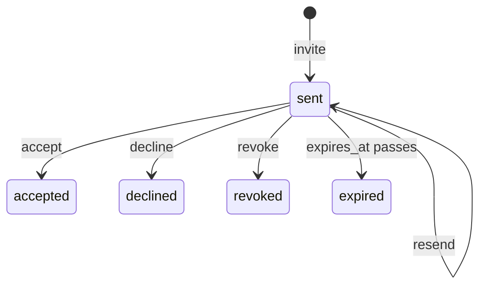

# Design: invitation recipe generator

Status: proposed.

## The problem

Team invites, event RSVPs and access grants share one workflow. Someone invites an email address, the person at that address accepts or declines, the inviter can withdraw or resend the invitation, and an invitation nobody answers lapses after a few days. Each application writes the same deadline, the same "only the inviter may revoke" rule and the same "one open invitation per address" check by hand.

`mix ash_workflow.gen.invitation` layers that workflow onto a subject resource. It is a request recipe in [`recipes.md`](recipes.md), the second after [`gen.approval`](approval-recipe.md), and it reuses the `fire_at` deadline that [`gen.expiry`](expiry-recipe.md) introduced.

## The split between generated code and the application

The generator owns the invitation lifecycle: the states, the transitions, the expiry deadline, the rule that `resend` moves that deadline, and the rule that only the inviter may revoke or resend.

The application owns four things:

- When an invitation is created. The application calls `TeamInvitation.invite/3` from wherever that makes sense: an "invite member" form, an admin import, a create action on the subject.
- How the invitation reaches the invitee. The generator writes no token, no email and no notifier. The application sends the invitation on `invite` and on `resend`, for example with an Ash notifier on the invitation resource or with AshAuthentication's magic link.
- How an actor proves they are the invitee. This is one `Ash.Policy.Check` module, `CanAccept`, generated to deny everyone.
- What accepting grants, such as creating a membership row. The generator adds no change for it.

## The command

```bash
mix ash_workflow.gen.invitation MyApp.Teams.Team \
  --invitee MyApp.Accounts.User \
  --expires-after 7d
```

| Option | Default | Effect |
|---|---|---|
| `--invitee` | required | The actor resource. The inviter and the accepting invitee both `belong_to` it. |
| `--expires-after` | `7d` | How long an invitation stays open after `invite` or `resend`. Accepts `30m`, `12h`, `2d` and `2w`. |
| `--module` | `<Subject>Invitation` | Name of the generated invitation resource. |
| `--domain` | the subject's domain | Domain for a subject the generator creates. Required only when the subject does not exist. |
| `--transition-log` | `true` | Composes `ash_workflow.gen.transition_log` with `--actor` set to the invitee resource. `--no-transition-log` skips it. |

`--expires-after` has a default rather than being optional, because an invitation that never expires keeps a link to the subject valid for as long as the email sits in an inbox. Every option is therefore always present in the generated code, and no step is optional.

## The invitation is a sibling resource

The generator adds `MyApp.Teams.TeamInvitation` next to the subject, for the reason approval does: a resource has one `workflow`, and the subject may already run one.

Invitation is a request recipe. A team sends many invitations over its life, to different addresses and to the same address again after one lapses, and each keeps its own outcome. The subject gains, by `Ash.Resource.Igniter` edits, and nothing else:

- `has_many :invitations, MyApp.Teams.TeamInvitation`
- `has_one :latest_invitation`, sorted by `inserted_at` descending

The subject gains no boolean calculation, which departs from the rule in [`recipes.md`](recipes.md). An approval decides the subject, so `approved?` on an expense answers a real question. An invitation decides one invitee's relationship to the subject. A team with ten members has ten accepted invitations and perhaps one expired one, and `latest_invitation.state == :accepted` would report whichever was sent last. The question an application asks is per address: "has `alice@example.com` accepted?", which is a filter on `invitations`.

The generator adds no change, argument or policy to the subject's actions.

When the subject module does not exist, the generator creates it with `ash.gen.resource` as approval does, taking the data layer from the `--invitee` resource, or else from the first ETS or Postgres resource in `--domain`. When there is none, it stops with an Igniter issue and writes nothing.

## The workflow



Generated for the command above:

```elixir
workflow do
  step :sent do
    transition :accept, to: :accepted
    transition :decline, to: :declined
    transition :revoke, to: :revoked
    transition :resend, to: :sent

    timeout :expired do
      fire_at :expires_at
      transition_to :expired
    end
  end

  step :accepted, terminal: true
  step :declined, terminal: true
  step :revoked, terminal: true
  step :expired, terminal: true
end
```

Every outcome is terminal. An expired, declined or revoked invitation is not reopened. The inviter sends a new one, and the old row keeps its outcome, as approval keeps a rejected request when the expense is resubmitted.

### The deadline reads `expires_at`

`expires_at` is an attribute on the invitation. `invite` sets it to now plus `--expires-after`, and `resend` sets it to now plus `--expires-after` again. The timeout uses `fire_at :expires_at`, not `fire_after` on `state_entered_at`.

`resend` loops back into `:sent`, which moves `state_entered_at`, so a `fire_after` deadline anchored on it would also restart on resend. `expires_at` is still the better anchor for three reasons:

- The invitation email needs to say when it lapses. A stored `expires_at` is that date. A `fire_after` deadline would need the same arithmetic again in the email template.
- An application can change one invitation's deadline, such as a longer window for an external guest, by writing `expires_at`. With `fire_after`, the duration is fixed in the DSL for every invitation.
- Any transition an application later adds that loops back into `:sent`, such as editing the invitation message, would restart a `state_entered_at` clock. It leaves `expires_at` alone.

`resend` sets the new deadline from now, not from the old `expires_at`. An invitation resent on its sixth day of seven gets seven more days from the moment the new email goes out, not eight.

`resend` re-arms the deadline in both schedulers. The AshOban trigger reads `expires_at` on each sweep. `AshWorkflow.Scheduler.Precise.Timeline` replaces a record's timers whenever it enters a step, and the `resend` self-transition enters `:sent`.

### Accepting after the deadline

The scheduler moves an invitation to `:expired` after `expires_at` passes, not at that instant. Until the sweep runs, `:accept` is still a valid transition from `:sent`. The `:accept` action validates `expires_at` is in the future, so an invitee cannot accept in that window. `:decline` has no such check, because declining a lapsed invitation grants nothing.

## The resource

`TeamInvitation` attributes: `subject_id`, `email` (`:ci_string`), `expires_at`, `invited_by_id` and `invitee_id`.

```elixir
actions do
  defaults [:read]

  create :invite do
    accept [:subject_id, :email]
    change relate_actor(:invited_by)
    change TeamInvitation.Changes.SetExpiresAt
    validate TeamInvitation.Validations.NoOpenInvitation
  end

  update :accept do
    require_atomic? false
    validate compare(:expires_at, greater_than: &DateTime.utc_now/0), message: "has expired"
    change relate_actor(:invitee)
  end

  update :resend do
    require_atomic? false
    change TeamInvitation.Changes.SetExpiresAt
  end
end
```

`TeamInvitation.Changes.SetExpiresAt` sets `expires_at` to now plus `--expires-after`. It is a change module because Spark cannot store an anonymous function in the DSL, and a non-atomic `set_attribute` does not evaluate an expression. One module keeps the duration in one place for `:invite` and `:resend`.

The generator adds no policy to `:invite`. Who may send an invitation is the application's decision.

`email` is a `:ci_string`, so `Alice@Example.com` and `alice@example.com` are one address. On AshPostgres this needs the `citext` extension, which the AshPostgres installer adds to `installed_extensions`.

`invitee` is set by `:accept` from the actor. `email` names who was invited. `invitee` names who accepted. They are separate because the application, not the generator, decides whether an actor whose own email differs may accept.

## One open invitation per address

A subject may not have two invitations in `:sent` to the same `email`. Two shapes were considered:

| Shape | ETS | Postgres | Concurrent invites |
|---|---|---|---|
| `identity :unique_open_email, [:subject_id, :email], where: expr(state == :sent)` | Wrong: the `pre_check_with` query `Ash.Changeset` runs ignores `where`, so a second invitation is refused even after the first expires | A partial unique index | Refused by the index |
| A validation on `:invite` that reads for an open invitation | Correct | Correct | Both can pass the read |

The generator writes the validation, `TeamInvitation.Validations.NoOpenInvitation`, for every data layer. On AshPostgres it also writes the partial identity with `identity_wheres_to_sql`, which closes the race the validation leaves. The validation still runs first there, so the common case reports `email` "already has an open invitation" rather than a constraint error.

On ETS the race stays. ETS is for tests and prototypes, where two concurrent invites to one address are not a case to design for.

## Who may act

The generator writes `MyApp.Teams.TeamInvitation.Checks.CanAccept`, which denies everyone, mirroring approval's `CanApprove`. The generator's notice says so.

```elixir
policies do
  policy action([:accept, :decline]) do
    authorize_if MyApp.Teams.TeamInvitation.Checks.CanAccept
  end

  policy action([:revoke, :resend]) do
    authorize_if relates_to_actor_via(:invited_by)
  end
end
```

`CanAccept` covers `:decline` as well. Both are the invitee's actions, and the proof an application asks for, such as a matching email or a token, is the same for both.

`:revoke` and `:resend` need no deny-by-default check. The inviter is recorded on the row, so "only the inviter" is decidable by the generated code. An application that lets team admins revoke any invitation adds an `authorize_if` line.

`AshWorkflow.Transformers.AddPolicies` allows `:invite`, reads and the scheduler's timeout transition, so an invitation can be sent and can lapse before the application has written `CanAccept`.

## Code shared with approval and expiry

`gen.invitation` uses `Mix.AshWorkflow.Recipe` as it stands: `parse_duration/2`, `ensure_subject/5` with `storage_like/2`, `add_subject_edits/4`, `compose_transition_log/3`, and the rendering helpers. `postgres_block/3` takes the `identity_index_names` and `identity_wheres_to_sql` lines as its `extra` argument. Nothing is added to the shared module.

## Open questions

1. Should an invitation to an address that already accepted one be refused? The validation only looks at `:sent`, so a team can invite a current member again. Whether that is an error depends on what accepting grants, which the application owns.
2. Should `:decline` record `invitee` too? It is left unset, because a decline needs no account, and an application whose invitees decline from a signed-out email link has no actor to record.
3. Should the subject gain an aggregate such as `open_invitation_count` in place of the boolean calculation? It is left out until an application asks for it.
