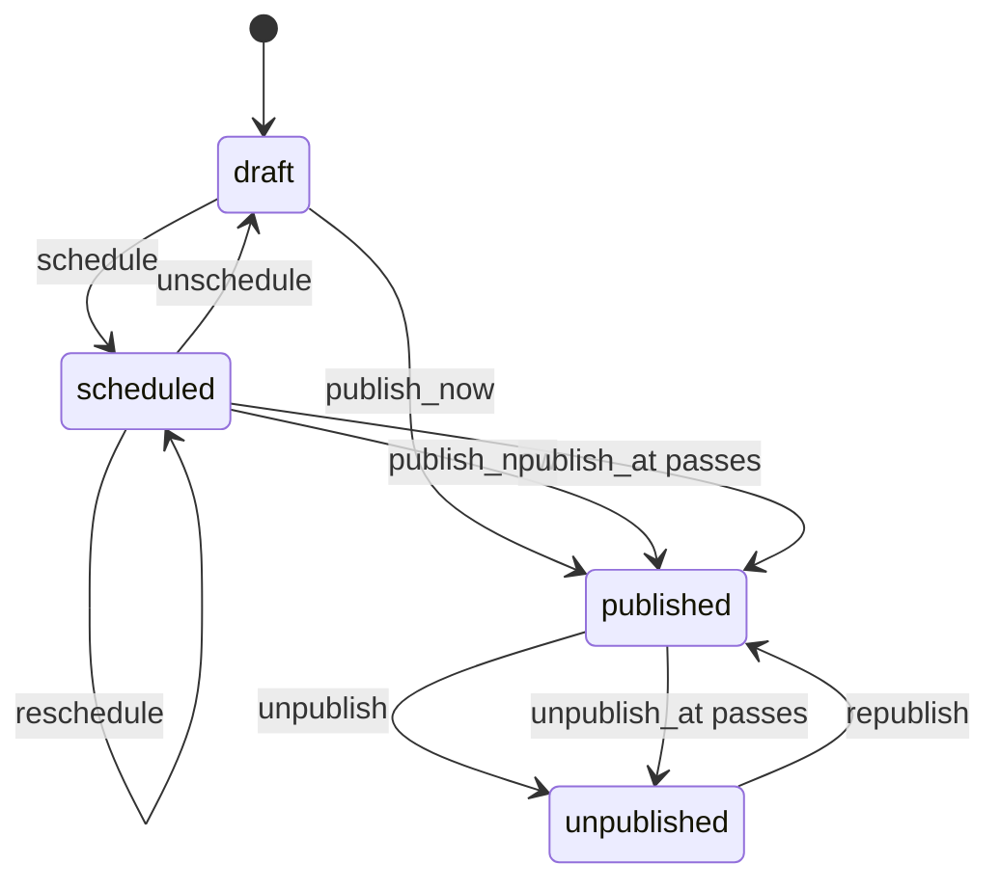

# Design: publication recipe generator

Status: implemented.

## The problem

Posts, announcements and listings go live at a set time and often come down at another. Each application writes the same thing: a `publish_at` column, a job that flips a status once it passes, an optional end date, and actions to move the date, cancel the schedule, take the record down and put it back up. Publication carries two deadlines on one record, and each belongs to a different step.

`mix ash_workflow.gen.publication` layers that lifecycle onto a subject resource. It is the second lifecycle recipe in [`recipes.md`](recipes.md), after [`gen.expiry`](expiry-recipe.md).

## Request or lifecycle

Publication is a lifecycle recipe. A post has one current publication state, not a history of publication requests, so unpublishing and republishing move the existing row rather than creating a new one. The transition log records the history.

The subject gains, by `Ash.Resource.Igniter` edits, and nothing else:

- `has_one :publication, MyApp.Blog.PostPublication`
- `calculate :published?, :boolean, expr(publication.state == :published)`

`PostPublication` has the identity `:unique_subject` on `subject_id`, with `pre_check_with` on a data layer without unique constraints, as expiry does. A second `create` for the same subject fails on the identity.

The generator adds no change, argument or policy to the subject's actions. Showing only published posts on a public page is an application decision, made with a filter or a policy on `published?`.

## The split between generated code and the application

The generator owns the publication lifecycle: the steps, the transitions, the two deadlines and the schedule attributes.

The application owns three things:

- When a publication is created. The application calls `PostPublication.create/2` with the subject, from the subject's create action or wherever a draft starts. The generated `create` action is guarded by `Checks.CanCreate`, which denies everyone until the application defines who may create one.
- Who may move a publication. This is one `Ash.Policy.Check` module, generated to deny everyone.
- What happens on publishing or unpublishing, such as a cache purge or a notification. The generator adds no notifier.

## The command

```bash
mix ash_workflow.gen.publication MyApp.Blog.Post --with-unpublish-at
```

| Option | Default | Effect |
|---|---|---|
| `--module` | `<Subject>Publication` | Name of the generated publication resource. |
| `--domain` | the subject's domain | Domain for a subject the generator creates. Required only when the subject does not exist. |
| `--with-unpublish-at` | `false` | Generates the `unpublish_at` attribute and the timeout that moves `:published` to `:unpublished`. Without it, a publication stays published until someone unpublishes it. |
| `--transition-log` | `true` | Composes `ash_workflow.gen.transition_log`. `--no-transition-log` skips it. |

`--with-unpublish-at` is a boolean rather than a duration, because each record's `unpublish_at` is a date the caller sets when scheduling, not an offset the task can fix.

There is no actor option, for the reason expiry has none. Nothing in the generated resource records who published, so the transition log is generated without `--actor`.

When the subject module does not exist, the generator creates it with `ash.gen.resource` and takes the data layer from the first resource in `--domain` that uses ETS or Postgres, as expiry does. When no resource there uses either, the generator stops with an Igniter issue and writes nothing.

## The workflow



The `unpublish_at passes` edge is generated only with `--with-unpublish-at`. No step is terminal, so the workflow has no end state.

Generated with `--with-unpublish-at`:

```elixir
workflow do
  step :draft do
    transition :schedule, to: :scheduled
    transition :publish_now, to: :published
  end

  step :scheduled do
    transition :reschedule, to: :scheduled
    transition :unschedule, to: :draft
    transition :publish_now, to: :published

    timeout :published do
      fire_at :publish_at
      transition_to :published
    end
  end

  step :published do
    transition :unpublish, to: :unpublished

    timeout :unpublished do
      fire_at :unpublish_at
      transition_to :unpublished
    end
  end

  step :unpublished do
    transition :republish, to: :published
  end
end
```

`publish_now` is allowed from `:scheduled` as well as `:draft`, so an editor can publish a scheduled post early without unscheduling it first.

### Each deadline reads its own attribute

`publish_at` and `unpublish_at` are attributes on the publication, and each timeout names one with `fire_at`. Neither reads `state_entered_at`. `reschedule` loops `:scheduled` back into itself, which moves `state_entered_at`, so a deadline measured from it would restart on every reschedule. A `fire_at` deadline holds the instant the application chose and moves only when an action writes it.

Both are attributes rather than calculations, so `AshWorkflow.Transformers.AddIndexes` gives each a `(state, field)` index on Postgres.

### An absent `unpublish_at`

`unpublish_at` is nullable. A publication published without one stays published until someone calls `unpublish`.

The library already behaves this way, so the generator adds nothing for it. Both schedulers select due records with `field <= bound`, and a `nil` field never compares as due. `AshWorkflow.Scheduler.due_at/2` returns `nil` for it, so `AshWorkflow.Scheduler.Precise.Timeline` arms no timer. The generated tests cover it, so a change to that comparison fails the recipe's tests too.

The alternative is a separate step for "published with an end date". It would double the steps for one nullable column, and an application could not add an end date to a live publication without a transition.

## The resource

`PostPublication` attributes: `subject_id`, `publish_at` and, with the option, `unpublish_at`. Both datetimes are nullable, because a draft has neither.

```elixir
actions do
  defaults [:read]

  create :create do
    accept [:subject_id]
  end

  update :schedule do
    require_atomic? false
    argument :publish_at, :utc_datetime_usec, allow_nil?: false
    argument :unpublish_at, :utc_datetime_usec
    change set_attribute(:publish_at, arg(:publish_at))
    change set_attribute(:unpublish_at, arg(:unpublish_at))
    validate compare(:unpublish_at, greater_than: :publish_at), where: present(:unpublish_at)
  end

  update :reschedule do
    require_atomic? false
    argument :publish_at, :utc_datetime_usec, allow_nil?: false
    change set_attribute(:publish_at, arg(:publish_at))
    validate compare(:unpublish_at, greater_than: :publish_at), where: present(:unpublish_at)
  end

  update :unschedule do
    require_atomic? false
    change set_attribute(:publish_at, nil)
    change set_attribute(:unpublish_at, nil)
  end

  update :republish do
    require_atomic? false
    argument :unpublish_at, :utc_datetime_usec
    change set_attribute(:unpublish_at, arg(:unpublish_at))
  end
end
```

Without `--with-unpublish-at`, the `unpublish_at` argument, change and validation are left out, and `republish` is not declared at all. AshWorkflow then generates `republish` with the other plain transitions.

- `schedule` takes `publish_at` as a required argument, for the reason expiry's `renew` does: `require_attributes` on an update passes whenever the attribute already holds a value.
- `reschedule` moves `publish_at` and leaves `unpublish_at`. The validation stops a reschedule from moving `publish_at` past the end date.
- `unschedule` clears both datetimes. A draft scheduled with an end date, unscheduled and then published with `publish_now` would otherwise come down at the old end date.
- `republish` writes `unpublish_at` from its argument, and clears it when none is given. An `unpublish_at` that has passed would otherwise move the publication straight back to `:unpublished` on the next sweep.
- `publish_now` and `unpublish` are not declared. They write nothing, so AshWorkflow generates them. `publish_now` from `:scheduled` keeps the scheduled `unpublish_at`.

No action checks that a datetime is in the future, for the reason expiry's `renew` does not. A `publish_at` in the past publishes on the first sweep.

`publish_at` is kept once a publication is published, so it records when the publication was due to go live. `published_at` and similar audit columns are left to the transition log.

## Who may publish

The generator writes `MyApp.Blog.PostPublication.Checks.CanCreate` and `MyApp.Blog.PostPublication.Checks.CanPublish`, which both deny everyone. `CanCreate` guards `:create`, and one policy with `CanPublish` covers every transition a person makes:

```elixir
policies do
  policy action(:create) do
    authorize_if MyApp.Blog.PostPublication.Checks.CanCreate
  end

  policy action([:schedule, :reschedule, :unschedule, :publish_now, :unpublish, :republish]) do
    authorize_if MyApp.Blog.PostPublication.Checks.CanPublish
  end
end
```

One check rather than one per transition, because the people who schedule a post are the people who take it down in most applications. An application that separates them splits the policy and adds a check of its own.

`AshWorkflow.Transformers.AddPolicies` allows `read` and the scheduler's timeout transitions, so a publication that was created goes live on schedule before the application has written `CanPublish`.

## Code shared with other recipes

The task uses `Mix.AshWorkflow.Recipe` as expiry does: `ensure_subject/5`, `add_subject_edits/4`, `compose_transition_log/3` and the rendering helpers. It needs nothing new from it.

## Open questions

1. A publication window that the application moves while published. `reschedule` only runs from `:scheduled`, so moving `unpublish_at` on a live publication takes an update action the application writes. A generated `extend` transition from `:published` to itself is a possible follow-up.
2. Whether `unpublish` should clear `unpublish_at`. Today it keeps it, so a manually unpublished record still shows the end date it was given, and `republish` replaces it.
