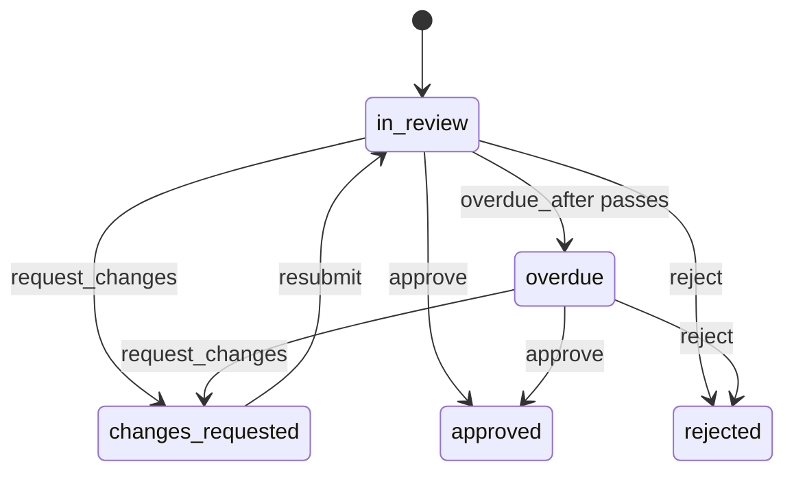

# Design: review recipe generator

Status: implemented.

## The problem

Content, design work and sign-offs go through review. Someone submits a piece of work, a reviewer reads it and either accepts it, rejects it, or sends it back with comments. The requester revises it and submits it again, and the reviewer reads it again. Each team writes the same `workflow` block, the same history of who asked for what in which round, and the same rule that only the requester may resubmit.

`mix ash_workflow.gen.review` layers that workflow onto a subject resource. It is the third recipe in [`recipes.md`](recipes.md). It is [`gen.approval`](approval-recipe.md) with a send-back loop, and this document states where it reuses approval's shapes and where it differs.

## The split between generated code and the application

The generator owns the review lifecycle: the states, the send-back loop, the round count, the overdue deadline and the history of decisions.

The application owns two things, as it does for approval:

- Who may review. This is one `Ash.Policy.Check` module, `Checks.CanReview`, generated to deny everyone.
- When a review is opened. The application calls `ArticleReview.request/2` from wherever that makes sense: a submit action, a LiveView event, an import.

Who may resubmit is not an application decision. Only the requester may resubmit, and the generated policy says so with `relates_to_actor_via(:requested_by)`, as approval's `:cancel` does.

## The command

```bash
mix ash_workflow.gen.review MyApp.Content.Article \
  --reviewer MyApp.Accounts.User \
  --overdue-after 3d
```

| Option | Default | Effect |
|---|---|---|
| `--reviewer` | required | The actor resource. Decisions and the requester `belong_to` it. |
| `--module` | `<Subject>Review` | Name of the generated review resource. |
| `--domain` | the subject's domain | Domain for a subject the generator creates. Required only when the subject does not exist. |
| `--overdue-after` | none | Move a review the reviewer has not decided to `:overdue`. Omitted means no `:overdue` step. |
| `--transition-log` | `true` | Composes `ash_workflow.gen.transition_log` with `--actor` set to the reviewer resource. `--no-transition-log` skips it. |

`--overdue-after` accepts `30m`, `12h`, `2d` and `2w`, parsed by `Mix.AshWorkflow.Recipe.parse_duration/2` as approval's is.

There is no `--required-approvals`. A review round ends with one reviewer's decision, so there is no quorum to count. A review that needs several reviewers to agree is an approval, and the application can run both recipes on one subject.

## The review is a sibling resource

The generator adds two resources next to the subject, for the reasons approval does: a resource has one `workflow`, and the subject may already run one.

- `MyApp.Content.ArticleReview` holds the workflow. It `belongs_to :subject` and `belongs_to :requested_by`.
- `MyApp.Content.ArticleReviewDecision` holds one row per decision. Each row records the round it ended.

Review is a request recipe. A subject can be reviewed many times, and a rejected article that is rewritten gets a new review row. The subject gains, by `Ash.Resource.Igniter` edits, and nothing else:

- `has_many :reviews, MyApp.Content.ArticleReview`
- `has_one :latest_review`, sorted by `inserted_at` descending
- `calculate :review_approved?, :boolean, expr(latest_review.state == :approved)`

The calculation is `review_approved?` rather than approval's `approved?`. A subject can run both recipes, and `Mix.AshWorkflow.Recipe.add_subject_edits/4` skips a calculation whose name is already there, so a shared name would leave the second recipe's outcome unreachable.

The generator adds no change, argument or policy to the subject's actions. Gating a subject action on `review_approved?` is an application decision.

When the subject module does not exist, the generator creates it with `ash.gen.resource` as approval does, taking the data layer from the reviewer resource, or else from the first ETS or Postgres resource in `--domain`. When neither has one, `Mix.AshWorkflow.Recipe.ensure_subject/5` stops the task with an issue.

## The workflow



Generated for the command above:

```elixir
workflow do
  step :in_review do
    transition :request_changes, to: :changes_requested
    transition :approve, to: :approved
    transition :reject, to: :rejected

    timeout :overdue, fire_after: {3, :days}, field: :submitted_at, transition_to: :overdue
  end

  step :overdue do
    transition :request_changes, to: :changes_requested
    transition :approve, to: :approved
    transition :reject, to: :rejected
  end

  step :changes_requested do
    transition :resubmit, to: :in_review
  end

  step :approved, terminal: true
  step :rejected, terminal: true
end
```

Approval loops a request back into its own step with a routed `:approve`. Review loops through a second step instead: `:request_changes` leaves `:in_review`, and `:resubmit` returns to it. No transition is routed, so review has no `ConditionalTransition` and none of approval's quorum race.

`:overdue` is a step, not a flag, for the reason approval gives: a query filters on `state == :overdue`, and an application adds its own `timeout` or `every` to the step for reminders. The reviewer can still decide an overdue review. `:changes_requested` has no timeout. The work is waiting on the requester there, and how long a requester may take is an application decision.

There is no `:cancel` transition. Approval has one because a request can become moot. The catalogue lists review's steps without one, and an application adds `transition :cancel, to: :cancelled` and a terminal step by hand. This is open question 1.

### The overdue deadline reads `submitted_at`

The overdue timeout is anchored on `submitted_at`, an attribute the `:request` action sets when the review opens and the `:resubmit` action sets again. A resubmission starts a new review clock. A reviewer who sends work back after two days and receives it again gets the full `--overdue-after` period for the next round.

Three anchors were considered:

| Anchor | Resubmit restarts the clock | A transition the application adds into `:in_review` | Chosen |
|---|---|---|---|
| `submitted_at`, written by `:request` and `:resubmit` | Yes | Leaves the clock alone | Yes |
| `state_entered_at` | Yes | Restarts the clock | No |
| `requested_at`, written once, as approval uses | No | Leaves the clock alone | No |

`state_entered_at` gives the right answer for the generated workflow, because `:resubmit` is the only way back into `:in_review`. It stops being right as soon as the application adds a loop such as `transition :reassign, to: :in_review`, which would hand an overdue review a fresh deadline. `submitted_at` changes only in the two actions that start a round, and it is also the value a UI shows as "waiting since". Approval's `requested_at` is wrong here: measured from the first submission, a review sent back twice would be overdue on arrival in round three.

## Rounds and decisions

`ArticleReview` attributes: `round` (integer, default `1`) and `submitted_at`. `round` is the round count: `:resubmit` adds one to it. A review approved on first reading ends with `round == 1`.

`ArticleReviewDecision` attributes: `review_id`, `reviewer_id`, `round`, `decision` (`:changes_requested | :approved | :rejected`), `comment`, `decided_at`. Every reviewer transition writes one row, so the decisions of a review approved in round three are two `:changes_requested` rows and one `:approved` row, each with the comment the reviewer gave.

The identity `:unique_round` on `(review_id, round)` allows one decision per round. The workflow already stops a second decision, because each reviewer transition leaves `:in_review` and `:overdue`. The identity also holds against a row written outside the workflow. On ETS it sets `pre_check_with` to the domain, and on Postgres a long table name gets a shortened `identity_index_names` entry, both through `Mix.AshWorkflow.Recipe` as approval's `:unique_approver` does.

The decision resource keeps approval's policy shape: one policy that allows reads, and no policy on `:create`. Rows are created only by `RecordDecision`, which runs in an `after_action` of each reviewer transition with `authorize?: false`.

`:request_changes` requires a `comment`. A send-back with no reason gives the requester nothing to revise. `:approve` and `:reject` accept an optional `comment`, as approval's do.

Approval stops an approver deciding twice with `forbid_if expr(exists(decisions, approver_id == ^actor(:id)))`. Review has no such rule. The same reviewer reads every round of the same work, which is the usual case.

## Who may act

```elixir
policies do
  policy action([:request_changes, :approve, :reject]) do
    forbid_if expr(requested_by_id == ^actor(:id))
    authorize_if MyApp.Content.ArticleReview.Checks.CanReview
  end

  policy action(:resubmit) do
    authorize_if relates_to_actor_via(:requested_by)
  end
end
```

`CanReview` denies everyone, as approval's `CanApprove` does, and the generator's notice says so. The requester cannot review their own work.

The generator adds no policy to the `:request` create action. Who may open a review is the application's decision, like when a review is opened. `AshWorkflow.Transformers.AddPolicies` still allows `:request`, reads and the scheduler's overdue timeout, so a review opens and goes overdue before the application has written `CanReview`.

## Code shared with approval

`gen.review` uses `Mix.AshWorkflow.Recipe` as it stands: `parse_duration/2`, `ensure_subject/5`, `add_subject_edits/4`, `compose_transition_log/3` and the rendering helpers. It adds nothing to the module.

The review generator does not share templates with approval. The two templates differ in every action, in the workflow and in the decision resource's attributes, and a shared template would need a parameter for each difference.

## Open questions

1. Whether to generate `:cancel`. Approval has one and the catalogue's review does not. Adding it later is an edit to the generated file, not a breaking change to the generator.
2. Whether a review should pin one reviewer. The generated review records the deciding reviewer on each decision, not on the review. An application that assigns a reviewer adds a `belongs_to :reviewer` and checks it in `CanReview`.
3. Whether `:changes_requested` should time out. A requester who never resubmits leaves the review in `:changes_requested` indefinitely. An application that wants an abandoned review closed adds a `timeout` to the step.
