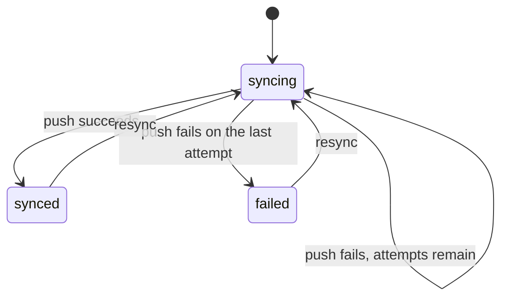

# Design: sync recipe generator

Status: implemented.

## The problem

Applications push records to systems they do not own: a CRM, a payment provider, a search index. Each push can fail for reasons that pass on their own, such as a timeout or a rate limit, so it is retried with a delay. Once the retries run out, someone has to see the failure and push again. Every team writes the same status column, the same retry loop and the same "push it again" button.

`mix ash_workflow.gen.sync` layers that lifecycle onto a subject resource. It is the last recipe in [`recipes.md`](recipes.md), and the first to generate an automatic step.

## The split between generated code and the application

The generator owns the sync lifecycle: the states, the retry policy, the `resync` transition, and the `external_id` and `last_synced_at` attributes.

The application owns three things:

- When a sync is created. The application calls `CustomerSync.create/2` with the subject, from wherever that makes sense: the subject's create action, an import, a backfill.
- What a push does. The generated `:push` action has no push logic. The application adds the change that calls the external system and writes `external_id`.
- Who may create and resync a sync. These are two `Ash.Policy.Check` modules, generated to deny everyone.

## The command

```bash
mix ash_workflow.gen.sync MyApp.Sales.Customer --max-attempts 5 --backoff 30s
```

| Option | Default | Effect |
|---|---|---|
| `--module` | `<Subject>Sync` | Name of the generated sync resource. |
| `--domain` | the subject's domain | Domain for a subject the generator creates. Required only when the subject does not exist. |
| `--max-attempts` | `5` | How many times the scheduler runs `:push` before the sync moves to `:failed`. Must be a positive integer. |
| `--backoff` | `exponential` | The delay between attempts. A duration such as `10s`, `30m`, `12h`, `2d` or `2w` is a fixed delay. `exponential` grows the delay with the attempt number. |
| `--transition-log` | `true` | Composes `ash_workflow.gen.transition_log`. `--no-transition-log` skips it. |

`--backoff` accepts seconds, which `--overdue-after` and `--notice-period` do not. A retry delay is usually seconds long, and a deadline days long. `Mix.AshWorkflow.Recipe.parse_backoff/2` parses it, and `parse_duration/2` is unchanged.

The default of five attempts with an exponential backoff waits 16, 31, 96 and 271 seconds between them, using the formula `AshWorkflow.Entities.Retry.delay_ms/2` shares with Oban. A push that fails for under seven minutes therefore recovers without anyone resyncing it.

There is no actor option, for the reason expiry has none. The transition log is generated without `--actor`.

## The sync is a sibling resource

The generator adds `MyApp.Sales.CustomerSync` next to the subject, for the reason approval and expiry do: a resource has one `workflow`, and the subject may already run one.

Sync is a lifecycle recipe. A subject has one current sync state, the one the external system last agreed with. A resync moves the existing row back through the workflow rather than creating a new row. The subject gains, by `Ash.Resource.Igniter` edits, and nothing else:

- `has_one :sync, MyApp.Sales.CustomerSync`
- `calculate :synced?, :boolean, expr(sync.state == :synced || false)`

`CustomerSync` has the identity `:unique_subject` on `subject_id`. On a data layer without unique constraints, such as ETS, it sets `pre_check_with` to the domain.

The generator adds no change, argument or policy to the subject's actions. Calling `resync` when the subject changes is an application decision.

When the subject module does not exist, the generator creates it as expiry does, taking the data layer from the first resource in `--domain` that uses `Ash.DataLayer.Ets` or `AshPostgres.DataLayer`. When no resource there uses either, `Mix.AshWorkflow.Recipe.ensure_subject/5` stops the task with an Igniter issue.

## The workflow



Generated for the command above:

```elixir
workflow do
  step :syncing do
    action :push
    on_success :synced
    on_error :failed

    retry do
      max_attempts 5
      backoff {30, :seconds}
    end
  end

  step :synced do
    transition :resync, to: :syncing
  end

  step :failed do
    transition :resync, to: :syncing
  end
end
```

The `syncing --> syncing` edge is not a transition. A failed attempt rolls back, the record stays in `:syncing`, and the scheduler runs `:push` again after the backoff. `on_error` runs only once the last attempt has failed, as [Error Handling](../topics/error-handling.md) describes.

Neither `:synced` nor `:failed` is terminal, because `resync` leaves both. `:failed` is a manual step rather than a terminal one, which is the pattern the error handling guide recommends for an error state.

### No `pending` step

The catalogue in [`recipes.md`](recipes.md) lists `pending → syncing`. The generated workflow has no `:pending` step, and a new sync enters `:syncing` directly.

A `:pending` step that moves straight to `:syncing` would be an automatic step, and an automatic step needs an action. That action would do nothing, and its only effect would be one extra scheduler pass before the push starts. On `AshWorkflow.Scheduler.Oban` that is a second job per sync. A `:pending` step the application moves on by hand would be a manual step, which makes creating the sync and starting it two calls. The application already decides when a sync starts by deciding when to create it, so a second call adds nothing.

`resync` therefore targets `:syncing` too. Entering `:syncing` again starts a fresh set of attempts, so a resynced record gets the full `max_attempts` again.

### No timeout

The workflow has no timeout, so no deadline is anchored on any datetime. The delay between attempts is the backoff, measured from the failed attempt by the scheduler, not from `state_entered_at` or any attribute. `AshWorkflow.Scheduler.Precise` arms a timer for it, and `AshWorkflow.Scheduler.Oban` hands it to Oban's own retry loop.

`last_synced_at` is not an anchor. It records when the external system last accepted a push, for the application to display or filter on.

## The resource

`CustomerSync` attributes: `subject_id`, required, and `external_id` and `last_synced_at`, both optional.

```elixir
actions do
  defaults [:read]

  create :create do
    accept [:subject_id]
  end

  update :push do
    require_atomic? false
    change set_attribute(:last_synced_at, &DateTime.utc_now/0)
  end
end

code_interface do
  define :create, args: [:subject_id]
  define :resync
end
```

`:push` declares `require_atomic? false`. The change an application adds to it calls an external system, which cannot run atomically, and on ETS the `:unique_subject` identity's `pre_check_with` needs a `before_action` hook anyway.

`:push` stamps `last_synced_at`. The stamp is only written when the action succeeds, because a failed attempt rolls the action back. `external_id` is left to the application's change, because only the external system's response knows it.

`:resync` is the transition AshWorkflow generates. It accepts nothing and runs no change, so the generator does not declare it.

## Who may create and resync

The generator writes `MyApp.Sales.CustomerSync.Checks.CanResync`, which denies everyone, mirroring expiry's `CanRenew`. The generator's notice says so.

```elixir
policies do
  policy action(:resync) do
    authorize_if MyApp.Sales.CustomerSync.Checks.CanResync
  end
end
```

`resync` is the only transition a human calls. The generator also writes `MyApp.Sales.CustomerSync.Checks.CanCreate`, denying everyone, and a policy on `:create` that authorizes with it, mirroring expiry. `AshWorkflow.Transformers.AddPolicies` allows `read`, the scheduler's `:push` and the generated `on_error` action, so a created sync can succeed or fail before the application has written `CanResync`.

## Code shared with the other recipes

`gen.sync` uses `Mix.AshWorkflow.Recipe` as it stands, and adds one function to it, `parse_backoff/2`. No existing function changes, so the approval and expiry output is unchanged.

## Open questions

1. A push that hangs keeps the sync in `:syncing` for as long as the scheduler lets the job run. A `timeout` on `:syncing`, anchored on `state_entered_at`, could move a stuck sync to `:failed`. `state_entered_at` is the right anchor there, because nothing re-enters `:syncing` while it waits. The recipe leaves it out until an application asks for it.
2. The generated `:push` does nothing, so every sync reaches `:synced` until the application fills it in. A `:push` that fails until it is filled in would land every sync in `:failed` instead, the analogue of a check that denies by default. The recipe follows the empty action, and the generator's notice says what it does.
3. A change to the subject does not resync it. A `--resync-on` option naming subject actions would need a change on the subject's actions, which the split rule forbids.
4. `:syncing` does not declare `resync`. On `AshWorkflow.Scheduler.Oban`, a failed attempt leaves a retryable job that is unique per record, so a resync from `:syncing` could not replace the job or reset its attempt count, and the old job would still push on its backoff. The recipe page shows the application recording a change during a sync and resyncing once the sync settles.
