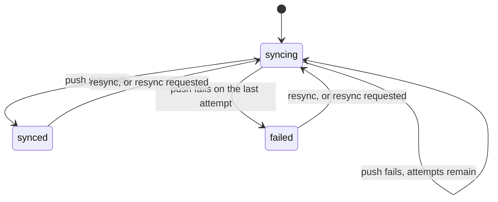

# Design: sync recipe generator

Status: implemented.

## The problem

Applications push records to systems they do not own: a CRM, a payment provider, a search index. Each push can fail for reasons that pass on their own, such as a timeout or a rate limit, so it is retried with a delay. Once the retries run out, someone has to see the failure and push again. Every team writes the same status column, the same retry loop and the same "push it again" button.

`mix ash_workflow.gen.sync` layers that lifecycle onto a subject resource. It is the last recipe in [`recipes.md`](recipes.md), and the first to generate an automatic step.

## The split between generated code and the application

The generator owns the sync lifecycle: the states, the retry policy, the `resync` transition, the `request_resync` action and its timeout, and the `external_id`, `last_synced_at` and `resync_requested_at` attributes. It also starts each new subject's sync, through a `StartSync` change on the subject's create actions, and requests a resync on each subject update, through a `RequestSync` change on the subject's update actions.

The application owns three things:

- Syncs for subjects that existed before the generator ran. The recipe page shows a backfill.
- What a push does. The generated `:push` action has no push logic. The application adds the change that calls the external system and writes `external_id`.
- Who may create a sync directly and who may resync one by hand. These are two `Ash.Policy.Check` modules, generated to deny everyone.

## The command

```bash
mix ash_workflow.gen.sync MyApp.Sales.Customer --max-attempts 5 --backoff 30s
```

| Option | Default | Effect |
|---|---|---|
| `--module` | `<Subject>Sync` | Name of the generated sync resource. |
| `--domain` | the subject's domain | Domain for a subject the generator creates. Required only when the subject does not exist. |
| `--max-attempts` | `5` | How many times the scheduler runs `:push` before the sync moves to `:failed`. Must be a positive integer. |
| `--backoff` | `exponential` | The delay between attempts. A duration such as `10s`, `30m`, `12h`, `2d` or `2w` is a fixed delay. `exponential` grows the delay with the attempt number. |
| `--fields` | every update | Subject fields whose change requests a resync. Each must be an attribute or relationship of the subject, checked when the subject compiles. |
| `--transition-log` | `true` | Composes `ash_workflow.gen.transition_log`. `--no-transition-log` skips it. |

`--backoff` accepts seconds, which `--overdue-after` and `--notice-period` do not. A retry delay is usually seconds long, and a deadline days long. `Mix.AshWorkflow.Recipe.parse_backoff/2` parses it, and `parse_duration/2` is unchanged.

The default of five attempts with an exponential backoff waits 16, 31, 96 and 271 seconds between them, using the formula `AshWorkflow.Entities.Retry.delay_ms/2` shares with Oban. A push that fails for under seven minutes therefore recovers without anyone resyncing it.

There is no actor option, for the reason expiry has none. The transition log is generated without `--actor`.

## The sync is a sibling resource

The generator adds `MyApp.Sales.CustomerSync` next to the subject, for the reason approval and expiry do: a resource has one `workflow`, and the subject may already run one.

Sync is a lifecycle recipe. A subject has one current sync state, the one the external system last agreed with. A resync moves the existing row back through the workflow rather than creating a new row. The subject gains, by `Ash.Resource.Igniter` edits, and nothing else:

- `has_one :sync, MyApp.Sales.CustomerSync`
- `calculate :synced?, :boolean, expr(sync.state == :synced || false)`
- `change MyApp.Sales.CustomerSync.Changes.StartSync, on: [:create]` in its `changes` block
- `change MyApp.Sales.CustomerSync.Changes.RequestSync, on: [:update]` in its `changes` block, with a `where:` condition under `--fields`

`CustomerSync` has the identity `:unique_subject` on `subject_id`. On a data layer without unique constraints, such as ETS, it sets `pre_check_with` to the domain.

The generator adds no argument or policy to the subject's actions. `Mix.AshWorkflow.Recipe.add_subject_change/4` adds both changes, so a rerun adds nothing and a differing `change` for the same module is left with a warning.

## Starting and requesting syncs

A sync needs no input to start, and a subject without one is never synced. Leaving the create to the application left every subject unsynced until the application remembered to call `CustomerSync.create`.

In an `after_action` hook, `StartSync` calls `CustomerSync.create/2` with the subject's id. An error from that create fails the subject create.

- It passes `authorize?: false`, with the actor and tenant of the subject create. The sync follows from a create the subject already authorized, and `CanCreate` denies everyone as generated.
- It skips a create that upserted onto an existing subject, read from the record's `upsert_action: :update` or `upsert_skipped: true` metadata.
- It skips a subject that already has a sync, found by a read with `authorize?: false`.

In an `after_action` hook, `RequestSync` calls `CustomerSync.request_resync/2` with `authorize?: false`, or `CustomerSync.create/2` for a subject with no sync. It defines `atomic/3`, as expiry's `SetExpiry` does, so an atomic update runs it.

`request_resync` is an update action, not a transition. It stamps `resync_requested_at` and leaves the state alone, so it can run in any state, `:syncing` included. Its policy is `authorize_if always()`, because `AshWorkflow` authorizes only reads, creates and workflow actions. It declares `require_atomic? false`, because on ETS the identity's `pre_check_with` adds a `before_action` hook to every update.

`--fields title,body` adds `where: [any([changing(:title, touching?: true), changing(:body, touching?: true)])]` to the `RequestSync` change, and one field adds `where: [changing(:title, touching?: true)]`. A plain `changing/1` on an atomic update compares values inside the database. Ash then cannot decide before the update whether to add the `after_action` hook, and refuses the update. `touching?: true` decides from the changeset alone, at the cost of a request when an update writes a field's current value.

When the subject module does not exist, the generator creates it as expiry does, taking the data layer from the first resource in `--domain` that uses `Ash.DataLayer.Ets` or `AshPostgres.DataLayer`. When no resource there uses either, `Mix.AshWorkflow.Recipe.ensure_subject/5` stops the task with an Igniter issue.

## The workflow



Generated for the command above:

```elixir
workflow do
  step :syncing do
    action :push
    on_success :synced
    on_error :failed

    retry do
      max_attempts 5
      backoff {30, :seconds}
    end
  end

  step :synced do
    transition :resync, to: :syncing

    timeout :resync_requested do
      fire_at :resync_requested_at
      transition_to :syncing
    end
  end

  step :failed do
    transition :resync, to: :syncing

    timeout :resync_requested do
      fire_at :resync_requested_at
      transition_to :syncing
    end
  end
end
```

The `syncing --> syncing` edge is not a transition. A failed attempt rolls back, the record stays in `:syncing`, and the scheduler runs `:push` again after the backoff. `on_error` runs only once the last attempt has failed, as [Error Handling](../topics/error-handling.md) describes.

Neither `:synced` nor `:failed` is terminal, because `resync` leaves both. `:failed` is a manual step rather than a terminal one, which is the pattern the error handling guide recommends for an error state.

### No `pending` step

The catalogue in [`recipes.md`](recipes.md) lists `pending → syncing`. The generated workflow has no `:pending` step, and a new sync enters `:syncing` directly.

A `:pending` step that moves straight to `:syncing` would be an automatic step, and an automatic step needs an action. That action would do nothing, and its only effect would be one extra scheduler pass before the push starts. On `AshWorkflow.Scheduler.Oban` that is a second job per sync. A `:pending` step the application moves on by hand would be a manual step, which makes creating the sync and starting it two calls. `StartSync` creates the sync when the subject is created, which is when it should start, so a second call adds nothing.

`resync` therefore targets `:syncing` too. Entering `:syncing` again starts a fresh set of attempts, so a resynced record gets the full `max_attempts` again.

### The backoff is not a timeout

The delay between attempts is the backoff, measured from the failed attempt by the scheduler, not from `state_entered_at` or any attribute. `AshWorkflow.Scheduler.Precise` arms a timer for it, and `AshWorkflow.Scheduler.Oban` hands it to Oban's own retry loop.

`last_synced_at` is not an anchor. It records when the external system last accepted a push, for the application to display or filter on.

### Resync requests

The `:resync_requested` timeout on `:synced` and `:failed` reads `fire_at :resync_requested_at`. A `nil` stamp never fires: `AshWorkflow.Scheduler.due_at/2` returns `nil` for it, and the Oban trigger's `resync_requested_at <= now()` filter excludes it. A stamp in the past fires at the scheduler's next pass.

Entering `:syncing` clears the stamp, rather than `:push` clearing it. A request stamped while a push runs therefore survives the push, and the timeout fires once the push moves the sync to `:synced` or `:failed`. Several requests during one push cause one resync.

The clearing is done in two places:

- A global change, `change set_attribute(:resync_requested_at, nil), on: [:update], where: [changing(:state, to: :syncing)]`, covers the two hidden timeout actions. Their `transition_state` change sets the state while the action's changes run, so the condition sees it.
- `:resync` is declared on the resource with `change set_attribute(:resync_requested_at, nil)`, and `AshWorkflow` appends its transition to it. `resync` leaves two steps, so its transition is a `ConditionalTransition`, which sets the state in a `before_action` hook. The global change's condition is checked before that hook runs, so it does not see `resync` entering `:syncing`.

`request_resync` changes no state, so it does not call `AshWorkflow.Scheduler.notify_state_change/1`. `AshWorkflow.Scheduler.Precise` arms the timeout at its next sweep, and `AshWorkflow.Scheduler.Oban` at its next poll.

## The resource

`CustomerSync` attributes: `subject_id`, required, and `external_id`, `last_synced_at` and `resync_requested_at`, all optional.

```elixir
actions do
  defaults [:read]

  create :create do
    accept [:subject_id]
  end

  update :push do
    require_atomic? false
    change set_attribute(:last_synced_at, &DateTime.utc_now/0)
  end

  update :request_resync do
    require_atomic? false
    change set_attribute(:resync_requested_at, &DateTime.utc_now/0)
  end

  update :resync do
    accept []
    change set_attribute(:resync_requested_at, nil)
  end
end

changes do
  change set_attribute(:resync_requested_at, nil),
    on: [:update],
    where: [changing(:state, to: :syncing)]
end

code_interface do
  define :create, args: [:subject_id]
  define :resync
  define :request_resync
end
```

`:push` declares `require_atomic? false`. The change an application adds to it calls an external system, which cannot run atomically, and on ETS the `:unique_subject` identity's `pre_check_with` needs a `before_action` hook anyway.

`:push` stamps `last_synced_at`. The stamp is only written when the action succeeds, because a failed attempt rolls the action back. `external_id` is left to the application's change, because only the external system's response knows it.

`:resync` is the transition AshWorkflow generates. The generator declares it only to clear `resync_requested_at`, as [Resync requests](#resync-requests) explains, and `AshWorkflow` appends the transition's changes to it.

## Who may create and resync

The generator writes `MyApp.Sales.CustomerSync.Checks.CanResync`, which denies everyone, mirroring expiry's `CanRenew`. The generator's notice says so.

```elixir
policies do
  policy action(:resync) do
    authorize_if MyApp.Sales.CustomerSync.Checks.CanResync
  end

  policy action(:request_resync) do
    authorize_if always()
  end
end
```

`resync` is the only transition a human calls. The generator also writes `MyApp.Sales.CustomerSync.Checks.CanCreate`, denying everyone, and a policy on `:create` that authorizes with it, mirroring expiry. `CanCreate` gates only a direct call to `CustomerSync.create`, since `StartSync` and `RequestSync` create the sync with `authorize?: false`. A subject create therefore succeeds while `CanCreate` still denies everyone. `AshWorkflow.Transformers.AddPolicies` allows `read`, the scheduler's `:push`, the generated `on_error` action and the timeout transitions, so a created sync can succeed, fail and resync on request before the application has written `CanResync`.

## Code shared with the other recipes

`gen.sync` uses `Mix.AshWorkflow.Recipe` as it stands, including `add_subject_change/4`, and adds one function to it, `parse_backoff/2`. No existing function changes, so the approval and expiry output is unchanged.

## Open questions

1. A push that hangs keeps the sync in `:syncing` for as long as the scheduler lets the job run. A `timeout` on `:syncing`, anchored on `state_entered_at`, could move a stuck sync to `:failed`. `state_entered_at` is the right anchor there, because nothing re-enters `:syncing` while it waits. The recipe leaves it out until an application asks for it.
2. The generated `:push` does nothing, so every sync reaches `:synced` until the application fills it in. A `:push` that fails until it is filled in would land every sync in `:failed` instead, the analogue of a check that denies by default. The recipe follows the empty action, and the generator's notice says what it does.
3. `:syncing` does not declare `resync`. On `AshWorkflow.Scheduler.Oban`, a failed attempt leaves a retryable job that is unique per record, so a resync from `:syncing` could not replace the job or reset its attempt count, and the old job would still push on its backoff. `request_resync` stamps the sync instead, and the `:resync_requested` timeout resyncs it once it settles.
