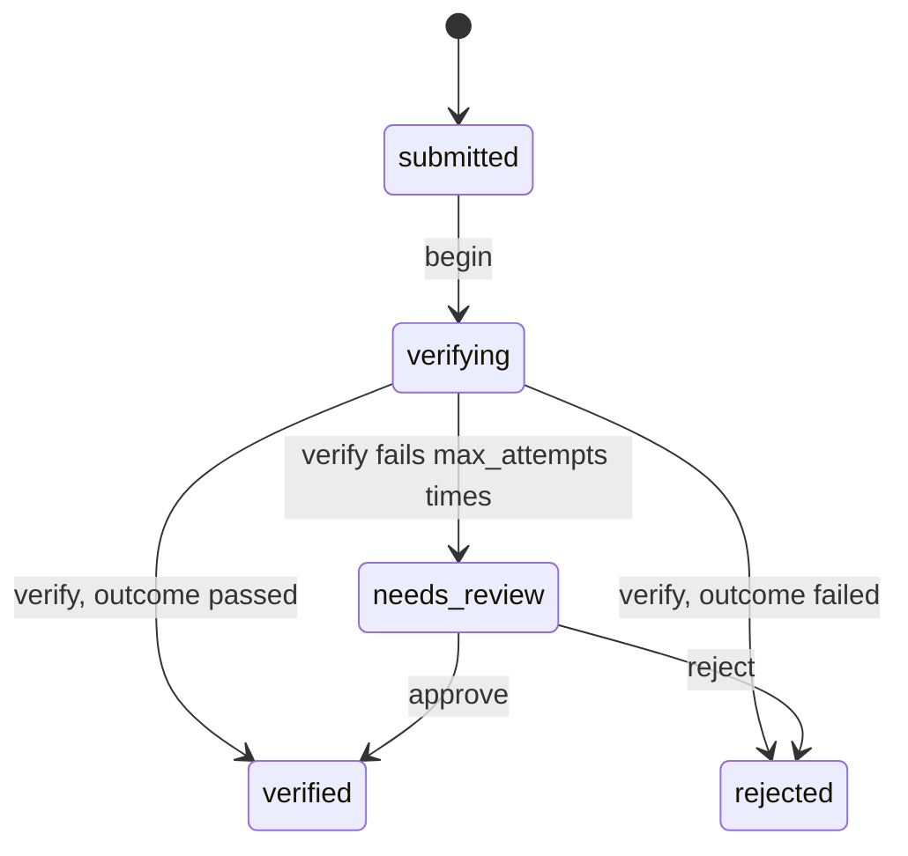

# Design: verification recipe generator

Status: implemented.

## The problem

Identity documents, business registrations and bank accounts are checked against an outside provider before an application trusts them. Each application writes the same thing: a record of the check, a background job that calls the provider, a pass or fail read off the response, retries for a provider that is down, and a queue of checks a person must decide by hand once the retries run out.

`mix ash_workflow.gen.verification` layers that workflow onto a subject resource. It is the request recipe in [`recipes.md`](recipes.md) that exercises an automatic step with `on_success` routes, `retry` and `on_error`.

## The split between generated code and the application

The generator owns the verification lifecycle: the states, the routes out of `:verifying` on the provider's outcome, the retry policy, and the fallback into `:needs_review`.

The application owns four things:

- When a verification is submitted. The application calls `IdentityDocumentVerification.submit/1` with the subject from wherever that makes sense: the subject's create action, an upload handler, a resubmission after a rejection.
- When verification starts. The application calls `begin/1` once the verification has what the provider needs, such as an uploaded file.
- What the provider call is. The generated `:verify` action is empty. The application adds the change that calls the provider and writes `outcome`.
- Who may decide a verification in `:needs_review`. This is one `Ash.Policy.Check` module, generated to deny everyone.

## The command

```bash
mix ash_workflow.gen.verification MyApp.Accounts.IdentityDocument --max-attempts 5
```

| Option | Default | Effect |
|---|---|---|
| `--module` | `<Subject>Verification` | Name of the generated verification resource. |
| `--domain` | the subject's domain | Domain for a subject the generator creates. Required only when the subject does not exist. |
| `--max-attempts` | `3` | Attempts `:verify` gets before the verification moves to `:needs_review`. `1` generates no `retry` block. |
| `--transition-log` | `true` | Composes `ash_workflow.gen.transition_log`. `--no-transition-log` skips it. |

`--max-attempts` must be at least `1`. There is no backoff option. The generated `retry` block keeps the library's `:exponential` default, which an application changes by editing one line.

There is no actor option, for the reason expiry has none. Nothing in the generated code records who submitted or who reviewed. An application that wants the reviewer recorded passes `--no-transition-log` and runs `ash_workflow.gen.transition_log` itself with `--actor`.

## The verification is a sibling resource

The generator adds `MyApp.Accounts.IdentityDocumentVerification` next to the subject, for the reason approval does: a resource has one `workflow`, and the subject may already run one.

Verification is a request recipe. A rejected document that is uploaded again gets a new verification row, and the old row keeps the rejection. The subject gains, by `Ash.Resource.Igniter` edits, and nothing else:

- `has_many :verifications, MyApp.Accounts.IdentityDocumentVerification`
- `has_one :latest_verification`, sorted by `inserted_at` descending
- `calculate :verified?, :boolean, expr(latest_verification.state == :verified)`

The calculation has no `public?: true`, for the reason approval's `approved?` has none.

The generator adds no change, argument or policy to the subject's actions. Gating a subject action on `verified?` is an application decision.

When the subject module does not exist, the generator creates it with `ash.gen.resource` as expiry does. Verification has no actor resource, so it takes the data layer from the first resource in `--domain` that uses `Ash.DataLayer.Ets` or `AshPostgres.DataLayer`. When no resource in the domain uses either, `Mix.AshWorkflow.Recipe.ensure_subject/5` stops the task with an Igniter issue and nothing is written.

## The workflow



Generated for the command above:

```elixir
workflow do
  step :submitted do
    transition :begin, to: :verifying
  end

  step :verifying do
    action :verify
    on_success :verified, when: expr(outcome == :passed)
    on_success :rejected, when: expr(outcome == :failed)
    on_error :needs_review

    retry do
      max_attempts 5
    end
  end

  step :needs_review do
    transition :approve, to: :verified
    transition :reject, to: :rejected
  end

  step :verified, terminal: true
  step :rejected, terminal: true
end
```

### `:submitted` waits for `begin`

`:submitted` is a manual step, not an automatic one. A verification is often created before the provider has what it needs: the row exists so that an upload can be attached to it. `begin` is the application's signal that the evidence is complete. A verification created and started in one go calls `submit/1` and then `begin/1`.

The `:submit` create action has no generated policy. Who may create a verification is the application's decision, and it adds a policy if it needs one. `begin` has no generated policy either. `AshWorkflow.Transformers.AddPolicies` allows it, so the person who submitted can begin it. Beginning spends one provider call, and denying it by default would stop the happy path of every verification until the application wrote a check.

### `:verifying` routes on `outcome`

`:verify` writes `outcome`, an atom constrained to `:passed` or `:failed`. The two `on_success` entries read it after the action has run, as `AshWorkflow.Changes.ConditionalOnSuccess` documents.

A rejection by the provider is an outcome, not an error, so it goes through `on_success` to `:rejected` rather than through `on_error`. [`error-handling.md`](../topics/error-handling.md) draws the same line.

The `on_success` entries are not exhaustive. `AshWorkflow.Verifiers.ValidateWorkflow` accepts the step because it declares `on_error`. A `:verify` that succeeds without writing `outcome` matches neither entry and fails with `AshWorkflow.Errors.NoMatchingRoute`, which runs down `on_error` like any other failure. The generated `:verify` is empty, so a verification started before the application fills it in lands in `:needs_review`. That is the deny-by-default for the automatic half: an unfinished recipe never verifies anything on its own.

### Retries and `:needs_review`

`on_error :needs_review` runs only after the last of `max_attempts` attempts has failed. A provider that times out twice and answers on the third attempt routes on its answer. One that fails every attempt hands the verification to a person.

`retry` repeats a no-match as well as a provider failure. A `:verify` that never writes `outcome` calls the provider `max_attempts` times before `:needs_review`. The recipe page states this.

`:needs_review` is a manual step. `approve` moves it to `:verified` and `reject` to `:rejected`. Neither writes `outcome`, so `outcome` keeps what the provider said, or `nil` when it said nothing. `state` is the verdict and `outcome` is the provider's answer.

There is no transition from `:needs_review` back to `:verifying`. Retrying the provider by hand is a variation an application can add with one `transition :retry, to: :verifying` line.

### No timeouts

The workflow has no timeout, so no datetime anchors a deadline. `:verifying` is bounded by `retry`, not by the clock. `:needs_review` waits for a person indefinitely.

An application that wants an overdue flag on `:needs_review` adds a timeout there. `state_entered_at` is a sound anchor for it: no transition re-enters `:needs_review`, so the clock cannot restart, unlike approval's partial approval.

## The resource

`IdentityDocumentVerification` attributes: `subject_id`, required, and `outcome`, nullable.

```elixir
actions do
  defaults [:read]

  create :submit do
    accept [:subject_id]
  end

  update :verify do
    require_atomic? false
    accept []
  end
end

code_interface do
  define :submit, args: [:subject_id]
  define :begin
  define :approve
  define :reject
end
```

`:verify` is non-atomic because the change an application adds calls a provider, which an atomic update cannot do.

`:verify` is an ordinary update action, and `AddPolicies` allows it for any caller, as it does every automatic step's action. The application can restrict it with a policy of its own. The generator adds none, because the Precise scheduler runs it with no actor and no AshOban context for a policy to match.

## Who may decide a review

The generator writes `MyApp.Accounts.IdentityDocumentVerification.Checks.CanReview`, which denies everyone, mirroring approval's `CanApprove`. The generator's notice says so.

```elixir
policies do
  policy action([:approve, :reject]) do
    authorize_if MyApp.Accounts.IdentityDocumentVerification.Checks.CanReview
  end
end
```

## Code shared with the other recipes

The generator uses `ensure_subject/5`, `add_subject_edits/4`, `compose_transition_log/3` and the rendering helpers from `Mix.AshWorkflow.Recipe`.

It passes no `sources` to `ensure_subject/5`, as expiry does. `Mix.AshWorkflow.Recipe` is unchanged by this PR.

## Open questions

1. Should `submit` start verification itself? Making `:submitted` automatic would drop the `begin` call, but it would run a no-op job per verification and leave no point at which evidence can be attached before the provider sees it.
2. Should `approve` and `reject` take a `comment`, as approval's decisions do? A reviewer's reason is useful, but storing it means an attribute the provider never writes. The recipe leaves it to the application.
3. Should a generated policy restrict `:verify` to the scheduler? `AshOban.Checks.AshObanInteraction` covers the Oban scheduler only, so a policy built on it would forbid the Precise scheduler.
