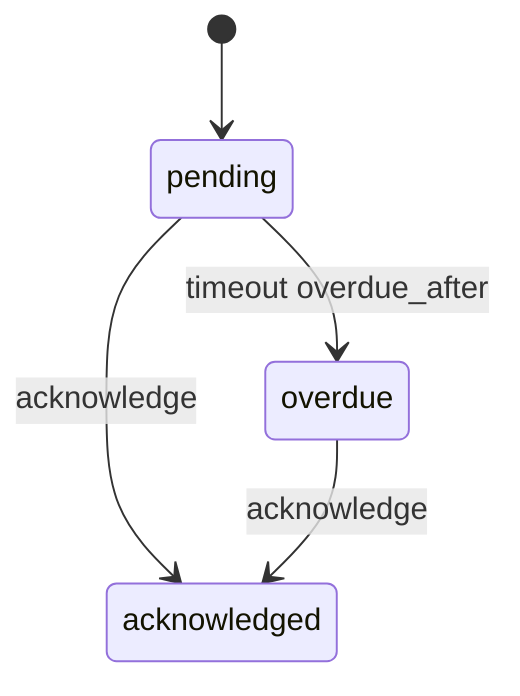

# Acknowledgement

`mix ash_workflow.gen.acknowledgement` adds an acknowledgement workflow to a resource. Your application opens one request per person who must acknowledge a record, such as a policy or a terms update. Each person acknowledges their own request, and a request nobody has acknowledged moves to `:overdue` once its deadline passes.

## The command

```bash
mix ash_workflow.gen.acknowledgement MyApp.Policies.Policy \
  --person MyApp.Accounts.User \
  --overdue-after 14d
```

| Option | Default | Effect |
|---|---|---|
| `--person` | required | The actor resource. Each acknowledgement belongs to one person. |
| `--module` | `<Subject>Acknowledgement` | Name of the generated acknowledgement resource. |
| `--domain` | the subject's domain | Domain for a subject the task creates. Required only when the subject does not exist. |
| `--overdue-after` | none | Moves an unacknowledged request to `:overdue` this long after `requested_at`. Accepts `30m`, `12h`, `2d` and `2w`. A duration under a minute needs `AshWorkflow.Scheduler.Precise`. Without it, no `:overdue` step is generated. |
| `--transition-log` | `true` | Also runs `mix ash_workflow.gen.transition_log` for the acknowledgement resource, recording the person who made each transition. Pass `--no-transition-log` to skip it. |

When the subject does not exist, the task creates it with `mix ash.gen.resource`, using the data layer of the `--person` resource, or else the data layer of the first ETS or Postgres resource in `--domain`. When neither the person resource nor any resource there uses ETS or Postgres, the task stops with an issue and writes nothing. Create the subject resource first, or pass a `--domain` that has one. Running the task again on the same subject changes nothing.

## What it generates

For the command above, the task writes two modules and edits the subject:

- `MyApp.Policies.PolicyAcknowledgement` runs the workflow. It belongs to the policy and to a person, and holds `requested_at` and `acknowledged_at`. An identity on `(subject_id, person_id)` allows one request per person per policy.
- `MyApp.Policies.PolicyAcknowledgement.Checks.CanRequest` decides who may open a request. It denies everyone as generated.
- `MyApp.Policies.Policy` gains `has_many :acknowledgements` and an `acknowledged_by_actor?` calculation. The task adds no change, argument or policy to the subject's actions.

The acknowledgement is a separate resource rather than a `workflow` block on the subject, so a subject that already runs a workflow keeps it.

## The workflow



```elixir
workflow do
  step :pending do
    transition :acknowledge, to: :acknowledged

    timeout :overdue, fire_after: {14, :days}, field: :requested_at, transition_to: :overdue
  end

  step :overdue do
    transition :acknowledge, to: :acknowledged
  end

  step :acknowledged, terminal: true
end
```

Without `--overdue-after`, there is no `:overdue` step and no timeout.

A person in `:overdue` can still acknowledge. The overdue deadline reads `requested_at`, which `:request` writes once. A transition you add that loops back into `:pending`, such as a reminder, does not move the deadline.

## The policies

```elixir
policies do
  policy action(:request) do
    authorize_if MyApp.Policies.PolicyAcknowledgement.Checks.CanRequest
  end

  policy action(:acknowledge) do
    authorize_if relates_to_actor_via(:person)
  end
end
```

Only the person a request was opened for may acknowledge it. Nobody can acknowledge on someone else's behalf, and an acknowledgement without an actor is forbidden.

`CanRequest` gates `:request`, so it also gates `request_many/3`, which runs the same action in bulk. Nobody can open a request until you change it.

## What your application does next

### Decide who may open a request

`CanRequest` denies everyone, so no request can be opened until you change it. Replace its `match?/3`, or replace the `authorize_if` line in the `:request` policy with a built-in check:

```elixir
policies do
  policy action(:request) do
    authorize_if actor_attribute_equals(:role, :compliance_officer)
  end
end
```

Code that opens requests on the application's behalf, such as an onboarding job, can pass `authorize?: false` instead.

Reads stay open by default. `AshWorkflow` authorizes `:read` on the acknowledgement resource for every actor. Add a read policy if acknowledgements are private.

### Open requests

Call `request/3` for one person, or `request_many/3` for a list of people, wherever acknowledgement should start, such as a publish action or an onboarding step:

```elixir
MyApp.Policies.PolicyAcknowledgement.request(policy.id, user.id, actor: current_user)

MyApp.Policies.PolicyAcknowledgement.request_many(
  policy.id,
  Enum.map(staff, &%{person_id: &1.id}),
  actor: current_user
)
```

`request_many/3` runs `Ash.bulk_create/4`. Pass `bulk_options: [return_records?: true]` to get the rows back.

`:request` is an upsert on the `(subject_id, person_id)` identity. Asking a person who already has a request returns that request unchanged, with its state and dates as they were. Call `request_many/3` with everyone who must acknowledge each time the list grows, and only the new people get new requests.

A person acknowledges a record once. To ask everyone again after a change, open requests against a new subject record, such as a new version of the policy.

### Acknowledge

```elixir
MyApp.Policies.PolicyAcknowledgement.acknowledge(acknowledgement, actor: current_user)
```

### React to overdue

The task generates no reminder. Add a timeout with an `action` or an `every` to the `:overdue` step to chase the person, or use an Ash notifier on the acknowledgement resource.

### Use the outcome

`acknowledged_by_actor?` on the subject is true when the actor loading it has acknowledged it. Load it with the current user to decide whether to show a banner:

```elixir
Ash.load!(policy, :acknowledged_by_actor?, actor: current_user)
```

To list who has not acknowledged, read the acknowledgement rows:

```elixir
MyApp.Policies.PolicyAcknowledgement
|> Ash.Query.filter(subject_id == ^policy.id and state != :acknowledged)
|> Ash.read!()
```

### Generate the migrations

On AshPostgres, run `mix ash.codegen add_policy_acknowledgement` to create the acknowledgement and transition log tables.

## Limits

There is no transition to withdraw a request. A person who leaves before acknowledging keeps a `:pending` or `:overdue` request. Add a transition to a terminal step if you need one.

`acknowledged_by_actor?` returns `false` when it is loaded without an actor.
