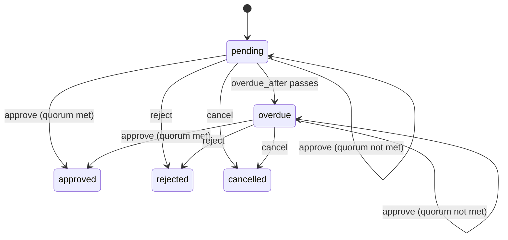

# Approval

`mix ash_workflow.gen.approval` adds an approval workflow to a resource. A request is opened against a record, one or more approvers approve or reject it, and the request can be marked overdue when nobody decides in time.

## The command

```bash
mix ash_workflow.gen.approval MyApp.Expenses.Expense \
  --approver MyApp.Accounts.User \
  --required-approvals 1 \
  --overdue-after 2d
```

| Option | Default | Effect |
|---|---|---|
| `--approver` | required | The actor resource. Decisions and the requester belong to it. |
| `--module` | `<Subject>Approval` | Name of the generated approval resource. |
| `--domain` | the subject's domain | Domain for a subject the task creates. Required only when the subject does not exist. |
| `--required-approvals` | `1` | Default number of approvals a request needs. Each request stores its own count, so a caller can override it. |
| `--overdue-after` | none | Moves a waiting request to `:overdue` after this long. Accepts `30m`, `12h`, `2d` and `2w`. Without it, no `:overdue` step is generated. |
| `--transition-log` | `true` | Also runs `mix ash_workflow.gen.transition_log` for the approval resource, recording the approver as the actor. Pass `--no-transition-log` to skip it. |

When the subject does not exist, the task creates it with `mix ash.gen.resource`, using the approver's data layer. Running the task again on the same subject changes nothing.

## What it generates

For the command above, the task writes four modules and edits the subject:

- `MyApp.Expenses.ExpenseApproval` runs the workflow. It belongs to the expense and to the user who requested it.
- `MyApp.Expenses.ExpenseApprovalDecision` holds one row for each approval or rejection. An identity stops an approver deciding the same request twice.
- `MyApp.Expenses.ExpenseApproval.Changes.RecordDecision` writes the decision row when `:approve` or `:reject` runs.
- `MyApp.Expenses.ExpenseApproval.Checks.CanApprove` decides who may approve. It denies everyone as generated.
- `MyApp.Expenses.Expense` gains `has_many :approvals`, `has_one :latest_approval` and an `approved?` calculation. The task adds no change, argument or policy to the subject's actions.

The approval is a separate resource rather than a `workflow` block on the subject. A subject that already runs a workflow keeps it, and a rejected expense that is submitted again gets a new approval row. The old row keeps the rejection and who made it.

## The workflow



```elixir
workflow do
  step :pending do
    transition :approve do
      route :approved, when: expr(approvals_remaining <= 1)
      route :pending, when: expr(approvals_remaining > 1)
    end

    transition :reject, to: :rejected
    transition :cancel, to: :cancelled

    timeout :overdue, fire_after: {2, :days}, field: :requested_at, transition_to: :overdue
  end

  step :overdue do
    transition :approve do
      route :approved, when: expr(approvals_remaining <= 1)
      route :overdue, when: expr(approvals_remaining > 1)
    end

    transition :reject, to: :rejected
    transition :cancel, to: :cancelled
  end

  step :approved, terminal: true
  step :rejected, terminal: true
  step :cancelled, terminal: true
end
```

`approvals_remaining` is `required_approvals` minus the number of approving decisions. Routes read it before the current call's decision is written, so `<= 1` means this call is the last approval needed. One rejection rejects the request.

The overdue deadline is measured from `requested_at`, which the `:request` action sets once. A partial approval loops the request back into its step and moves `state_entered_at`, so a deadline measured from `state_entered_at` would restart with every approval.

`:overdue` is a step, not a flag. An overdue request can still be approved, rejected or cancelled, and a query can filter on `state == :overdue`. Add a `timeout` or `every` to the `:overdue` step for reminders or escalation.

## The policies

```elixir
policies do
  policy action([:approve, :reject]) do
    forbid_if expr(requested_by_id == ^actor(:id))
    forbid_if expr(exists(decisions, approver_id == ^actor(:id)))
    authorize_if MyApp.Expenses.ExpenseApproval.Checks.CanApprove
  end

  policy action(:cancel) do
    authorize_if relates_to_actor_via(:requested_by)
  end
end
```

The requester cannot decide their own request, and an approver cannot decide twice. Only the requester can cancel. The generated `:available_actions` calculation applies these policies, so loading it with an actor tells a UI whether that user can approve.

## What your application does next

### Decide who may approve

`CanApprove` denies everyone, so nothing can be approved until you change it. Replace its `match?/3`, or replace the `authorize_if` line in the approval's policy with a built-in check:

```elixir
# The expense owner's manager approves
authorize_if relates_to_actor_via([:subject, :owner, :manager])

# Any finance manager approves
authorize_if actor_attribute_equals(:role, :finance_manager)
```

### Open a request

Call `request/2` wherever a request should start, such as a submit action or a LiveView event. The actor becomes the requester:

```elixir
MyApp.Expenses.ExpenseApproval.request(expense.id, actor: current_user)
MyApp.Expenses.ExpenseApproval.request(expense.id, %{required_approvals: 3}, actor: current_user)
```

### Approve, reject or cancel

```elixir
MyApp.Expenses.ExpenseApproval.approve(approval, %{comment: "Within budget"}, actor: approver)
MyApp.Expenses.ExpenseApproval.reject(approval, %{comment: "Missing receipt"}, actor: approver)
MyApp.Expenses.ExpenseApproval.cancel(approval, actor: current_user)
```

### Use the outcome

`approved?` on the subject is true when its latest approval is approved. Gating a subject action on it is up to you, for example with a policy on the subject:

```elixir
policy action(:reimburse) do
  authorize_if expr(approved?)
end
```

### Generate the migrations

On AshPostgres, run `mix ash.codegen add_expense_approval` to create the approval, decision and transition log tables.

## Limits

Each approval reads the approval count when the call arrives. Two approvals that arrive at the same moment can both read the count before either decision row is written, and both loop back to the current step. The request then holds enough approvals but is still waiting. Serialise approvals of one request if your approvers are likely to decide together.
