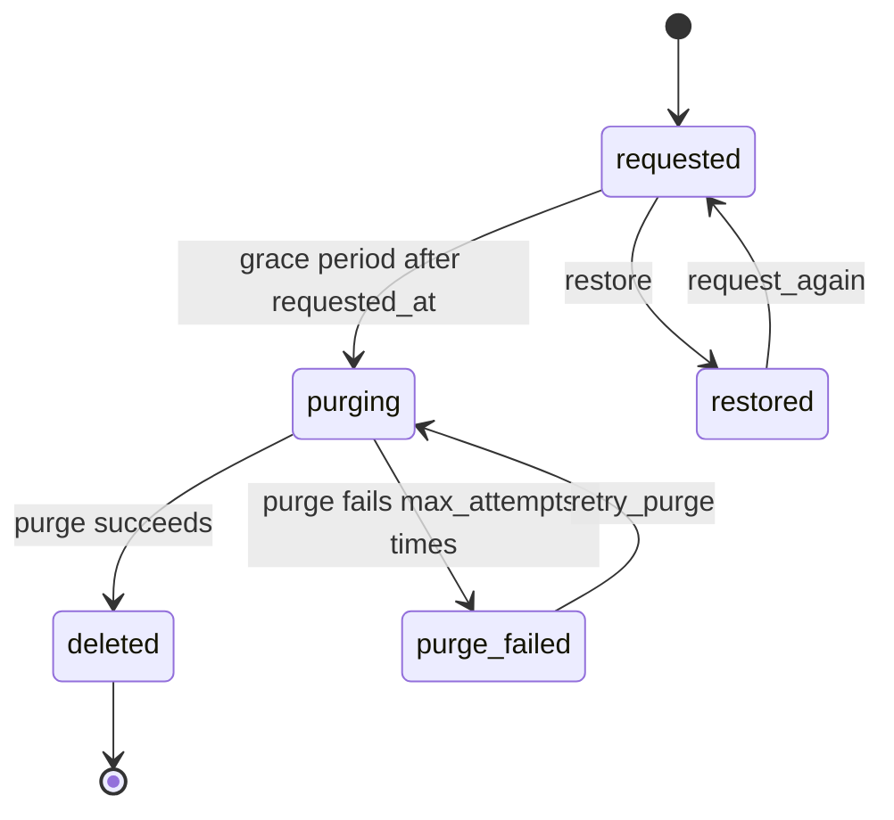

# Deletion

`mix ash_workflow.gen.deletion` adds a deletion workflow to a resource. A deletion is requested, waits a grace period during which it can be restored, then runs a purge action your application fills in. A purge that keeps failing moves to `:purge_failed` for an operator to retry.

## The command

```bash
mix ash_workflow.gen.deletion MyApp.Accounts.Account --grace-period 30d
```

| Option | Default | Effect |
|---|---|---|
| `--grace-period` | required | How long a request waits in `:requested` before the purge runs. Accepts `30m`, `12h`, `2d` and `2w`. A grace period in seconds, such as `10s`, needs a scheduler that fires more often than once a minute, such as `AshWorkflow.Scheduler.Precise`. |
| `--max-attempts` | `3` | How many times the purge runs before the deletion moves to `:purge_failed`. Must be at least `1`. |
| `--module` | `<Subject>Deletion` | Name of the generated deletion resource. |
| `--domain` | the subject's domain | Domain for a subject the task creates. Required only when the subject does not exist. |
| `--transition-log` | `true` | Also runs `mix ash_workflow.gen.transition_log` for the deletion resource. Pass `--no-transition-log` to skip it. |

When the subject does not exist, the task creates it with `mix ash.gen.resource`, using the data layer of the first ETS or Postgres resource in `--domain`. When no resource there uses ETS or Postgres, the task stops with an issue and writes nothing. Create the subject resource first, or pass a `--domain` that has one. Running the task again on the same subject changes nothing.

## What it generates

For the command above, the task writes three modules and edits the subject:

- `MyApp.Accounts.AccountDeletion` runs the workflow. It belongs to the account and holds `requested_at`. An identity on `subject_id` allows one deletion per account.
- `MyApp.Accounts.AccountDeletion.Checks.CanRequestDeletion` decides who may request a deletion again and who may retry a failed purge. It denies everyone as generated.
- `MyApp.Accounts.AccountDeletion.Checks.CanRestore` decides who may restore a deletion. It denies everyone as generated.
- `MyApp.Accounts.Account` gains `has_one :deletion` and a `pending_deletion?` calculation. The task adds no change, argument or policy to the subject's actions.

The task deletes nothing itself. The generated `:purge` action is empty until you fill it in.

## The workflow



```elixir
workflow do
  step :requested do
    transition :restore, to: :restored

    timeout :purging, fire_after: {30, :days}, field: :requested_at, transition_to: :purging
  end

  step :purging do
    action :purge
    on_success :deleted
    on_error :purge_failed

    retry do
      max_attempts 3
    end
  end

  step :purge_failed do
    transition :retry_purge, to: :purging
  end

  step :restored do
    transition :request_again, to: :requested
  end

  step :deleted, terminal: true
end
```

The grace period runs from `requested_at`, which `request` and `request_again` both set to the current time. It does not read `state_entered_at`, so a transition you add that loops back into `:requested` does not restart it.

`:restored` is not terminal. The identity allows one deletion per account, so `request_again` is how a restored account is deleted later. It starts a new grace period.

`restore` is a plain transition rather than `undo`. `:requested` is the first state, so undo has nothing to rewind to, and a restore usually has work of its own to do, such as re-enabling a login.

## What your application does next

### Request the deletion

Call `request/2` wherever a deletion starts, such as a settings page or a support tool:

```elixir
MyApp.Accounts.AccountDeletion.request(account.id, actor: current_user)
```

The `:request` create action has no policy, so anyone who can call it can request a deletion. Add a policy on `:request` if your application needs one. A second request for the same account fails on the `:unique_subject` identity.

### Fill in the purge

The `:purge` action runs once the grace period has passed. Add the changes that erase or anonymise the subject:

```elixir
update :purge do
  require_atomic? false
  change MyApp.Accounts.Changes.EraseAccount
end
```

A purge is retried up to `--max-attempts` times, and `retry_purge` runs it again from the start. Write it so that running it twice is safe, such as by checking whether a file is already gone before removing it.

### Decide who may act

`CanRequestDeletion` and `CanRestore` deny everyone, so nobody can call `request_again`, `retry_purge` or `restore` until you change them. Replace their `match?/3`, or replace the `authorize_if` lines in the deletion's policies with built-in checks:

```elixir
policies do
  policy action([:request_again, :retry_purge]) do
    authorize_if actor_attribute_equals(:role, :support)
  end

  policy action(:restore) do
    authorize_if relates_to_actor_via([:subject, :owner])
  end
end
```

### Restore

`restore/2` moves a deletion in `:requested` to `:restored`:

```elixir
MyApp.Accounts.AccountDeletion.restore(deletion, actor: current_user)
```

A deletion in `:purging` or `:purge_failed` cannot be restored, since part of the subject may already be gone.

### Handle a failed purge

The task generates no notification. Add a timeout with an `action` to the `:purge_failed` step, or an Ash notifier on the deletion resource, to tell an operator. The transition log's `:error_path` row records the failure. Once the cause is fixed, call `retry_purge/2`.

### Use the outcome

`pending_deletion?` on the subject is true while its deletion is in `:requested`, `:purging` or `:purge_failed`. Gating a subject action on it is up to you, for example with a policy on the subject:

```elixir
policy action(:sign_in) do
  forbid_if expr(pending_deletion?)
  authorize_if always()
end
```

### Generate the migrations

On AshPostgres, run `mix ash.codegen add_account_deletion` to create the deletion and transition log tables.

## Limits

The task records no actor. Nothing in the generated code says who requested or restored a deletion. Add a `requested_by` relationship, and pass `--no-transition-log` and run `mix ash_workflow.gen.transition_log` with `--actor`, if you need to record it.

The deletion row stays after the purge, so the account's history survives its erasure. If the purge destroys the subject itself, the deletion row's `subject_id` points at nothing. On AshPostgres the generated foreign key then blocks the destroy, so remove the reference in the purge or change the reference's `on_delete`.
