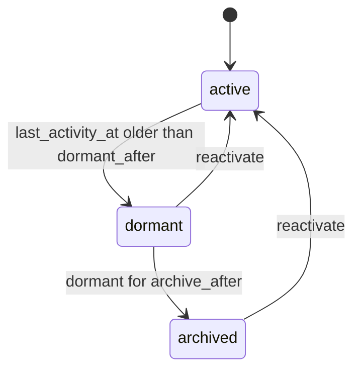

# Dormancy

`mix ash_workflow.gen.dormancy` adds a dormancy workflow to a resource. Each record carries a `last_activity_at` that your application moves whenever the record is used. A record nobody uses for a while moves to `:dormant`, optionally moves on to `:archived`, and returns to `:active` when it is reactivated.

## The command

```bash
mix ash_workflow.gen.dormancy MyApp.Accounts.Account --dormant-after 90d --archive-after 180d
```

| Option | Default | Effect |
|---|---|---|
| `--dormant-after` | required | Moves a dormancy to `:dormant` once `last_activity_at` is this old. Accepts `30m`, `12h`, `2d` and `2w`. A duration under a minute needs `AshWorkflow.Scheduler.Precise`. |
| `--archive-after` | none | Moves a dormancy to `:archived` once it has been `:dormant` this long. Without it, no `:archived` step is generated. A duration under a minute needs `AshWorkflow.Scheduler.Precise`. |
| `--module` | `<Subject>Dormancy` | Name of the generated dormancy resource. |
| `--domain` | the subject's domain | Domain for a subject the task creates. Required only when the subject does not exist. |
| `--transition-log` | `true` | Also runs `mix ash_workflow.gen.transition_log` for the dormancy resource. Pass `--no-transition-log` to skip it. |

When the subject does not exist, the task creates it with `mix ash.gen.resource`, using the data layer of the first ETS or Postgres resource in `--domain`. When no resource there uses ETS or Postgres, the task stops with an issue and writes nothing. Create the subject resource first, or pass a `--domain` that has one. Running the task again on the same subject changes nothing.

## What it generates

For the command above, the task writes five modules and edits the subject:

- `MyApp.Accounts.AccountDormancy` runs the workflow. It belongs to the account and holds `last_activity_at`. An identity on `subject_id` allows one dormancy per account.
- `MyApp.Accounts.AccountDormancy.Checks.CanCreate` decides who may create a dormancy directly. It denies everyone as generated.
- `MyApp.Accounts.AccountDormancy.Checks.CanReactivate` decides who may reactivate. It denies everyone as generated.
- `MyApp.Accounts.AccountDormancy.Changes.StartDormancy` creates an account's dormancy when the account is created.
- `MyApp.Accounts.AccountDormancy.Changes.RecordActivity` records activity on an account's dormancy after an account action. The task does not attach it to any action.
- `MyApp.Accounts.Account` gains `has_one :dormancy`, a `dormant?` calculation, and a `changes` block that runs `StartDormancy` on every create action. The task adds no argument or policy to the subject's actions.

The dormancy is a separate resource rather than a `workflow` block on the subject, so a subject that already runs a workflow keeps it.

## The workflow



```elixir
workflow do
  step :active do
    timeout :dormant, fire_after: {90, :days}, field: :last_activity_at, transition_to: :dormant
  end

  step :dormant do
    transition :reactivate, to: :active

    timeout :archived, fire_after: {180, :days}, transition_to: :archived
  end

  step :archived do
    transition :reactivate, to: :active
  end
end
```

Without `--archive-after`, there is no `:archived` step. A dormant record then stays dormant until it is reactivated.

The `:dormant` deadline is measured from `last_activity_at`. Each call to `record_activity` writes the current time to it, so a record in use never reaches the deadline.

The `:archived` deadline is measured from `state_entered_at`, the moment the record became dormant. Activity on a dormant record does not move it. A record that is used while dormant, but never reactivated, still archives on time.

`reactivate` writes the current time to `last_activity_at` as well as returning the record to `:active`. Without that, a reactivated record would go dormant again on the next scheduler pass.

`:archived` is not terminal. An archived record stays archived until it is reactivated.

## What your application does next

### New accounts get a dormancy

The task adds `StartDormancy` to the account's `changes` block, so every create action on the account starts a dormancy:

```elixir
changes do
  change MyApp.Accounts.AccountDormancy.Changes.StartDormancy, on: [:create]
end
```

After the account is created, `StartDormancy` calls `AccountDormancy.create` with the account's id, so `last_activity_at` starts at the time of creation. It passes the actor and tenant through with `authorize?: false`, because the account's create action already decided who may create the account. It runs once per record in `Ash.bulk_create/4` too.

A create that upserts onto an existing account starts no second dormancy, and neither does a create for an account that already has one. An error from the dormancy create fails the account create, and on a data layer with transactions the account rolls back with it.

### Backfill existing accounts

Accounts created before the task ran have no dormancy, and `dormant?` is `false` for them. Create their dormancies with `Ash.bulk_create/4`:

```elixir
require Ash.Query

MyApp.Accounts.Account
|> Ash.Query.filter(not exists(dormancy, true))
|> Ash.stream!(authorize?: false)
|> Stream.map(&%{subject_id: &1.id, last_activity_at: &1.last_seen_at || DateTime.utc_now()})
|> Ash.bulk_create(MyApp.Accounts.AccountDormancy, :create,
  authorize?: false,
  return_errors?: true
)
```

`last_activity_at` takes the account's real last use from an existing column, here `last_seen_at`. An account last seen longer ago than `--dormant-after` goes dormant on the next scheduler pass. Leave `last_activity_at` out of the map to start every clock at the time of the backfill.

### Decide who may create a dormancy directly

`CanCreate` only gates direct calls to `AccountDormancy.create`, since `StartDormancy` and the backfill above skip authorization. It denies everyone, so no direct create succeeds until you change it. Replace its `match?/3`, or replace the `authorize_if` line in the `:create` policy with a built-in check:

```elixir
policies do
  policy action(:create) do
    authorize_if actor_attribute_equals(:role, :admin)
  end
end
```

Code that creates a dormancy on the application's behalf, such as an import, can pass `authorize?: false` instead. A second dormancy for the same account fails on the `:unique_subject` identity.

Reads stay open by default. `AshWorkflow` authorizes `:read` on the dormancy resource for every actor. Add a read policy if dormancies are private.

### Record activity

What counts as activity is up to the application. To count an account action as activity, add `RecordActivity` to it. In the account's `changes` block, it covers every update action:

```elixir
changes do
  change MyApp.Accounts.AccountDormancy.Changes.StartDormancy, on: [:create]
  change MyApp.Accounts.AccountDormancy.Changes.RecordActivity, on: [:update]
end
```

To count only some actions, add it to those actions instead:

```elixir
update :sign_in do
  change MyApp.Accounts.AccountDormancy.Changes.RecordActivity
end
```

`RecordActivity` runs after the account action, without authorization, and does nothing for an account with no dormancy. It also works in an atomic update.

Activity that is not an account action, such as an API request, calls `record_activity/2` on the dormancy:

```elixir
MyApp.Accounts.AccountDormancy.record_activity(dormancy)
```

`record_activity` changes no state and is allowed for every caller. Replace `authorize_if always()` in its policy if you expose it to users directly.

### Decide who may reactivate

`CanReactivate` denies everyone, so nothing can be reactivated until you change it. Replace its `match?/3`, or replace the `authorize_if` line in the dormancy's policy with a built-in check:

```elixir
policies do
  policy action(:reactivate) do
    authorize_if actor_attribute_equals(:role, :support)
  end
end
```

### Reactivate

`reactivate/2` returns a dormant or archived dormancy to `:active`:

```elixir
MyApp.Accounts.AccountDormancy.reactivate(dormancy, actor: current_user)
```

Activity on a dormant record does not reactivate it. To wake an account when its owner signs in, call `reactivate` from the sign-in with an actor `CanReactivate` permits.

### React to dormant and archived

The task generates no notification. Add a timeout with an `action` to the `:dormant` or `:archived` step to send a reminder or revoke access, or use an Ash notifier on the dormancy resource.

### Use the outcome

`dormant?` on the subject is true when its dormancy is in `:dormant` or `:archived`. Gating a subject action on it is up to you, for example with a policy on the subject:

```elixir
policy action(:sign_in) do
  forbid_if expr(dormant?)
  authorize_if always()
end
```

Read `dormancy.state` to tell a dormant subject from an archived one.

### Generate the migrations

On AshPostgres, run `mix ash.codegen add_account_dormancy` to create the dormancy and transition log tables.

## Limits

`record_activity` writes the dormancy row on every call. An application that calls it on every request writes that row on every request. To reduce writes, call it only when `last_activity_at` is older than some threshold you choose.
