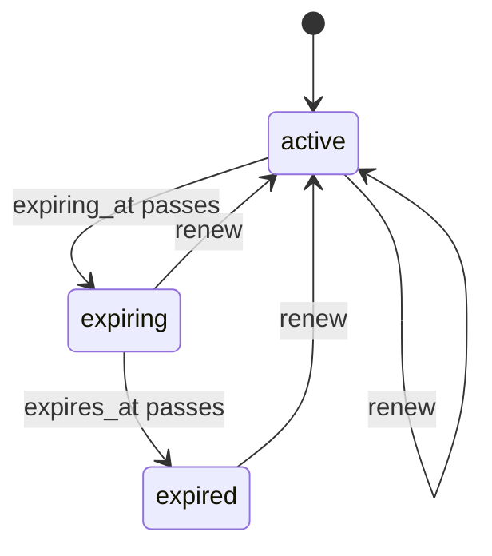

# Expiry

`mix ash_workflow.gen.expiry` adds an expiry workflow to a resource. Each record gets an `expires_at`, moves to `:expiring` a notice period before it, moves to `:expired` once it passes, and returns to `:active` when it is renewed with a new date.

## The command

```bash
mix ash_workflow.gen.expiry MyApp.Contracts.Contract --notice-period 30d
```

| Option | Default | Effect |
|---|---|---|
| `--module` | `<Subject>Expiry` | Name of the generated expiry resource. |
| `--domain` | the subject's domain | Domain for a subject the task creates. Required only when the subject does not exist. |
| `--notice-period` | none | Moves an expiry to `:expiring` this long before `expires_at`. Accepts `30m`, `12h`, `2d` and `2w`. Without it, no `:expiring` step is generated. |
| `--transition-log` | `true` | Also runs `mix ash_workflow.gen.transition_log` for the expiry resource. Pass `--no-transition-log` to skip it. |

When the subject does not exist, the task creates it with `mix ash.gen.resource`, using the data layer of the first ETS or Postgres resource in `--domain`. When no resource there uses ETS or Postgres, the task stops with an issue and writes nothing. Create the subject resource first, or pass a `--domain` that has one. Running the task again on the same subject changes nothing.

## What it generates

For the command above, the task writes two modules and edits the subject:

- `MyApp.Contracts.ContractExpiry` runs the workflow. It belongs to the contract and holds `expires_at`. An identity on `subject_id` allows one expiry per contract.
- `MyApp.Contracts.ContractExpiry.Checks.CanRenew` decides who may renew. It denies everyone as generated.
- `MyApp.Contracts.Contract` gains `has_one :expiry` and an `expired?` calculation. The task adds no change, argument or policy to the subject's actions.

The expiry is a separate resource rather than a `workflow` block on the subject, so a subject that already runs a workflow keeps it.

## The workflow



```elixir
workflow do
  step :active do
    transition :renew, to: :active

    timeout :expiring do
      fire_at :expiring_at
      transition_to :expiring
    end
  end

  step :expiring do
    transition :renew, to: :active

    timeout :expired do
      fire_at :expires_at
      transition_to :expired
    end
  end

  step :expired do
    transition :renew, to: :active
  end
end

calculations do
  calculate :expiring_at, :utc_datetime_usec, expr(datetime_add(expires_at, -30, :day))
end
```

Without `--notice-period`, there is no `:expiring` step and no `expiring_at` calculation. The `:expired` timeout sits on `:active` instead.

Both deadlines read `expires_at`, and `expiring_at` is calculated from it. Renewing writes a new `expires_at`, which moves both deadlines. Neither timeout reads `state_entered_at`.

`:expired` is not terminal. An expired record stays expired until it is renewed.

An expiry created with `expires_at` already in the past moves to `:expiring` on the first scheduler pass and to `:expired` on the next.

## What your application does next

### Create the expiry

Call `create/3` wherever a subject starts to run out, such as the subject's create action, an activation step or an import:

```elixir
MyApp.Contracts.ContractExpiry.create(contract.id, ~U[2027-06-30 00:00:00Z])
```

A second expiry for the same contract fails on the `:unique_subject` identity.

The generated `:create` action has no policy. Add one to the expiry resource if your application restricts who can create an expiry.

### Decide who may renew

`CanRenew` denies everyone, so nothing can be renewed until you change it. Replace its `match?/3`, or replace the `authorize_if` line in the expiry's policy with a built-in check:

```elixir
policies do
  policy action(:renew) do
    authorize_if actor_attribute_equals(:role, :account_manager)
  end
end
```

### Renew

`renew/3` takes the new `expires_at` and returns the expiry to `:active` from any step:

```elixir
MyApp.Contracts.ContractExpiry.renew(expiry, ~U[2028-06-30 00:00:00Z], actor: current_user)
```

`renew` does not check that the new date is in the future. Add a validation to the `:renew` action if your application needs one.

### React to expiring and expired

The task generates no notification. Add a timeout with an `action` to the `:expiring` or `:expired` step to send a reminder or revoke access, or use an Ash notifier on the expiry resource.

### Use the outcome

`expired?` on the subject is true when its expiry is in `:expired`. Gating a subject action on it is up to you, for example with a policy on the subject:

```elixir
policy action(:sign) do
  forbid_if expr(expired?)
  authorize_if always()
end
```

### Generate the migrations

On AshPostgres, run `mix ash.codegen add_contract_expiry` to create the expiry and transition log tables.

## Limits

`expiring_at` is a calculation, so Postgres has no index on it. The trigger for the `:active` step filters on the state and then on `expires_at` minus the notice period. The `(state, expires_at)` index AshWorkflow adds for the `:expired` timeout covers the state part of that filter only.

`expiring_at` is computed in whole seconds, so the notice deadline can fall up to a second before `expires_at` minus the notice period.

`AshWorkflow.Scheduler.due_at/2` returns `nil` for an expiry whose `expiring_at` was not loaded. Load the calculation before calling it.
