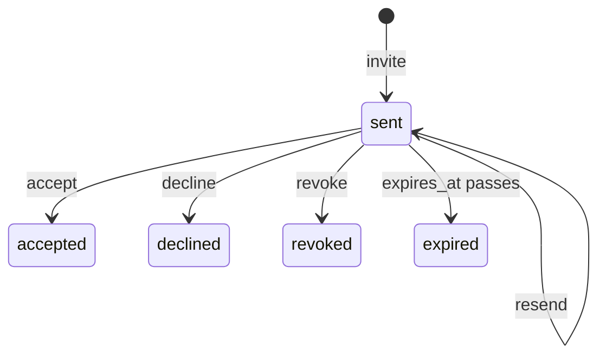

# Invitation

`mix ash_workflow.gen.invitation` adds an invitation workflow to a resource. An email address is invited to a record, the invitee accepts or declines, the inviter can revoke or resend the invitation, and an invitation nobody answers expires.

## The command

```bash
mix ash_workflow.gen.invitation MyApp.Teams.Team \
  --invitee MyApp.Accounts.User \
  --expires-after 7d
```

| Option | Default | Effect |
|---|---|---|
| `--invitee` | required | The actor resource. The inviter and the invitee who accepts belong to it. |
| `--expires-after` | `7d` | How long an invitation stays open after `invite` or `resend`. Accepts `30m`, `12h`, `2d` and `2w`. |
| `--module` | `<Subject>Invitation` | Name of the generated invitation resource. |
| `--domain` | the subject's domain | Domain for a subject the task creates. Required only when the subject does not exist. |
| `--transition-log` | `true` | Also runs `mix ash_workflow.gen.transition_log` for the invitation resource, recording the invitee resource as the actor. Pass `--no-transition-log` to skip it. |

When the subject does not exist, the task creates it with `mix ash.gen.resource`, using the invitee resource's data layer, or else the data layer of the first ETS or Postgres resource in `--domain`. When neither the invitee resource nor any resource there uses ETS or Postgres, the task stops with an issue and writes nothing. Create the subject resource first, or pass a `--domain` that has one. Running the task again on the same subject changes nothing.

## What it generates

For the command above, the task writes four modules and edits the subject:

- `MyApp.Teams.TeamInvitation` runs the workflow. It belongs to the team and to the user who sent it, and holds the invited `email` and `expires_at`.
- `MyApp.Teams.TeamInvitation.Checks.CanAccept` decides who may accept or decline. It denies everyone as generated.
- `MyApp.Teams.TeamInvitation.Changes.SetExpiresAt` sets `expires_at` to now plus `--expires-after` on `invite` and `resend`.
- `MyApp.Teams.TeamInvitation.Validations.NoOpenInvitation` refuses a second open invitation to the same email for the same team.
- `MyApp.Teams.Team` gains `has_many :invitations` and `has_one :latest_invitation`. The task adds no change, argument or policy to the subject's actions.

The subject gains no boolean calculation such as `accepted?`. A team has many invitations to different people, so whether the latest one was accepted says nothing about the team. Filter `invitations` by email instead.

## The workflow



```elixir
workflow do
  step :sent do
    transition :accept, to: :accepted
    transition :decline, to: :declined
    transition :revoke, to: :revoked
    transition :resend, to: :sent

    timeout :expired do
      fire_at :expires_at
      transition_to :expired
    end
  end

  step :accepted, terminal: true
  step :declined, terminal: true
  step :revoked, terminal: true
  step :expired, terminal: true
end
```

The deadline reads `expires_at`, not `state_entered_at`. `resend` writes a new `expires_at` a full `--expires-after` from now, and both schedulers pick up the new deadline.

Every outcome is terminal. To invite someone again after their invitation expired, was declined or was revoked, send a new invitation. The old row keeps its outcome.

`:accept` refuses an invitation whose `expires_at` has passed, even before the scheduler has moved it to `:expired`.

## What your application does next

### Send invitations

Call `invite/3` wherever someone invites a person, with the inviter as the actor:

```elixir
MyApp.Teams.TeamInvitation.invite(team.id, "ada@example.com", actor: current_user)
```

`email` is case-insensitive. A second invitation to the same address for the same team fails while the first is in `:sent`. On AshPostgres, `email` is a `citext` column, so the repo needs `"citext"` in its `installed_extensions`.

The `:invite` create action has no policy, so any actor can send an invitation until you add a policy for it, for example one that only lets team admins invite.

### Deliver the invitation

The task generates no token and sends no email. Send the invitation from an Ash notifier on the invitation resource, or from the code that calls `invite/3` and `resend/2`. If the email carries a link with a token, store the token yourself, for example in an attribute you add to the invitation.

### Decide who is the invitee

`CanAccept` denies everyone, so nobody can accept or decline until you change it. Replace its `match?/3` with however an actor proves they are the invitee, such as a matching email:

```elixir
def match?(%{email: email}, %{subject: %{data: invitation}}, _opts),
  do: Ash.CiString.compare(email, invitation.email) == :eq

def match?(_actor, _context, _opts), do: false
```

`:accept` sets `invitee` to the actor. `:decline` leaves it unset.

### Revoke and resend

Only the user who sent an invitation can revoke or resend it, through `relates_to_actor_via(:invited_by)`. To let others do so, such as team admins, add an `authorize_if` line to that policy:

```elixir
policy action([:revoke, :resend]) do
  authorize_if relates_to_actor_via(:invited_by)
  authorize_if relates_to_actor_via([:subject, :admins])
end
```

### Grant what the invitation is for

Accepting an invitation creates nothing else. Add a change to `:accept`, or a notifier, that creates the membership, RSVP or grant your application needs.

### Generate the migrations

On AshPostgres, run `mix ash.codegen add_team_invitation` to create the invitation and transition log tables.

## Limits

On AshPostgres, a partial unique index on `subject_id` and `email` where `state = 'sent'` backs `NoOpenInvitation`. On other data layers, two invitations to the same address sent at the same moment can both pass the validation.

`NoOpenInvitation` only looks at invitations in `:sent`. A team can invite an address that already accepted an invitation.
