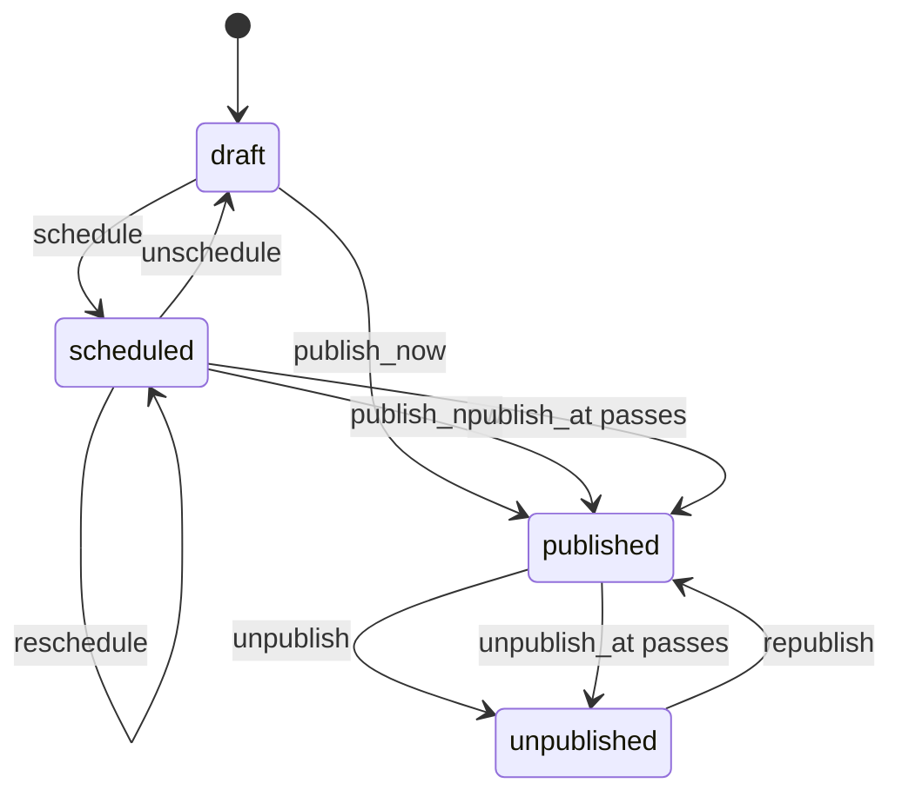

# Publication

`mix ash_workflow.gen.publication` adds a publication workflow to a resource. Each record starts as a draft, can be scheduled for a `publish_at`, goes live once that passes or when someone publishes it straight away, and can be unpublished and republished. With `--with-unpublish-at`, a publication can also come down on its own at an `unpublish_at`.

## The command

```bash
mix ash_workflow.gen.publication MyApp.Blog.Post --with-unpublish-at
```

| Option | Default | Effect |
|---|---|---|
| `--module` | `<Subject>Publication` | Name of the generated publication resource. |
| `--domain` | the subject's domain | Domain for a subject the task creates. Required only when the subject does not exist. |
| `--with-unpublish-at` | `false` | Generates an `unpublish_at` attribute and the timeout that moves a publication to `:unpublished` once it passes. Without it, a publication stays published until someone unpublishes it. |
| `--transition-log` | `true` | Also runs `mix ash_workflow.gen.transition_log` for the publication resource. Pass `--no-transition-log` to skip it. |

When the subject does not exist, the task creates it with `mix ash.gen.resource`, using the data layer of the first ETS or Postgres resource in `--domain`. When no resource there uses ETS or Postgres, the task stops with an issue and writes nothing. Create the subject resource first, or pass a `--domain` that has one. Running the task again on the same subject changes nothing.

## What it generates

For the command above, the task writes three modules and edits the subject:

- `MyApp.Blog.PostPublication` runs the workflow. It belongs to the post and holds `publish_at` and `unpublish_at`. An identity on `subject_id` allows one publication per post.
- `MyApp.Blog.PostPublication.Checks.CanCreate` decides who may create a publication. It denies everyone as generated.
- `MyApp.Blog.PostPublication.Checks.CanPublish` decides who may schedule, publish and unpublish. It denies everyone as generated.
- `MyApp.Blog.Post` gains `has_one :publication` and a `published?` calculation. The task adds no change, argument or policy to the subject's actions.

The publication is a separate resource rather than a `workflow` block on the subject, so a subject that already runs a workflow keeps it.

## The workflow



```elixir
workflow do
  step :draft do
    transition :schedule, to: :scheduled
    transition :publish_now, to: :published
  end

  step :scheduled do
    transition :reschedule, to: :scheduled
    transition :unschedule, to: :draft
    transition :publish_now, to: :published

    timeout :published do
      fire_at :publish_at
      transition_to :published
    end
  end

  step :published do
    transition :unpublish, to: :unpublished

    timeout :unpublished do
      fire_at :unpublish_at
      transition_to :unpublished
    end
  end

  step :unpublished do
    transition :republish, to: :published
  end
end
```

Without `--with-unpublish-at`, there is no `unpublish_at` attribute and no `:unpublished` timeout.

Each deadline reads its own attribute. `reschedule` writes a new `publish_at`, and neither timeout reads `state_entered_at`.

A publication with no `unpublish_at` stays published until someone calls `unpublish`. The scheduler never treats an empty `fire_at` field as due.

No step is terminal. An unpublished record can be republished.

## The actions

| Action | From | Writes |
|---|---|---|
| `schedule` | `:draft` | `publish_at`, required, and `unpublish_at`, optional. |
| `reschedule` | `:scheduled` | `publish_at`. Keeps `unpublish_at`. |
| `unschedule` | `:scheduled` | Clears `publish_at` and `unpublish_at`. |
| `publish_now` | `:draft`, `:scheduled` | Nothing. A scheduled `unpublish_at` is kept. |
| `unpublish` | `:published` | Nothing. |
| `republish` | `:unpublished` | `unpublish_at`, optional. Cleared when not given. |

`schedule` and `reschedule` reject an `unpublish_at` that is not after `publish_at`. No action checks that a date is in the future. A `publish_at` in the past publishes on the first scheduler pass.

`republish` clears `unpublish_at` when none is given. A date that has already passed would otherwise unpublish the record again on the next pass.

## What your application does next

### Create the publication

Call `create/2` wherever a draft starts, such as the subject's create action:

```elixir
MyApp.Blog.PostPublication.create(post.id)
```

A second publication for the same post fails on the `:unique_subject` identity.

`CanCreate` denies everyone, so no publication can be created until you change it. Replace its `match?/3`, or replace the `authorize_if` line in the `:create` policy with a built-in check:

```elixir
policies do
  policy action(:create) do
    authorize_if actor_attribute_equals(:role, :editor)
  end
end
```

Code that creates a publication on the application's behalf, such as the subject's create action, can pass `authorize?: false` instead.

Reads stay open by default. `AshWorkflow` authorizes `:read` on the publication resource for every actor. Add a read policy if publications are private.

### Decide who may publish

`CanPublish` denies everyone, so no transition a person makes succeeds until you change it. One policy covers `schedule`, `reschedule`, `unschedule`, `publish_now`, `unpublish` and `republish`. Replace `match?/3` in `CanPublish`, or replace the `authorize_if` line with a built-in check:

```elixir
policies do
  policy action([:schedule, :reschedule, :unschedule, :publish_now, :unpublish, :republish]) do
    authorize_if actor_attribute_equals(:role, :editor)
  end
end
```

Split the policy if different people schedule and take down publications. The scheduler's timeouts do not go through it, so a scheduled publication still goes live.

### Schedule and publish

```elixir
MyApp.Blog.PostPublication.schedule(publication, ~U[2027-01-05 09:00:00Z], ~U[2027-02-05 09:00:00Z], actor: editor)
MyApp.Blog.PostPublication.publish_now(publication, actor: editor)
```

### React to publishing and unpublishing

The task generates no notification. Add a timeout with an `action` to the `:published` or `:unpublished` step, or use an Ash notifier on the publication resource, to purge a cache or announce the post.

### Use the outcome

`published?` on the subject is true when its publication is in `:published`. Filtering public reads on it is up to you, for example with a policy on the subject:

```elixir
policy action(:read) do
  authorize_if expr(published?)
  authorize_if actor_attribute_equals(:role, :editor)
end
```

### Generate the migrations

On AshPostgres, run `mix ash.codegen add_post_publication` to create the publication and transition log tables.

## Limits

`reschedule` runs only from `:scheduled`. Moving `unpublish_at` on a live publication needs an update action you add yourself.
