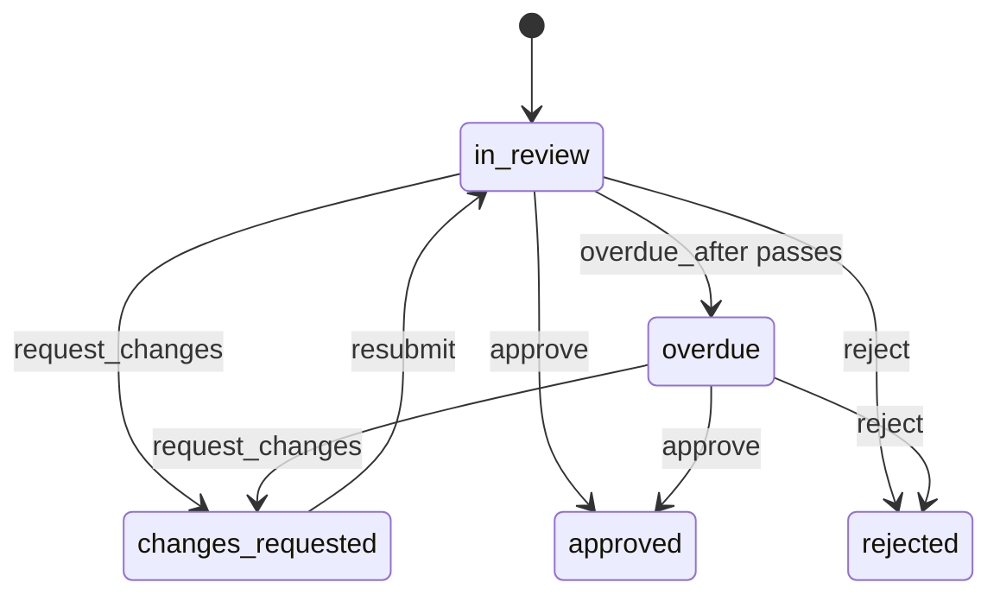

# Review

`mix ash_workflow.gen.review` adds a review workflow to a resource. A requester submits a record for review, and a reviewer approves it, rejects it, or sends it back with a comment. The requester resubmits a record that was sent back, and each round's decision is kept.

## The command

```bash
mix ash_workflow.gen.review MyApp.Content.Article \
  --reviewer MyApp.Accounts.User \
  --overdue-after 3d
```

| Option | Default | Effect |
|---|---|---|
| `--reviewer` | required | The actor resource. Decisions and the requester belong to it. |
| `--module` | `<Subject>Review` | Name of the generated review resource. |
| `--domain` | the subject's domain | Domain for a subject the task creates. Required only when the subject does not exist. |
| `--overdue-after` | none | Moves a review the reviewer has not decided to `:overdue` this long after it was last submitted. Accepts `30m`, `12h`, `2d` and `2w`. A duration under a minute needs `AshWorkflow.Scheduler.Precise`. Without it, no `:overdue` step is generated. |
| `--transition-log` | `true` | Also runs `mix ash_workflow.gen.transition_log` for the review resource, recording the reviewer as the actor. Pass `--no-transition-log` to skip it. |

When the subject does not exist, the task creates it with `mix ash.gen.resource`, using the reviewer's data layer, or else the data layer of the first ETS or Postgres resource in `--domain`. When neither the reviewer nor any resource there uses ETS or Postgres, the task stops with an issue and writes nothing. Create the subject resource first, or pass a `--domain` that has one. Running the task again on the same subject changes nothing.

## What it generates

For the command above, the task writes six modules and edits the subject:

- `MyApp.Content.ArticleReview` runs the workflow. It belongs to the article and to the user who requested the review, and its `round` attribute counts the rounds.
- `MyApp.Content.ArticleReviewDecision` holds one row for each decision, with the round it ended, the reviewer and the comment. A decision made with no actor, such as by a system process with `authorize?: false`, has no reviewer. An identity allows one decision per round.
- `MyApp.Content.ArticleReview.Changes.RecordDecision` writes the decision row when `:request_changes`, `:approve` or `:reject` runs.
- `MyApp.Content.ArticleReview.Validations.NoOpenReview` refuses a `:request` for a subject that already has a review in `:in_review`, `:overdue` or `:changes_requested`.
- `MyApp.Content.ArticleReview.Checks.CanRequest` decides who may open a review of a subject. It denies everyone as generated.
- `MyApp.Content.ArticleReview.Checks.CanReview` decides who may review. It denies everyone as generated.
- `MyApp.Content.Article` gains `has_many :reviews`, `has_one :latest_review` and a `review_approved?` calculation. The task adds no change, argument or policy to the subject's actions.

The review is a separate resource rather than a `workflow` block on the subject. A subject that already runs a workflow keeps it, and a rejected article that is rewritten gets a new review row. The calculation is named `review_approved?` so that a subject can also run `gen.approval`, which adds `approved?`.

## The workflow



```elixir
workflow do
  step :in_review do
    transition :request_changes, to: :changes_requested
    transition :approve, to: :approved
    transition :reject, to: :rejected

    timeout :overdue, fire_after: {3, :days}, field: :submitted_at, transition_to: :overdue
  end

  step :overdue do
    transition :request_changes, to: :changes_requested
    transition :approve, to: :approved
    transition :reject, to: :rejected
  end

  step :changes_requested do
    transition :resubmit, to: :in_review
  end

  step :approved, terminal: true
  step :rejected, terminal: true
end
```

`:resubmit` adds one to `round`. A review approved on first reading ends in round 1, and one sent back twice ends in round 3 with three decision rows.

The overdue deadline is measured from `submitted_at`. The `:request` action sets it when the review opens, and `:resubmit` sets it again, so each resubmission starts a new review clock. A review waiting in `:changes_requested` is waiting on the requester and never goes overdue.

`:overdue` is a step, not a flag. An overdue review can still be approved, rejected or sent back, and a query can filter on `state == :overdue`. Add a `timeout` or `every` to the `:overdue` step for reminders or escalation.

## One open review per subject

A subject has at most one open review. `:request` validates with `NoOpenReview`, which refuses a second review while one is in `:in_review`, `:overdue` or `:changes_requested`. Without it, a second request would become the subject's `latest_review` and turn `review_approved?` false for a subject whose first review is then approved. Once a review is approved or rejected, the subject can be reviewed again.

On AshPostgres the review also declares a partial unique identity on `subject_id`, limited to open reviews with `identity_wheres_to_sql`. Two requests that pass the validation at the same moment then fail on the index rather than both open. Other data layers have only the validation, so two simultaneous requests for one subject can both succeed there.

## The policies

```elixir
policies do
  policy action(:request) do
    authorize_if MyApp.Content.ArticleReview.Checks.CanRequest
  end

  policy action([:request_changes, :approve, :reject]) do
    forbid_if expr(requested_by_id == ^actor(:id))
    authorize_if MyApp.Content.ArticleReview.Checks.CanReview
  end

  policy action(:resubmit) do
    authorize_if relates_to_actor_via(:requested_by)
  end
end
```

Only an actor that `CanRequest` permits can open a review. The requester cannot review their own work, and only the requester can resubmit. The generated `:available_actions` calculation applies these policies, so loading it with an actor tells a UI whether that user can review or resubmit.

Reads stay open by default. `AshWorkflow` authorizes `:read` on the review resource for every actor, and the decision resource's only policy allows every read. Add a read policy to each if reviews or decisions are private.

## What your application does next

### Decide who may open a review

`CanRequest` denies everyone, so no review can be opened until you change it. Replace its `match?/3`, or replace the `authorize_if` line in the `:request` policy with a built-in check. The `:request` action is a create, so a check that reads the subject finds its id in `context.changeset`:

```elixir
# Any author may request a review
authorize_if actor_attribute_equals(:role, :author)
```

### Decide who may review

`CanReview` denies everyone, so nothing can be reviewed until you change it. Replace its `match?/3`, or replace the `authorize_if` line in the review's policy with a built-in check:

```elixir
# The article's editor reviews
authorize_if relates_to_actor_via([:subject, :editor])

# Any editor reviews
authorize_if actor_attribute_equals(:role, :editor)
```

### Open a review

Call `request/2` wherever a review should start, such as a submit action or a LiveView event. The actor becomes the requester:

```elixir
MyApp.Content.ArticleReview.request(article.id, actor: current_user)
```

### Review and resubmit

`request_changes` requires a comment. `approve` and `reject` accept an optional one.

```elixir
MyApp.Content.ArticleReview.request_changes(review, "Cite the source", actor: reviewer)
MyApp.Content.ArticleReview.resubmit(review, actor: current_user)
MyApp.Content.ArticleReview.approve(review, %{comment: "Ready to publish"}, actor: reviewer)
MyApp.Content.ArticleReview.reject(review, %{comment: "Out of scope"}, actor: reviewer)
```

Load `decisions` on a review to show the history of rounds, sorted by round.

### Use the outcome

`review_approved?` on the subject is true when its latest review is approved, and false otherwise, including when the subject has no review. Gating a subject action on it is up to you, for example with a policy on the subject:

```elixir
policy action(:publish) do
  authorize_if expr(review_approved?)
end
```

### Generate the migrations

On AshPostgres, run `mix ash.codegen add_article_review` to create the review, decision and transition log tables.

## Limits

The review has no `:cancel` transition. Add `transition :cancel, to: :cancelled` to `:in_review`, `:overdue` and `:changes_requested`, and a terminal `:cancelled` step, if a requester should be able to withdraw.
