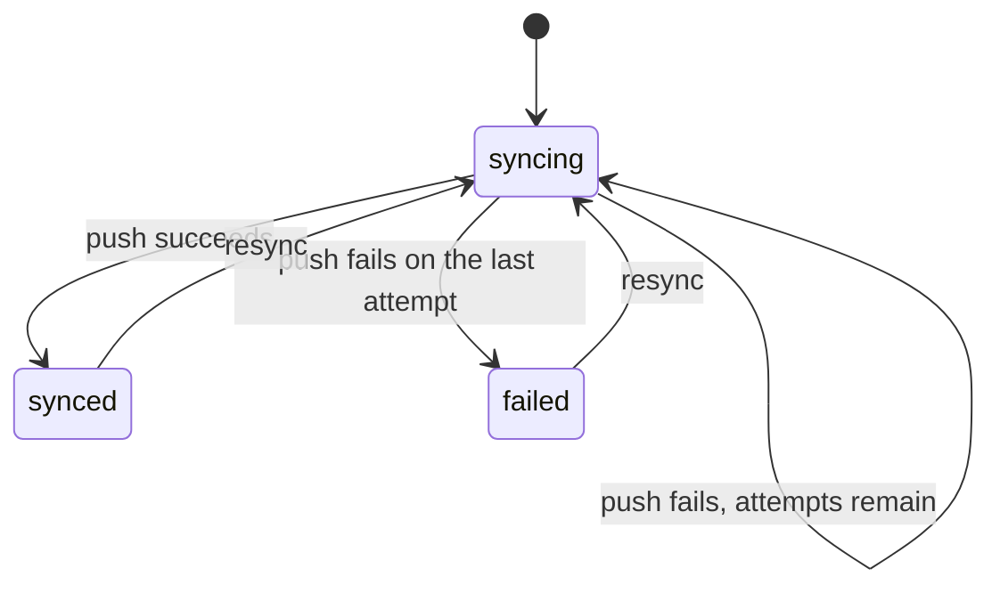

# Sync

`mix ash_workflow.gen.sync` adds a sync workflow to a resource. Each record is pushed to an external system by a `:push` action, which is retried with a backoff when it fails. The record moves to `:synced` when a push succeeds, to `:failed` once every attempt has failed, and back to `:syncing` when it is resynced.

## The command

```bash
mix ash_workflow.gen.sync MyApp.Sales.Customer --max-attempts 5 --backoff 30s
```

| Option | Default | Effect |
|---|---|---|
| `--module` | `<Subject>Sync` | Name of the generated sync resource. |
| `--domain` | the subject's domain | Domain for a subject the task creates. Required only when the subject does not exist. |
| `--max-attempts` | `5` | How many times `:push` runs before the sync moves to `:failed`. |
| `--backoff` | `exponential` | The delay between attempts. Accepts `10s`, `30m`, `12h`, `2d`, `2w` for a fixed delay, or `exponential` for a delay that grows with each attempt. |
| `--transition-log` | `true` | Also runs `mix ash_workflow.gen.transition_log` for the sync resource. Pass `--no-transition-log` to skip it. |

When the subject does not exist, the task creates it with `mix ash.gen.resource`, using the data layer of the first ETS or Postgres resource in `--domain`. When no resource there uses ETS or Postgres, the task stops with an issue and writes nothing. Create the subject resource first, or pass a `--domain` that has one. Running the task again on the same subject changes nothing.

## What it generates

For the command above, the task writes two modules and edits the subject:

- `MyApp.Sales.CustomerSync` runs the workflow. It belongs to the customer and holds `external_id` and `last_synced_at`. An identity on `subject_id` allows one sync per customer.
- `MyApp.Sales.CustomerSync.Checks.CanResync` decides who may resync. It denies everyone as generated.
- `MyApp.Sales.Customer` gains `has_one :sync` and a `synced?` calculation. The task adds no change, argument or policy to the subject's actions.

The sync is a separate resource rather than a `workflow` block on the subject, so a subject that already runs a workflow keeps it.

## The workflow



```elixir
workflow do
  step :syncing do
    action :push
    on_success :synced
    on_error :failed

    retry do
      max_attempts 5
      backoff {30, :seconds}
    end
  end

  step :synced do
    transition :resync, to: :syncing
  end

  step :failed do
    transition :resync, to: :syncing
  end
end
```

A new sync starts in `:syncing`, so the first scheduler pass pushes it. A failed attempt leaves the record in `:syncing`, and the scheduler runs `:push` again after the backoff. Only the last failed attempt moves it to `:failed`, and the transition log records that move with `triggered_by: :error_path`.

`resync` returns a record to `:syncing` from `:synced` or `:failed`. The record then gets the full `--max-attempts` again.

The workflow has no timeout. The backoff is measured from the failed attempt by the scheduler, not from a field on the record.

With the default exponential backoff, five attempts wait 16, 31, 96 and 271 seconds between them.

## What your application does next

### Create the sync

Call `create/2` wherever a subject should start syncing, such as the subject's create action, an import or a backfill:

```elixir
MyApp.Sales.CustomerSync.create(customer.id)
```

The `:create` action has no generated policy, and your application adds one if it needs to restrict who may start a sync. A second sync for the same customer fails on the `:unique_subject` identity.

### Fill in the push

The generated `:push` action only stamps `last_synced_at`, so every sync reaches `:synced` until you add the change that calls the external system:

```elixir
update :push do
  require_atomic? false
  change set_attribute(:last_synced_at, &DateTime.utc_now/0)
  change MyApp.Sales.Changes.PushToCrm
end
```

The change returns an error to fail the attempt, and writes `external_id` from the external system's response on success. A failed attempt rolls back, so `last_synced_at` only moves when a push succeeds.

`:push` can run more than once for the same record. Make the call idempotent, for example by sending `external_id` when it is already set.

### Decide who may resync

`CanResync` denies everyone, so nothing can be resynced until you change it. Replace its `match?/3`, or replace the `authorize_if` line in the sync's policy with a built-in check:

```elixir
policies do
  policy action(:resync) do
    authorize_if actor_attribute_equals(:role, :support)
  end
end
```

### Resync

Call `resync/2` after the subject changes, or from an admin screen listing failed syncs:

```elixir
MyApp.Sales.CustomerSync.resync(sync, actor: current_user)
```

### Use the outcome

`synced?` on the subject is true when its sync is in `:synced`. Gating a subject action on it is up to you, for example with a policy on the subject:

```elixir
policy action(:invoice) do
  authorize_if expr(synced?)
end
```

### Generate the migrations

On AshPostgres, run `mix ash.codegen add_customer_sync` to create the sync and transition log tables.

## Limits

A push that hangs keeps the sync in `:syncing`. The workflow has no timeout to move it on. Add a `timeout` with `transition_to :failed` to the `:syncing` step if your application needs one.

A change to the subject does not resync it. Call `resync/2` from the subject's actions yourself.
