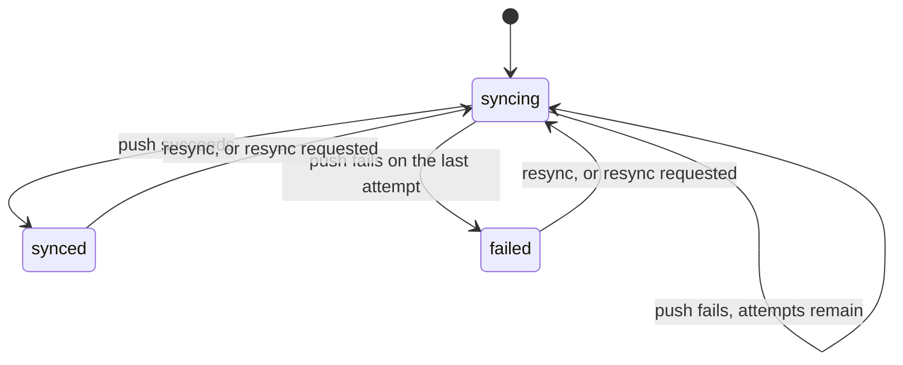

# Sync

`mix ash_workflow.gen.sync` adds a sync workflow to a resource. Each record is pushed to an external system by a `:push` action, which is retried with a backoff when it fails. The record moves to `:synced` when a push succeeds, to `:failed` once every attempt has failed, and back to `:syncing` when it is resynced. Creating a subject starts its sync, and updating a subject requests a resync.

## The command

```bash
mix ash_workflow.gen.sync MyApp.Sales.Customer --max-attempts 5 --backoff 30s
```

| Option | Default | Effect |
|---|---|---|
| `--module` | `<Subject>Sync` | Name of the generated sync resource. |
| `--domain` | the subject's domain | Domain for a subject the task creates. Required only when the subject does not exist. |
| `--max-attempts` | `5` | How many times `:push` runs before the sync moves to `:failed`. |
| `--backoff` | `exponential` | The delay between attempts. Accepts `10s`, `30m`, `12h`, `2d`, `2w` for a fixed delay, or `exponential` for a delay that grows with each attempt. |
| `--fields` | every update | The subject fields whose change requests a resync, such as `title,body`. See [Syncing only when certain fields change](#syncing-only-when-certain-fields-change). |
| `--transition-log` | `true` | Also runs `mix ash_workflow.gen.transition_log` for the sync resource. Pass `--no-transition-log` to skip it. |

When the subject does not exist, the task creates it with `mix ash.gen.resource`, using the data layer of the first ETS or Postgres resource in `--domain`. When no resource there uses ETS or Postgres, the task stops with an issue and writes nothing. Create the subject resource first, or pass a `--domain` that has one. A `--fields` entry that names no attribute or relationship of an existing subject also stops the task with an issue. Running the task again on the same subject changes nothing.

## What it generates

For the command above, the task writes five modules and edits the subject:

- `MyApp.Sales.CustomerSync` runs the workflow. It belongs to the customer and holds `external_id`, `last_synced_at` and `resync_requested_at`. An identity on `subject_id` allows one sync per customer.
- `MyApp.Sales.CustomerSync.Changes.StartSync` creates a customer's sync when the customer is created.
- `MyApp.Sales.CustomerSync.Changes.RequestSync` requests a resync when the customer is updated.
- `MyApp.Sales.CustomerSync.Checks.CanCreate` decides who may create a sync directly. It denies everyone as generated.
- `MyApp.Sales.CustomerSync.Checks.CanResync` decides who may resync. It denies everyone as generated.
- `MyApp.Sales.Customer` gains `has_one :sync`, a `synced?` calculation, which is `false` for a customer without a sync, and a `changes` block:

```elixir
changes do
  change MyApp.Sales.CustomerSync.Changes.StartSync, on: [:create]
  change MyApp.Sales.CustomerSync.Changes.RequestSync, on: [:update]
end
```

The sync is a separate resource rather than a `workflow` block on the subject, so a subject that already runs a workflow keeps it.

## The workflow



```elixir
workflow do
  step :syncing do
    action :push
    on_success :synced
    on_error :failed

    retry do
      max_attempts 5
      backoff {30, :seconds}
    end
  end

  step :synced do
    transition :resync, to: :syncing

    timeout :resync_requested do
      fire_at :resync_requested_at
      transition_to :syncing
    end
  end

  step :failed do
    transition :resync, to: :syncing

    timeout :resync_requested do
      fire_at :resync_requested_at
      transition_to :syncing
    end
  end
end
```

A new sync starts in `:syncing`, so the first scheduler pass pushes it. A failed attempt leaves the record in `:syncing`, and the scheduler runs `:push` again after the backoff. Only the last failed attempt moves it to `:failed`, and the transition log records that move with `triggered_by: :error_path`.

`resync` returns a record to `:syncing` from `:synced` or `:failed`. So does the `:resync_requested` timeout, once `resync_requested_at` holds a time that has passed. A `nil` `resync_requested_at` never fires. Either way the record gets the full `--max-attempts` again, and entering `:syncing` clears `resync_requested_at`.

The backoff is measured from the failed attempt by the scheduler, not from a field on the record.

With the default exponential backoff, five attempts wait 16, 31, 96 and 271 seconds between them.

## What your application does next

### New syncs start on subject create

`StartSync` runs after every create action on the customer, and creates the customer's sync in `:syncing`. It runs with `authorize?: false`, with the tenant of the customer create, because the customer's own create action already decided who may create the customer. A bulk create gets one sync per customer.

`StartSync` skips a create that upserted onto an existing customer, and a customer that already has a sync.

### Backfill existing customers

Customers created before the task ran have no sync, and `synced?` is `false` for them. Create their syncs with `Ash.bulk_create/4`:

```elixir
require Ash.Query

MyApp.Sales.Customer
|> Ash.Query.filter(not exists(sync, true))
|> Ash.stream!(authorize?: false)
|> Stream.map(&%{subject_id: &1.id})
|> Ash.bulk_create(MyApp.Sales.CustomerSync, :create,
  authorize?: false,
  return_errors?: true
)
```

Each backfilled sync starts in `:syncing`, so the scheduler pushes every one of them. An existing customer that is updated before the backfill gets its sync from `RequestSync` instead.

### Updates request a resync

`RequestSync` runs after every update action on the customer. It calls `CustomerSync.request_resync/2` with `authorize?: false`, which stamps `resync_requested_at` with the current time. A customer with no sync gets one created instead. `RequestSync` defines `atomic/3`, so an atomic update runs it too.

The stamp does not move the sync. The `:resync_requested` timeout on `:synced` and `:failed` fires on it at the scheduler's next pass, and moves the sync to `:syncing`. `request_resync` has a policy of `authorize_if always()`, so any code may request a resync, with or without an actor:

```elixir
MyApp.Sales.CustomerSync.request_resync(sync)
```

### A request during a push runs once the push settles

A sync in `:syncing` refuses `resync`, because only `:synced` and `:failed` declare it. A request made while a push is running or waiting for its next attempt still stamps `resync_requested_at`. `:push` does not touch the stamp, so it survives the push. Once the push moves the sync to `:synced` or `:failed`, the `:resync_requested` timeout finds the stamp in the past and fires straight away. The next push sends the customer as it is after the update.

Entering `:syncing` clears the stamp, so several requests during one push cause one resync. A request after the sync has entered `:syncing` again stamps it afresh.

### Syncing only when certain fields change

An update to a field the external system does not hold need not resync. Pass `--fields` with the fields that matter:

```bash
mix ash_workflow.gen.sync MyApp.Sales.Customer --fields title,body
```

The task then adds a `where:` condition to the `RequestSync` change:

```elixir
changes do
  change MyApp.Sales.CustomerSync.Changes.StartSync, on: [:create]

  change MyApp.Sales.CustomerSync.Changes.RequestSync,
    on: [:update],
    where: [any([changing(:title, touching?: true), changing(:body, touching?: true)])]
end
```

With one field, the condition is `where: [changing(:title, touching?: true)]`. To change the fields later, edit the `where:` list.

The condition uses `touching?: true`. On an atomic update, a plain `changing(:title)` compares the old and new values inside the database. Ash cannot then decide before the update whether to add `RequestSync`'s `after_action` hook, so it refuses the update. With `touching?: true`, the condition passes whenever the update writes `title`, even with the value it already had. Such an update requests one resync it did not need.

### Decide who may create a sync directly

`CanCreate` only gates direct calls to `CustomerSync.create`, since `StartSync`, `RequestSync` and the backfill above skip authorization. It denies everyone, so no direct create succeeds until you change it. Replace its `match?/3`, or replace the `authorize_if` line in the `:create` policy with a built-in check:

```elixir
policies do
  policy action(:create) do
    authorize_if actor_attribute_equals(:role, :account_manager)
  end
end
```

A second sync for the same customer fails on the `:unique_subject` identity.

Reads stay open by default. `AshWorkflow` authorizes `:read` on the sync resource for every actor. Add a read policy if syncs are private.

### Fill in the push

The generated `:push` action only stamps `last_synced_at`, so every sync reaches `:synced` until you add the change that calls the external system:

```elixir
update :push do
  require_atomic? false
  change set_attribute(:last_synced_at, &DateTime.utc_now/0)
  change MyApp.Sales.Changes.PushToCrm
end
```

The change returns an error to fail the attempt, and writes `external_id` from the external system's response on success. A failed attempt rolls back, so `last_synced_at` only moves when a push succeeds.

`:push` can run more than once for the same record. Make the call idempotent, for example by sending `external_id` when it is already set.

### Decide who may resync

`CanResync` gates the manual `resync`. It denies everyone, so nothing can be resynced by hand until you change it. Replace its `match?/3`, or replace the `authorize_if` line in the sync's policy with a built-in check:

```elixir
policies do
  policy action(:resync) do
    authorize_if actor_attribute_equals(:role, :support)
  end
end
```

`CanResync` does not gate `request_resync` or the `:resync_requested` timeout.

### Resync

Call `resync/2` on a sync in `:synced` or `:failed`, for example from an admin screen listing failed syncs:

```elixir
MyApp.Sales.CustomerSync.resync(sync, actor: current_user)
```

The actor must be one that `CanResync` permits. As generated, `CanResync` denies everyone, so every `resync/2` call fails with `Ash.Error.Forbidden` until you change it. Code that runs without a user, such as a background job, can call `request_resync/2` instead, which needs no permission.

### Use the outcome

`synced?` on the subject is true when its sync is in `:synced`. Gating a subject action on it is up to you, for example with a policy on the subject:

```elixir
policy action(:invoice) do
  authorize_if expr(synced?)
end
```

### Generate the migrations

On AshPostgres, run `mix ash.codegen add_customer_sync` to create the sync and transition log tables.

## Limits

A push that hangs keeps the sync in `:syncing`. No timeout moves it on. Add a `timeout` with `transition_to :failed` to the `:syncing` step if your application needs one.

A request on a settled sync waits for the scheduler's next pass. `AshWorkflow.Scheduler.Oban` polls on its `check_interval`, every minute by default. `AshWorkflow.Scheduler.Precise` arms timers on a state change, and `request_resync` changes no state, so its periodic sweep picks the request up.

`:syncing` does not declare `resync`, because the scheduler would not restart the push. On the default `AshWorkflow.Scheduler.Oban`, a failed attempt leaves its Oban job waiting to retry. That job is unique per record, so a resync could neither replace it nor reset its attempt count, and the old job would still run `:push` on its backoff.
