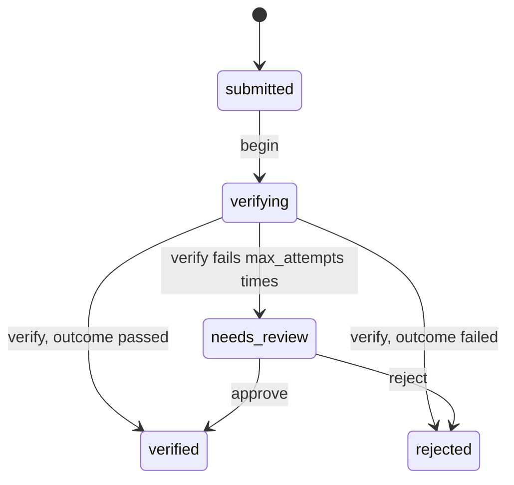

# Verification

`mix ash_workflow.gen.verification` adds a verification workflow to a resource. Each verification runs a `:verify` action you fill in, such as a call to an identity provider, and moves to `:verified` or `:rejected` on the outcome that action writes. A verification whose `:verify` fails on every attempt moves to `:needs_review`, where a person approves or rejects it.

## The command

```bash
mix ash_workflow.gen.verification MyApp.Accounts.IdentityDocument --max-attempts 5
```

| Option | Default | Effect |
|---|---|---|
| `--module` | `<Subject>Verification` | Name of the generated verification resource. |
| `--domain` | the subject's domain | Domain for a subject the task creates. Required only when the subject does not exist. |
| `--max-attempts` | `3` | Attempts `:verify` gets before the verification moves to `:needs_review`. With `1`, no `retry` block is generated. |
| `--transition-log` | `true` | Also runs `mix ash_workflow.gen.transition_log` for the verification resource. Pass `--no-transition-log` to skip it. |

When the subject does not exist, the task creates it with `mix ash.gen.resource`, using the data layer of the first ETS or Postgres resource in `--domain`. When no resource there uses ETS or Postgres, the task stops with an issue and writes nothing. Create the subject resource first, or pass a `--domain` that has one. Running the task again on the same subject changes nothing.

## What it generates

For the command above, the task writes two modules and edits the subject:

- `MyApp.Accounts.IdentityDocumentVerification` runs the workflow. It belongs to the document and holds the provider's `outcome`, either `:passed` or `:failed`.
- `MyApp.Accounts.IdentityDocumentVerification.Checks.CanReview` decides who may approve or reject a verification in review. It denies everyone as generated.
- `MyApp.Accounts.IdentityDocument` gains `has_many :verifications`, `has_one :latest_verification` and a `verified?` calculation. The task adds no change, argument or policy to the subject's actions.

A document can be verified many times. A rejected document that is uploaded again gets a new verification, and the old one keeps its rejection.

## The workflow



```elixir
workflow do
  step :submitted do
    transition :begin, to: :verifying
  end

  step :verifying do
    action :verify
    on_success :verified, when: expr(outcome == :passed)
    on_success :rejected, when: expr(outcome == :failed)
    on_error :needs_review

    retry do
      max_attempts 5
    end
  end

  step :needs_review do
    transition :approve, to: :verified
    transition :reject, to: :rejected
  end

  step :verified, terminal: true
  step :rejected, terminal: true
end
```

`:verifying` is an automatic step. The scheduler runs `:verify` as soon as a verification enters it, then routes on `outcome`. A provider that answers `:failed` rejects the verification directly. That is an outcome, not an error, so it is not retried.

A `:verify` that returns an error, raises, or writes no `outcome` is a failure. The scheduler retries it up to `--max-attempts` times with an exponential backoff, and moves the verification to `:needs_review` once the last attempt fails.

The workflow has no timeouts. `:verifying` is bounded by its attempts, and `:needs_review` waits for a person.

## What your application does next

### Submit and begin a verification

Call `submit/1` with the subject, then `begin/1` once the provider has what it needs, such as an uploaded file:

```elixir
verification = MyApp.Accounts.IdentityDocumentVerification.submit!(document.id)
MyApp.Accounts.IdentityDocumentVerification.begin!(verification)
```

The generated `:submit` create action has no policy. Your application adds one if it needs to restrict who may submit a verification. `begin` is allowed by the default policy AshWorkflow adds for every transition, and a policy of your own replaces it.

### Call your provider

The generated `:verify` action is empty, so every verification lands in `:needs_review` until you fill it in. Add a change that calls your provider and writes `outcome`:

```elixir
update :verify do
  require_atomic? false
  accept []
  change MyApp.Accounts.Changes.CheckWithProvider
end
```

```elixir
defmodule MyApp.Accounts.Changes.CheckWithProvider do
  use Ash.Resource.Change

  @impl true
  def change(changeset, _opts, _context) do
    Ash.Changeset.before_action(changeset, fn changeset ->
      %{subject: document} = Ash.load!(changeset.data, :subject, authorize?: false)

      case MyApp.IdentityProvider.check(document) do
        {:ok, :genuine} -> Ash.Changeset.force_change_attribute(changeset, :outcome, :passed)
        {:ok, :forged} -> Ash.Changeset.force_change_attribute(changeset, :outcome, :failed)
        {:error, reason} -> Ash.Changeset.add_error(changeset, inspect(reason))
      end
    end)
  end
end
```

Return an error for a provider that is down or times out, so the scheduler retries it.

### Decide who may review

`CanReview` denies everyone, so no verification in `:needs_review` can be approved or rejected until you change it. Replace its `match?/3`, or replace the `authorize_if` line in the verification's policy with a built-in check:

```elixir
policies do
  policy action([:approve, :reject]) do
    authorize_if actor_attribute_equals(:role, :compliance_officer)
  end
end
```

### Use the outcome

`verified?` on the subject is true when its latest verification is in `:verified`. Gating a subject action on it is up to you, for example with a policy on the subject:

```elixir
policy action(:withdraw) do
  forbid_unless expr(verified?)
  authorize_if always()
end
```

`state` is the verdict and `outcome` is what the provider said. A verification approved by a reviewer is `:verified` with an `outcome` of `nil`.

### Generate the migrations

On AshPostgres, run `mix ash.codegen add_identity_document_verification` to create the verification and transition log tables.

## Limits

A no-match is retried like any other failure. A `:verify` that succeeds without writing `outcome` calls your provider `--max-attempts` times before the verification moves to `:needs_review`.

`AshWorkflow.Transformers.AddPolicies` allows `:verify` for any caller, as it does every automatic step's action. Add a policy to the verification resource if callers outside the scheduler must not run it.

There is no transition from `:needs_review` back to `:verifying`. Add `transition :retry, to: :verifying` to the `:needs_review` step to let a reviewer send a verification back to the provider.
